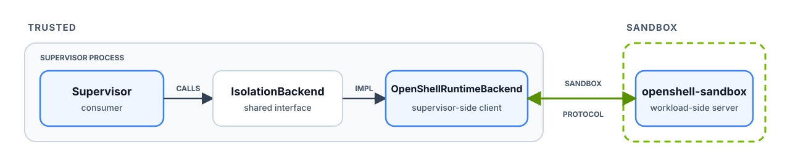

The supervisor uses the `IsolationBackend` RPC service to discover and bind an
isolation backend, then uses the Sandbox Protocol to launch and control the
agent workload. The built-in `openshell-sandbox` runtime and external backends
implement the same services, allowing different isolation mechanisms without
changing the gateway API or policy model.

## The protocols

The services are defined in
[`isolation_backend.proto`](https://github.com/NVIDIA/OpenShell/blob/main/proto/isolation_backend.proto)
and
[`sandbox_protocol.proto`](https://github.com/NVIDIA/OpenShell/blob/main/proto/sandbox_protocol.proto).
The supervisor's concrete RPC client, `OpenShellRuntimeBackend`, lives in
[`openshell-sandbox-backend`](https://github.com/NVIDIA/OpenShell/tree/main/crates/openshell-sandbox-backend).

| RPC | What it does |
|---|---|
| `IsolationBackend.Describe` | Negotiates the protocol and capabilities. |
| `IsolationBackend.OpenBoundary` | Binds a provisioned resource to an authenticated launch. |
| `IsolationBackend.SuspendBoundary` / `ResumeBoundary` | Optionally retains and restores workload state. |
| `SandboxProtocol.Exchange` | Carries admission, process control and I/O, TCP decisions, and relay data. |
| `SandboxProtocol.Mediate` | Carries the DNS mediation handshake, queries, and responses. |

The admission sequence is Attach, Confirm, then StartAgent. No workload code
runs before StartAgent.

External compute drivers advertise `openshell.compute.isolation-backend` to
accept an operator-selected `IsolationBackendRegistration`, including its Unix,
TCP, or vsock endpoint. The driver provisions the resource and delivers the
backend's trusted launch metadata to the supervisor.

## Who Owns What

| Component | Owns |
|---|---|
| Supervisor | Policy decisions. Policy, credentials, DNS resolution, and approved external connections stay outside the agent workload. |
| Compute driver | Placement and fencing. The driver creates runtime resources, installs the outer egress fence, and supplies a verified descriptor. |
| Isolation backend | Enforcement. The backend implements the RPC contracts and enforces the admitted policy inside its provisioned resource. |

For how `openshell-sandbox` enforces the boundary, refer to [Inside the Sandbox
Boundary](/about/architecture#inside-the-sandbox-boundary). For driver-specific
workload behavior, refer to [Runtimes](/how-it-works/sandboxes/runtimes).
