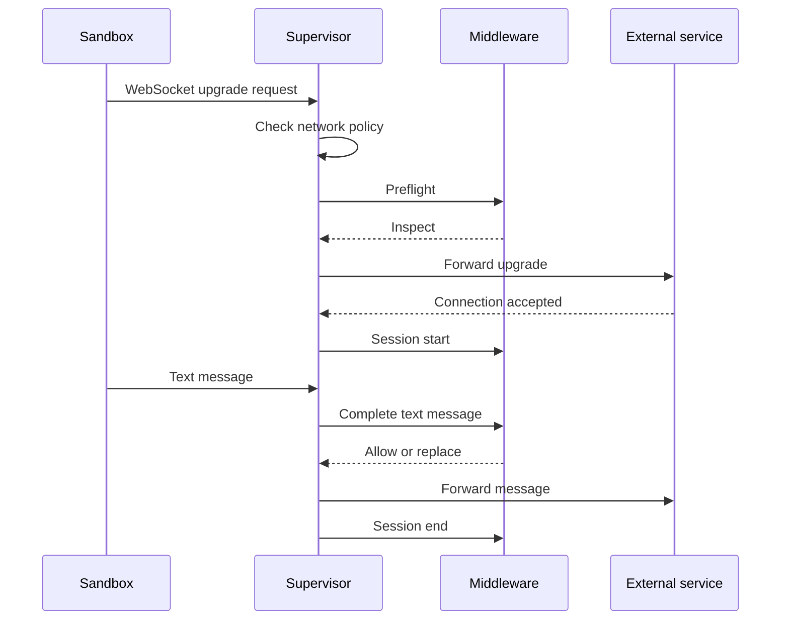

A middleware service handles one or more operations, such as HTTP requests or WebSocket messages. This page describes when OpenShell calls your service for each operation, what your service receives, and what it can return. The RPCs that every middleware service implements are described in [Build Your Middleware Service](/extensibility/supervisor-middleware#build-your-middleware-service).

## Operations and Phases

| Operation | Phase | When OpenShell calls your service | RPC |
| --- | --- | --- | --- |
| `HTTP_REQUEST` | `PRE_CREDENTIALS` | After network policy allows a request, before OpenShell injects provider credentials. | `EvaluateHttpRequestSession`, or v1 `EvaluateHttpRequest` |
| `HTTP_RESPONSE` | `PRE_RETURN` | After the external service responds, before the sandbox receives the response. | `EvaluateHttpResponseSession`, or v1 `HttpResponsePreReturn.Evaluate` |
| `WEBSOCKET_MESSAGE` | `PRE_CREDENTIALS` | When the sandbox opens a WebSocket connection, and for each text message it sends. | `EvaluateWebSocketSession` |

Your service declares each operation it supports as a binding, an operation and its phase, in its `Describe` manifest. OpenShell calls your service only for the operations it declares.

A service that requires the `openshell.supervisor-middleware.http-session` capability receives its HTTP bindings through the [HTTP session hooks](#http). Any other service receives them through the v1 HTTP hooks, which are deprecated for removal in 0.2.0.

When several middleware match the same traffic, OpenShell calls them in ascending `order`, and each middleware sees the changes that earlier middleware made.

## Common Inputs and Results

Every operation includes a request context. The context always includes `sandbox_id`. Use it for authorization, persistence, and correlation. The context also includes `sandbox` and `workspace` names when available. Names can be reused, so use them only for display and logging.

When OpenShell resolves the originating process, `context.originating_process` includes its binary and ancestors, with `pid` set to `0`.

Operations that include headers deliver them in wire order, and repeated headers stay separate. OpenShell removes credential, routing, and hop-by-hop headers before sending them to your service. It also removes framing headers from request input. Response preflight retains upstream `Content-Length`, `Content-Encoding`, and `Content-Range` as read-only metadata, unless `Connection` names them as hop-by-hop headers. Your service cannot change or remove these fields; OpenShell handles downstream framing.

Every result can include an optional reason code, findings, and metadata:

- A reason code identifies why your service denied traffic. OpenShell includes it in logs and in HTTP error responses. It must be 1-64 bytes long, start with a lowercase ASCII letter, and contain only lowercase ASCII letters, digits, and underscores. OpenShell treats an invalid code as a middleware failure.
- Findings report what your service detected, even when it allows the traffic. OpenShell logs how many findings your service reported, not their text.
- Metadata carries non-secret diagnostic details. OpenShell does not log it.

OpenShell never forwards free-form text from your service to the sandbox or to logs.

## HTTP

HTTP middleware inspects requests before OpenShell injects provider credentials and responses before the sandbox receives them. Implement `EvaluateHttpRequestSession` for `HTTP_REQUEST`, `EvaluateHttpResponseSession` for `HTTP_RESPONSE`, or both.

In `Describe`, add `openshell.supervisor-middleware.http-session` to both `extension.supported_capabilities` and `extension.required_capabilities`. This selects the session RPCs for all HTTP bindings in your service. Older gateways and supervisors refuse the service because they do not support this capability.

### Requests

Your service receives the request target, headers, and context before OpenShell reads the body. At preflight, return one of these results:

- `continue_without_body` to allow the request without inspecting its body, with optional header changes.
- `inspect` to choose a [body mode](#body-inspection).
- `reject` to deny the request, with an optional reason code. Use it, with a reason code that says so, when your service cannot inspect the message.

OpenShell applies middleware changes before it injects provider credentials. Middleware never sees those credentials. If middleware replaces a body, OpenShell checks it against body-aware policy, such as GraphQL, JSON-RPC, or MCP rules, before forwarding it.

Request output streams to the external service while the sandbox uploads. OpenShell instead buffers output, up to 4 MiB, when a stage selects BUFFERED, the route needs SigV4 signing or body credential rewriting, or the request uses the forward proxy, HTTP/1.0, or `Upgrade`. JSON-RPC, MCP, and GraphQL endpoints also buffer output so OpenShell can check the replaced body against policy.

### Responses

Your service receives the response status, headers, and request context. It can return `continue_without_body` or choose a body mode with `inspect`.

To stop the response from reaching the sandbox, return `block_delivery` at preflight or during body inspection. If delivery has started, OpenShell aborts the response. The external service has already handled the request, so blocking delivery does not undo it. Retrying may repeat side effects.

Interim `1xx` responses pass through unchanged. A `101` protocol upgrade skips response middleware.

### Body Inspection

OpenShell opens one bidirectional stream per HTTP message and middleware stage. Request and response streams are separate. All stages run their preflights in chain order before any stage receives body bytes.

The preflight lists `permitted_body_modes`, unavailable modes with their reasons, and the applicable limits. Select a permitted mode or continue without inspecting the body. A binding with `max_payload_bytes: 0` receives no body modes.

| Mode | Exchange |
| --- | --- |
| `BUFFERED` | Select `buffered` with a positive `max_body_bytes` within the advertised limit. After `begin`, receive one `buffered_body` with the complete body and trailers. Return `buffered_result` with `unchanged` or `replacement`. Empty replacement bytes delete the body. OpenShell withholds output until the chain finishes. |
| `STREAM` | After `begin`, receive `input_chunk` events and one `input_end` with trailers. Send `output_start`, any number of `output_chunk` results, and `finish` after `input_end`. Send every output byte, including unchanged bytes. Input and output chunk counts can differ. |

A STREAM stage must send `output_start` even for empty output. Set its `output_body_bytes` when you know the exact output length. OpenShell uses `Content-Length` when the output declares a length and chunked framing otherwise. It flushes each server-sent event chunk.

Your service can deny a request with `reject` or stop a response with `block_delivery` throughout inspection. After a terminal result, close your result stream or wait for the best-effort `session_end` notification. An unset, unknown, or out-of-order result fails closed.

Until all stages finish, OpenShell withholds the final byte or terminating chunk that would complete the message. This prevents a late denial from leaving the recipient with a response or request that appears complete.

#### Body Eligibility

OpenShell removes body modes that cannot safely inspect or transform the message:

| Condition | Requests | Responses |
| --- | --- | --- |
| Content encoding other than `identity` | No body modes | No body modes |
| Bodyless response, partial response, or `Cache-Control: no-transform` | Not applicable | No body modes |
| Declared length exceeds the stage's payload limit | No BUFFERED | No BUFFERED |
| `text/event-stream` or `multipart/x-mixed-replace` | No additional restriction | No BUFFERED |
| Request or response is not HTTP/1.1 | No additional restriction | No STREAM |

A BUFFERED body that exceeds the selected limit fails closed. OpenShell does not switch it to STREAM. If no mode suits your service, continue without inspection or deny the message with a reason code that says why.

### Header and Trailer Changes

A result can include an ordered list of header changes. A `write` change sets how it treats existing values:

- `append` adds another value.
- `overwrite` replaces all existing values.
- `skip` keeps the existing values.

A `remove` change removes all values for the name. OpenShell protects credential, routing, framing, connection, and content coding headers. For responses, it also protects status, authentication challenge, range, and security policy headers. Header values cannot contain control characters. Request values cannot contain OpenShell credential placeholders.

OpenShell does not update integrity headers, such as `ETag`, `Content-MD5`, `Digest`, `Content-Digest`, and `Signature`, when a stage changes a body. If your stage changes the body, remove these headers or write new values in `buffered_result` or `output_start`. A STREAM stage can read all input before it sends `output_start` if it needs the complete body to compute a value.

OpenShell applies all preflight changes in chain order, then late changes from `buffered_result` or `output_start` in chain order. `begin` carries the head after all preflight changes and earlier stages' late changes. Trailer changes can modify or remove existing trailers but cannot add new names.

OpenShell applies each stage's changes as a unit. If one change is invalid, it discards all of them and fails the stage.

### Uninspectable Traffic

For connections it cannot inspect as HTTP, OpenShell sends request middleware an `uninspectable` preflight. It includes the destination, policy name, and reason: `TLS_SKIP`, `H2C`, `UNSUPPORTED_TUNNEL`, `RAW_TCP`, or `SQL_PASSTHROUGH`.

Return `continue_without_body` to allow the connection or `reject` to refuse it. No body mode or header mutation is allowed. Failures and timeouts refuse the connection too.

This lets request middleware decide whether to allow `tls: skip` endpoints without seeing their content. Recreate sandboxes with older supervisors before attaching such a policy. Entries without a session request binding follow their `on_error` setting.

### Failures

HTTP session hooks always fail closed. The gateway rejects `on_error: fail_open` for these services. Each request or response chain must use one HTTP hook version; see [Mix HTTP Hook Versions](/extensibility/supervisor-middleware/configure#mix-http-hook-versions).

| Result | Before forwarding starts | After forwarding starts |
| --- | --- | --- |
| Request `reject` | `403 Forbidden`, `error: middleware_denied` | Close the upstream connection before the request completes. |
| Request failure | `403 Forbidden`, `error: middleware_failed` | Close the upstream connection before the request completes. |
| Response `block_delivery` | `403 Forbidden`, `error: middleware_denied` | Abort response delivery without an error body. |
| Response failure | `502 Bad Gateway`, `error: response_delivery_failed` | Abort response delivery without an error body. |

Denials include the policy entry's `middleware` name and the validated `reason_code`, if supplied. Failures include a platform-owned `failure_code` and identify the failed stage when known:

| `failure_code` | Cause |
| --- | --- |
| `middleware_cannot_inspect` | OpenShell could not provide the message head to the stage. |
| `middleware_timeout` | A binding, chain, or BUFFERED deadline expired. |
| `stream_idle_timeout` | A STREAM stage stalled. |
| `middleware_unavailable` | The service was unreachable, ended with a gRPC status, or evaluation capacity was unavailable. |
| `middleware_lifecycle_violation` | An unexpected result, unimplemented RPC, or output length mismatch. |
| `body_over_limit` | A body exceeded its selected limit. |
| `header_mutation_*` | A header or trailer change broke the rules above. |
| `middleware_hook_versions_mixed` | The chain mixed HTTP hook versions. |

No free-form service error text reaches the sandbox. If evaluation capacity remains full for the chain budget, OpenShell returns `503 Service Unavailable`. A stalled request upload receives `408 Request Timeout` with `error: request_timeout`.

<Accordion title="Legacy HTTP Hooks">

Services without the session capability use `EvaluateHttpRequest` and `HttpResponsePreReturn.Evaluate`. These RPCs are deprecated for removal in 0.2.0. Legacy requests use a single buffered evaluation. Legacy responses select `HEADERS_ONLY`, `WHOLE_BODY_BYTES`, or `STREAM_BYTES` and use `block_delivery` to stop delivery.

To migrate, require the session capability, implement the session RPCs, and use `fail_closed`. Replace request evaluation and `WHOLE_BODY_BYTES` with BUFFERED, `STREAM_BYTES` with STREAM, and `HEADERS_ONLY` with `continue_without_body`. Keep `block_delivery` for responses. The gateway and each sandbox supervisor read a service's `Describe` manifest when they connect to it, so after changing the service, restart the gateway, re-apply affected policies, and recreate sandboxes that use the service. Separate selectors from services still using legacy hooks, including `openshell/regex`.

Upgrade the gateway before deploying the service. Recreate sandboxes whose supervisors do not support session hooks. To support both contracts during migration, use separate service registrations.

</Accordion>

The [content guard example](https://github.com/NVIDIA/OpenShell/tree/main/examples/supervisor-middleware-content-guard) implements both HTTP operations.

## WebSocket

WebSocket middleware checks the text messages the sandbox sends over a WebSocket connection.

### Messages

OpenShell calls your service when the sandbox opens a WebSocket connection, then for each text message the sandbox sends. Your service can allow, deny, or replace each message.

<AccordionGroup>
<Accordion title="Session Events">

OpenShell opens one bidirectional stream to your service for each connection and sends these events:

1. A preflight before contacting the external service. Your service returns `INSPECT`, `SKIP`, or `DENY`. `SKIP` closes the middleware stream and passes all messages without inspection by that middleware. `DENY` rejects the upgrade.
2. A session start after the external service accepts the connection. It includes the negotiated subprotocol.
3. Each complete text message from the sandbox, in order.
4. A session end when the connection closes, sent on a best-effort basis.

Your service returns a result for each preflight and message. Session start and end are notifications that need no result. When OpenShell closes its side of the stream, finish your side of the stream too.

</Accordion>
<Accordion title="Message Handling">

OpenShell reassembles fragmented messages and decompresses `permessage-deflate` messages before sending them, so your service always receives a complete UTF-8 text message. A replacement can be any text, including an empty string. OpenShell re-frames and, when needed, re-compresses the replacement before forwarding it.

OpenShell does not send binary messages, control frames, or messages from the external service to middleware. Binary messages pass through unchanged, and OpenShell records an `unsupported_message_type` coverage event. Message sequence numbers count binary messages too, so your service can see gaps between text messages.

Only middleware that declares `WEBSOCKET_MESSAGE` receives messages. Middleware that declares only `HTTP_REQUEST` still inspects the upgrade request, and OpenShell records a `binding_not_selected` coverage event for it.

</Accordion>
<Accordion title="Denials and Failures">

A denied message closes the connection with code `1008`. When middleware fails, OpenShell rejects the upgrade or closes the connection. With `fail_open`, OpenShell instead stops using that middleware for the rest of the connection.

</Accordion>
<Accordion title="Close Codes">

| Code | Meaning |
| --- | --- |
| `1002` | WebSocket protocol error. |
| `1007` | Invalid UTF-8 text. |
| `1008` | Middleware or policy denial. |
| `1009` | Text message exceeds the 4 MiB platform limit. |
| `1012` | A policy change requires the connection to restart. |
| `1013` | Message assembly capacity is full. |

</Accordion>
</AccordionGroup>

## Limits

| Limit | Applies to | Value |
| --- | --- | --- |
| Preflight | HTTP session hooks | Binding timeout per stage, within a 30-second chain budget. |
| Concurrent messages | HTTP session hooks | 64 messages in preflight or BUFFERED processing, and 256 with STREAM stages, per sandbox. Messages wait within the 30-second chain budget. Stages that all continue release capacity after preflight. |
| Buffered body | HTTP session hooks | Stage payload limit, up to 4 MiB. Two minutes to receive, process, and deliver; individual exchanges also obey the binding timeout. |
| Streamed body | HTTP session hooks | No total size or duration limit. Chunks are at most 64 KiB or the stage payload limit, whichever is smaller. |
| Middleware stall | HTTP STREAM | 30 seconds to accept the next input, or between results after `input_end`. Waiting for the sandbox or external service to produce input does not count. |
| Request upload stall | HTTP STREAM | 30 seconds without progress from the sandbox. |
| Payload per middleware | Legacy HTTP hooks and WebSocket | Registration `max_payload_bytes`, up to 4 MiB, for each body, response piece, message, or replacement. |
| Evaluation or stream exchange | Legacy HTTP hooks and WebSocket | Smaller of registration and binding timeouts. Accepted streams have no connection-wide deadline. |
| Streamed response piece | Legacy HTTP hooks | 64 KiB, with a 30-second chain budget per piece. |
| Fragments per message | WebSocket | 4,096. |
| Message assembly | WebSocket | 30 seconds without progress, or two minutes total. |
| Message forwarding | WebSocket | Two minutes. |

A payload that exceeds one stage's limit fails that stage. Other stages retain their own limits. For HTTP payloads near 4 MiB, configure your gRPC server to send and receive at least 4.5 MiB messages because the envelope adds overhead.

Middleware evaluation capacity is shared across operations. When it is full, OpenShell returns `503 Service Unavailable` before reading a request body. When WebSocket message assembly capacity is full, OpenShell closes the connection with code `1013`.
