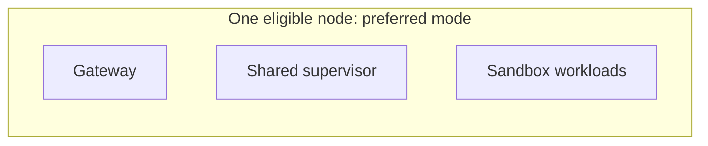
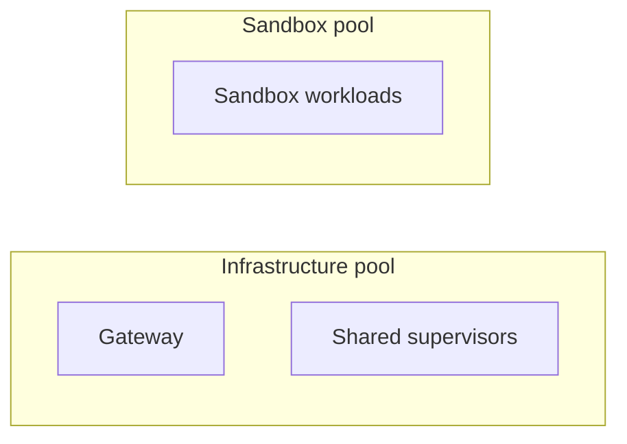
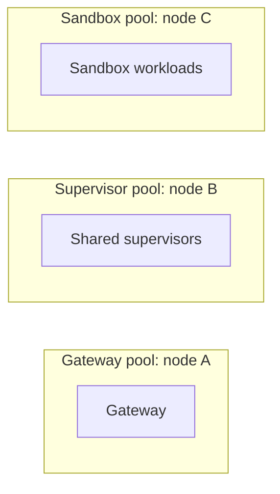

Workloads and supervisors prefer separate nodes by default. Node selectors and
tolerations are opt-in: the default deployment needs no node-pool labels,
taints, or dedicated nodes.

## Choose the separation policy

Set `pod_anti_affinity` in the gateway configuration to `preferred`, `required`,
or `off`. Preferred mode permits colocation when capacity is limited, including
a single-node cluster:



To require workload/supervisor separation, configure gateway TOML:

```toml
[openshell.drivers.kubernetes.sandbox_runtime]
pod_anti_affinity = "required"
```

In Helm values, use the same setting through `gatewayConfig`:

```yaml
gatewayConfig:
  openshell.drivers.kubernetes:
    sandbox_runtime:
      pod_anti_affinity: required
```

The chart derives the shared-supervisor Deployment's reciprocal rule from this
setting. The driver configures workloads and dedicated supervisors. Required
mode leaves pods Pending when no separate eligible node exists; it does not
fall back to colocation. `off` omits generated anti-affinity rules while keeping
operator-authored rules effective. Gateway placement is independent of this
policy.

## Select namespace scope

Rules use `kubernetes.io/hostname` and select the opposite pod role across all
namespaces, including other OpenShell installations. This covers shared
supervisors deployed in a separate namespace from their workloads.

To scope separation to one installation, label the participating supervisor and
workload namespaces with a common label, then select that label:

```yaml
gatewayConfig:
  openshell.drivers.kubernetes:
    sandbox_runtime:
      pod_anti_affinity_namespace_selector:
        matchLabels:
          example.com/openshell-group: production
```

The chart applies the same namespace scope to shared-supervisor rules. An empty
selector, `{}`, matches all namespaces. This selector identifies peer
namespaces; it does not choose nodes.

## Place pods in separate node pools

Use node selectors to constrain eligible nodes. Gateways use Helm's
`nodeSelector`; shared supervisors use `supervisor.nodeSelector`; workloads use
the operator-owned `sandbox_runtime.workload_placement.node_selector` in gateway
configuration. Caller driver-config opt-in is not required.

For example, gateways and supervisors can share an infrastructure pool while
sandbox workloads use another pool:



Label the nodes in those pools with `openshell.ai/node-pool=infrastructure` or
`openshell.ai/node-pool=sandbox`, then configure:

```yaml
nodeSelector:
  openshell.ai/node-pool: infrastructure
supervisor:
  nodeSelector:
    openshell.ai/node-pool: infrastructure
gatewayConfig:
  openshell.drivers.kubernetes:
    sandbox_runtime:
      workload_placement:
        node_selector:
          openshell.ai/node-pool: sandbox
```

To give every role a separate pool, label nodes with the corresponding pool
value and change the selectors:



```yaml
nodeSelector:
  openshell.ai/node-pool: gateway
supervisor:
  nodeSelector:
    openshell.ai/node-pool: supervisor
gatewayConfig:
  openshell.drivers.kubernetes:
    sandbox_runtime:
      workload_placement:
        node_selector:
          openshell.ai/node-pool: sandbox
```

Explicit node selectors constrain placement even when anti-affinity remains
preferred. Operator workload selectors merge with caller selectors; conflicting
values are rejected. Anti-affinity alone does not reserve capacity for future
supervisors.

### Tolerate pool taints

If a pool has a `NoSchedule` taint, give its pods the matching toleration.
Gateways use Helm's `tolerations`, shared supervisors use
`supervisor.tolerations`, and workloads use
`sandbox_runtime.workload_placement.tolerations`. For a sandbox pool tainted
`openshell.ai/node-pool=sandbox:NoSchedule`, add:

```yaml
gatewayConfig:
  openshell.drivers.kubernetes:
    sandbox_runtime:
      workload_placement:
        tolerations:
          - key: openshell.ai/node-pool
            operator: Equal
            value: sandbox
            effect: NoSchedule
```

Tolerations permit use of tainted nodes; they do not select a pool. Operator
workload tolerations append without duplicates and retain caller tolerations.
PKI hook Jobs inherit the gateway's node selectors and tolerations. Cluster
services, including storage provisioners, need their own placement configuration
when nodes are tainted.

## Use role labels in custom affinity rules

OpenShell uses the common label key `openshell.ai/runtime-role`:

| Pod | Label value | Applied by |
| --- | --- | --- |
| Sandbox workload | `workload` | Kubernetes driver |
| Shared supervisor | `supervisor` | Helm or its deployment owner |
| Dedicated supervisor | `supervisor` | Kubernetes driver |
| Gateway | `gateway` | Helm or its deployment owner |

These pod labels preserve existing Service and controller selectors. For
example, to prefer placing shared supervisors away from gateways, add:

```yaml
supervisor:
  affinity:
    podAntiAffinity:
      preferredDuringSchedulingIgnoredDuringExecution:
        - weight: 100
          podAffinityTerm:
            labelSelector:
              matchLabels:
                openshell.ai/runtime-role: gateway
            namespaceSelector: {}
            topologyKey: kubernetes.io/hostname
```

This example selects gateways across all namespaces. Set its namespace selector
to narrow the scope. Custom `supervisor.affinity` rules coexist with generated
workload/supervisor rules. Top-level Helm `affinity` configures gateway pods.

## Configure independently deployed supervisors

The gateway configures workload pods; the supervisor deployment owner configures
shared supervisors. Apply the supervisor role label and a reciprocal native
anti-affinity rule in the supervisor Pod template. For required separation:

```yaml
metadata:
  labels:
    openshell.ai/runtime-role: supervisor
spec:
  affinity:
    podAntiAffinity:
      requiredDuringSchedulingIgnoredDuringExecution:
        - labelSelector:
            matchLabels:
              openshell.ai/runtime-role: workload
          namespaceSelector: {}
          topologyKey: kubernetes.io/hostname
```

Use the same namespace scope and policy strength as the gateway. For soft
separation, put the term under
`preferredDuringSchedulingIgnoredDuringExecution` as a `podAffinityTerm` with
`weight: 100`. Changing the gateway setting does not change independently
deployed supervisor pods.

## Apply placement changes

Workload placement applies on creation and stop/start, preserving unrelated
affinity. Running pods are not moved or continuously evicted. Roll out gateway
and supervisor Pod templates to apply their changed placement or acquire role
labels. Older unlabeled pods are not selected by role anti-affinity.

## Diagnose Pending pods

Inspect placement, node-pool labels, and the affected pod's scheduling events:

```shell
kubectl get pods -A -l openshell.ai/runtime-role -o wide
kubectl get nodes -L openshell.ai/node-pool
kubectl describe pod POD --namespace NAMESPACE
```

Check for insufficient eligible nodes, conflicting node selectors or affinity,
and missing tolerations. Required separation needs enough eligible nodes for
both roles. A verified capacity wait does not consume the workload's bounded
startup grace after scheduling.

See the [gateway configuration reference](/how-it-works/gateways/configuration#kubernetes-pod-placement)
for field names and defaults.
