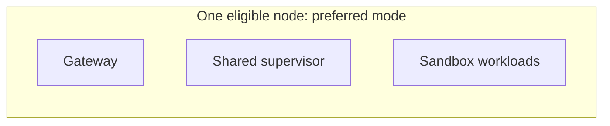
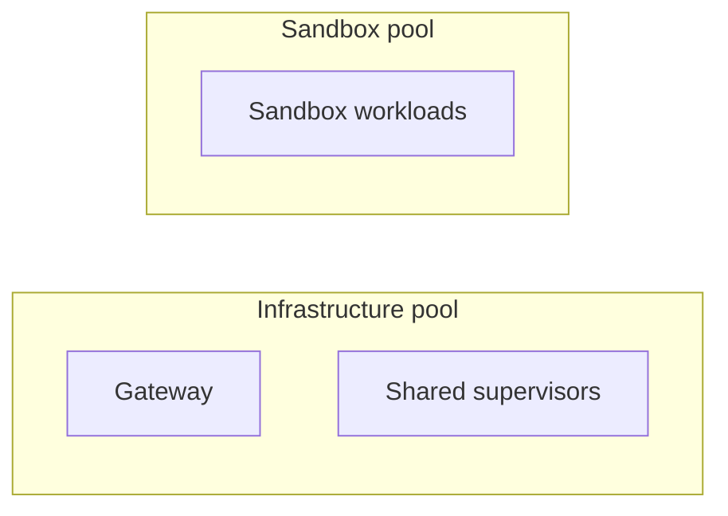
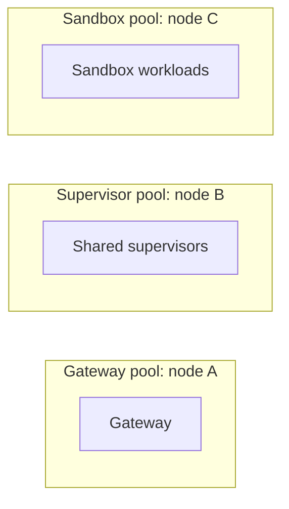

Kubernetes places OpenShell pods using standard labels, node selectors,
tolerations, and affinity rules. These concepts apply whether you use the
OpenShell Helm chart, an operator, or deployment manifests you maintain.

Placement configuration follows the owner of each pod:

- The Kubernetes driver configures workload placement and workload/supervisor
  anti-affinity through gateway configuration, including dedicated supervisors.
- Configure gateways and shared supervisors in their deployment's Pod templates.
  The OpenShell Helm chart renders these templates and derives shared-supervisor
  anti-affinity from the gateway configuration. With another deployment method,
  apply the equivalent labels and scheduling rules in your own templates.

Examples identified as Helm values below are specific to the OpenShell chart.
[Custom deployment manifests](#use-your-own-deployment-manifests) use native
Kubernetes Pod fields.

## Choose the separation policy

The Kubernetes driver defaults to `preferred` workload/supervisor anti-affinity.
Set `pod_anti_affinity` in the gateway configuration to `required` or `off` to
change it. Preferred mode permits colocation when capacity is limited, including
a single-node cluster. Node selectors and tolerations are opt-in; the default
policy needs no node-pool labels, taints, or dedicated nodes:



To require workload/supervisor node separation, configure gateway TOML:

```toml
[openshell.drivers.kubernetes.sandbox_runtime]
pod_anti_affinity = "required"
```

In Helm values, use the same setting through `gatewayConfig`:

```yaml
gatewayConfig:
  openshell.drivers.kubernetes:
    sandbox_runtime:
      pod_anti_affinity: required
```

When using the chart, it also derives the shared-supervisor Deployment's
reciprocal rule from this setting. Required mode leaves pods Pending when no
separate eligible node exists; it does not
fall back to colocation. `off` omits generated anti-affinity rules while keeping
operator-authored rules effective. Gateway placement is independent of this
policy.

## Select namespace scope

Rules use `kubernetes.io/hostname` and select the opposite pod role across all
namespaces, including other OpenShell installations. This covers shared
supervisors deployed in a separate namespace from their workloads.

To scope separation to one installation, label the participating supervisor and
workload namespaces with a common label, then select that label. For example,
use these Helm values:

```yaml
gatewayConfig:
  openshell.drivers.kubernetes:
    sandbox_runtime:
      pod_anti_affinity_namespace_selector:
        matchLabels:
          example.com/openshell-group: production
```

The chart applies the same namespace scope to shared-supervisor rules. In custom
supervisor manifests, set the native anti-affinity term's `namespaceSelector` to
the same selector. An empty selector, `{}`, matches all namespaces. This
selector identifies peer namespaces; it does not choose nodes.

## Place pods in separate node pools

Use node selectors to constrain eligible nodes. In your own gateway or
shared-supervisor Pod templates, set `spec.nodeSelector`. The OpenShell chart
exposes these fields as `nodeSelector` and `supervisor.nodeSelector` respectively.
For driver-created workloads, use the operator-owned
`sandbox_runtime.workload_placement.node_selector` in gateway configuration,
regardless of how you deploy the gateway. Caller driver-config opt-in is not
required.

You might use, for example, `openshell.ai/node-pool` as a node label to organize
where pods run within your cluster. This label is only an example; OpenShell
does not create or require it. Use your own node label keys and values in
selectors and tolerations. The built-in `openshell.ai/runtime-role` label
identifies pod roles for automatic anti-affinity.

For example, gateways and supervisors can share an infrastructure pool while
sandbox workloads use another pool:



Label the nodes in those pools with `openshell.ai/node-pool=infrastructure` or
`openshell.ai/node-pool=sandbox`. With the OpenShell Helm chart, configure:

```yaml
nodeSelector:
  openshell.ai/node-pool: infrastructure
supervisor:
  nodeSelector:
    openshell.ai/node-pool: infrastructure
gatewayConfig:
  openshell.drivers.kubernetes:
    sandbox_runtime:
      workload_placement:
        node_selector:
          openshell.ai/node-pool: sandbox
```

To give every role a separate pool, label nodes with the corresponding pool
value and change the selectors:



For the OpenShell Helm chart, the values are:

```yaml
nodeSelector:
  openshell.ai/node-pool: gateway
supervisor:
  nodeSelector:
    openshell.ai/node-pool: supervisor
gatewayConfig:
  openshell.drivers.kubernetes:
    sandbox_runtime:
      workload_placement:
        node_selector:
          openshell.ai/node-pool: sandbox
```

Explicit node selectors constrain placement even when anti-affinity remains
preferred. Operator workload selectors merge with caller selectors; conflicting
values are rejected. Anti-affinity alone does not reserve capacity for future
supervisors.

### Tolerate pool taints

If a pool has a `NoSchedule` taint, give its pods the matching toleration. Set
`spec.tolerations` in custom gateway or shared-supervisor Pod templates. The
OpenShell chart exposes these fields as `tolerations` and
`supervisor.tolerations` respectively. For driver-created workloads, use
`sandbox_runtime.workload_placement.tolerations`. These Helm values configure a
workload toleration for `openshell.ai/node-pool=sandbox:NoSchedule`:

```yaml
gatewayConfig:
  openshell.drivers.kubernetes:
    sandbox_runtime:
      workload_placement:
        tolerations:
          - key: openshell.ai/node-pool
            operator: Equal
            value: sandbox
            effect: NoSchedule
```

Tolerations permit use of tainted nodes; they do not select a pool. Operator
workload tolerations append without duplicates and retain caller tolerations.
With the OpenShell chart, PKI hook Jobs inherit the gateway's node selectors and
tolerations. Other deployment methods must configure their supporting Jobs as
needed. Cluster services, including storage provisioners, need their own
placement configuration when nodes are tainted.

## Use role labels in custom affinity rules

OpenShell uses the common label key `openshell.ai/runtime-role`:

| Pod | Label value | Applied by |
| --- | --- | --- |
| Sandbox workload | `workload` | Kubernetes driver |
| Shared supervisor | `supervisor` | Helm or its deployment owner |
| Dedicated supervisor | `supervisor` | Kubernetes driver |
| Gateway | `gateway` | Helm or its deployment owner |

These pod labels preserve existing Service and controller selectors. Use them
in native `spec.affinity` rules in your own Pod templates. For example, these
OpenShell Helm values prefer placing shared supervisors away from gateways:

```yaml
supervisor:
  affinity:
    podAntiAffinity:
      preferredDuringSchedulingIgnoredDuringExecution:
        - weight: 100
          podAffinityTerm:
            labelSelector:
              matchLabels:
                openshell.ai/runtime-role: gateway
            namespaceSelector: {}
            topologyKey: kubernetes.io/hostname
```

This example selects gateways across all namespaces. Set its namespace selector
to narrow the scope. Custom `supervisor.affinity` rules coexist with generated
workload/supervisor rules. Top-level Helm `affinity` configures gateway pods.

## Use your own deployment manifests

Apply `openshell.ai/runtime-role: gateway` to your gateway pods and
`openshell.ai/runtime-role: supervisor` to shared-supervisor pods. Configure
their node selectors, tolerations, and affinity using native Pod fields.

For example, this shared-supervisor Pod template requires separation from
workloads. In a Deployment or StatefulSet manifest, place this fragment under
`spec.template`:

```yaml
metadata:
  labels:
    openshell.ai/runtime-role: supervisor
spec:
  affinity:
    podAntiAffinity:
      requiredDuringSchedulingIgnoredDuringExecution:
        - labelSelector:
            matchLabels:
              openshell.ai/runtime-role: workload
          namespaceSelector: {}
          topologyKey: kubernetes.io/hostname
```

Continue to configure driver-created pods through gateway TOML, as shown above.
Give shared supervisors the same namespace scope and policy strength. For soft
separation, put the term under
`preferredDuringSchedulingIgnoredDuringExecution` as a `podAffinityTerm` with
`weight: 100`. Changing the gateway setting does not change independently
deployed supervisor pods. Your deployment tooling must maintain those labels
and rules across rollouts, replacements, and scaling.

## Apply placement changes

Workload placement applies on creation and stop/start, preserving unrelated
affinity. Running pods are not moved or continuously evicted. Roll out gateway
and supervisor Pod templates to apply their changed placement or acquire role
labels. Older unlabeled pods are not selected by role anti-affinity.

## Diagnose Pending pods

Inspect placement, node-pool labels, and the affected pod's scheduling events:

```shell
kubectl get pods -A -l openshell.ai/runtime-role -o wide
kubectl get nodes -L openshell.ai/node-pool
kubectl describe pod POD --namespace NAMESPACE
```

Check for insufficient eligible nodes, conflicting node selectors or affinity,
and missing tolerations. Required separation needs enough eligible nodes for
both roles. A verified capacity wait does not consume the workload's bounded
startup grace after scheduling.

See the [gateway configuration reference](/how-it-works/gateways/configuration#kubernetes-pod-placement)
for field names and defaults.
