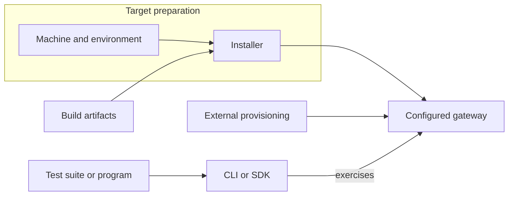

---
authors:
  - "@elezar"
state: draft
links:
  - https://github.com/NVIDIA/OpenShell/issues/3954
  - https://github.com/NVIDIA/OpenShell/issues/5281
  - https://github.com/NVIDIA/OpenShell/pull/3460
---

# RFC 0016 - OpenShell testing strategy

## Summary

Establish a shared testing strategy for OpenShell so required public behavior
is verified consistently across drivers and deployment environments. Separate
conformance end-to-end tests from feature-specific and driver-specific coverage, and
separate target preparation from test execution.

Run end-to-end tests on request for PRs and during release qualification. Adopt the
strategy incrementally using the existing infrastructure.

Much of the execution model already exists: tests written with testkit under
`tests/suites/`, run in tmachine environments by `openshell-test-runner`, or
against any gateway with the `openshell-conformance` program. This RFC records
the policy those pieces implement and the direction for what remains. The
migration of the legacy `e2e/rust` tests is tracked in
[#5281](https://github.com/NVIDIA/OpenShell/issues/5281).

## Motivation

The legacy end-to-end tests in `e2e/rust` (about 70 files) mix public behavior,
runtime inspection, external integrations, and performance measurements. This
makes coverage difficult to reuse across drivers and obscures whether a failure
reflects the product or its test infrastructure. The suites already moved to
testkit separate these concerns, but the rules for what belongs where are
written down only in `TESTING.md` and a suite README.

Clear test categories help contributors decide where tests belong and reviewers
understand what they verify.

## Non-goals

- Implement the framework or CI matrices in this PR.
- Classify every existing test or set the migration order; retain that work in
  migration issues such as
  [#5297](https://github.com/NVIDIA/OpenShell/issues/5297).
- Introduce certification or a review board.
- Define a cross-version compatibility matrix.
- Define SDK-specific compatibility testing.
- Define benchmark execution policy or performance thresholds.

## Proposal

### 1. Organise tests by family

Test families describe the scope and purpose of a check. Use them to decide
where a test belongs and what a passing result establishes.

| Test Family | Description |
| --- | --- |
| Lint | Check formatting, style, and static rules. |
| Unit | Verify one component in isolation. Place tests inline in its Rust module or in an adjacent test module under `src/`. |
| Integration | Verify interactions between components. Place Rust integration tests in the crate's top-level `tests/` directory. |
| End-to-end (e2e) | Verify a configured OpenShell target through a client interface. Place suites in `tests/suites/`. |
| Benchmark | Measure performance or scale. The location is decided when the first benchmark returns; the legacy live-Internet benchmarks were removed pending [#5472](https://github.com/NVIDIA/OpenShell/issues/5472). |

A test that needs no running gateway or sandbox, such as a check of CLI
preflight output against a fake `docker` on `PATH`, belongs in a unit or
integration test of the crate that owns the behavior, not in e2e.

Within the e2e family, group tests by the behavior they verify. This separates
reusable public behavior checks from checks tied to particular integrations
or drivers.

| e2e type | What it verifies | Folder |
| --- | --- | --- |
| Conformance | Required public behavior, including continuity across gateway restarts and upgrades. | `tests/suites/conformance/`, one crate and one workspace |
| Feature | Behavior requiring a named external service or special gateway configuration. | `tests/suites/features/`, one crate per suite in one workspace |
| Driver | Behavior specific to a driver, its host integration, or its configuration. | `tests/suites/drivers/<driver>/`, one workspace per driver |

Shared test code sits beside the suites. `tests/testkit/` holds the support
library and the `#[testkit::test]` attribute, and helpers for OpenShell itself
(sandboxes, policies, providers, the CLI) belong there. `tests/support/` holds
fixtures for services outside OpenShell, such as Keycloak or a host-side
recording server, in crates named `<service>-support` that any suite can use.

Conformance may include disruption tests. Add these under
`tests/suites/disruption/` initially, with their harness developed separately.
Tests that restart or reconfigure the gateway cannot be conformance tests,
because conformance tests do not change deployment configuration; their family
is decided when the first such migration lands.

### 2. Define conformance e2e requirements

Conformance is the e2e test type that verifies required public behavior against
a configured gateway. Each test must pass; a failure indicates a conformance
gap. These tests provide common expectations across supported targets.

Conformance tests can be grouped into broad behavioral areas. The following
section gives examples.

#### Conformance areas

These user stories illustrate each area from a user or administrator's
perspective. Tests requiring external services or special gateway configuration
belong in feature-specific suites.

| Area | User stories |
| --- | --- |
| Sandbox lifecycle and continuity | I can create, inspect, start, stop, and delete a sandbox. I can observe workload status and exit codes. My sandbox retains its expected state across stops and gateway restarts, including upgrades. Ephemeral sandboxes are removed when their workloads finish. |
| Sandbox I/O | I can execute commands with input and receive complete output and exit status. I can connect interactively and reconnect as supported. I can upload and download files safely. I can forward a port to a sandbox service. |
| Workspaces and resource management | I can create, inspect, and delete workspaces. My resources remain scoped to their workspace. I can label and filter resources. Deletion guards prevent accidental removal of resources still in use. |
| Policy management | I can validate, apply, inspect, and update policy. I can see which policy is effective and when an update takes effect. Invalid policy is rejected without weakening existing protection. |
| Sandbox enforcement | My workload can access permitted files, processes, and network destinations. Prohibited access is blocked. Updating policy changes enforcement as promised. |
| Providers | I can create, attach, update, detach, and delete providers. Authorized workloads receive usable credentials without exposing secrets. Credential changes and revocation take effect as promised. |
| Identity and authorization | I can authenticate and access resources I am authorized to use. Unauthorized requests are rejected. Access through another client interface does not bypass authorization. |
| Settings | I can read, change, and remove settings through public APIs. I can inspect effective values. Global overrides take precedence and prevent conflicting sandbox changes. |
| Middleware | My requests use the selected middleware in the configured order. Transformations and failure handling follow the configured behavior. |
| Interceptors | My gateway requests are transformed or rejected as configured. Interception preserves authorization boundaries. |

#### Test requirements

Each conformance test documents its expected behavior, preconditions, required
permissions, and significant side effects alongside its implementation; testkit
requires a doc comment on every test. Use a descriptive, stable test name that
identifies the behavior being verified and allows results to be tracked across
runs.

Tests exercise a configured gateway through public client interfaces. Assertions
verify observable behavior and structured output. They must not depend on native
runtime details, incidental presentation, or diagnostic availability. Assert
only what the proto comments and published documentation promise. Assert
workload `phase` and `exit_code`, not condition reasons or message text. Check
that something did not happen by reading the state that shows it, not by
sleeping. If a behavior is undocumented, document it before testing it.

Tests exercise public APIs within their declared permissions. Keep end-user and
administrative interactions in separate tests. Tests may change resources and
settings through public APIs, but must not change deployment configuration.

Tests must clean up their changes, including after a failure or panic, and use
names unique to the run so that they could run in parallel against one gateway.
A test that changes a gateway-wide setting restores it on cleanup and relies on
serial execution until the runner supports parallel groups. Behavioral checks
must not depend on public internet services.

A behavior that only some drivers or environments provide is not conformance;
place it in a feature or driver suite. Run tests across supported targets.
Changes or removals must distinguish corrections to tests from changes to
promised behavior.

#### Failure handling

Investigate each failure and track the underlying product, test, or
infrastructure issue. Notify the responsible maintainers of new failures.
Do not automatically retry failed tests; intermittent failures may expose races
that affect larger installations.

Tests may poll for documented asynchronous transitions within a defined timeout.
They must not retry failed assertions merely to obtain a pass.

Retain test results, failure logs, revision, target configuration, and run
duration for investigation. CI uploads the JUnit report, the nextest log, and
the guest's diagnostics after a failure as an `e2e-results-*` artifact named by
suite, environment, and installer.

#### Ignoring a test

A broken or flaky test is ignored, not skipped conditionally. To ignore one:

1. Open a tracking issue that describes the failure.
2. Mark the test `#[ignore = "<tracking issue link>"]`, so the reason is in
   source.
3. Remove the marker in the change that fixes the issue.

An ignored test does not run in any environment and shows as skipped in the
test report. The marker is global: a limitation specific to one environment is
a reason to move the test to a feature or driver suite, not to ignore it. This
is the only skip mechanism.

### 3. Separate target preparation from test execution

Prepare the target separately from test execution so the same suite can run
against locally provisioned or externally managed gateways.

Target preparation supplies deployment configuration, credentials, images, and
tools. Supply images and tools without requiring public internet access during
test execution, for example through preloading or configured mirrors.

Tests find the gateway the way the CLI does, through `OPENSHELL_GATEWAY`,
`OPENSHELL_GATEWAY_ENDPOINT`, or the active gateway, and run the CLI named by
`OPENSHELL_BIN`. There is no separate target description. Host and runtime
access supports provisioning, diagnostics, and disruption mechanisms.

Tests must not depend on a particular provisioning tool. Conformance requirements
remain the same across supported target configurations.

A service outside OpenShell that a feature suite needs is started by the
environment, which publishes how to reach it as `OPENSHELL_TEST_<SERVICE>_*`
variables; the suite's fixture in `tests/support/` reads them, so the same suite
runs against any deployment that sets them. A short-lived server that serves
one test is a test-owned helper instead. A test whose upstream runs on the
machine executing the tests requires sandboxes to reach that machine as
`host.openshell.internal`, which a remote cluster may not allow; see the open
questions.

To check a gateway without cargo, nextest, or a source checkout, the conformance
crate builds `openshell-conformance`, a program that finds the gateway as the
tests do and offers `list`, `ready`, and `run` with a JUnit report. CI builds it
once per architecture and passes it to every conformance row.



### 4. Select and trigger test runs

Test execution depends on the purpose of the run:

| Context | Tests to run |
| --- | --- |
| Pull requests | Automatically run lint, unit, and component integration checks. Run e2e tests when requested. |
| Release qualification | Run those checks and all applicable e2e tests for dev and stable releases. |
| Additional schedules | Add scheduled runs where further coverage is needed. |

Each e2e type runs as its own CI job, so a failure names the type that failed.
Branch E2E runs `conformance-integration`, `feature-specific-integration`, and
`driver-specific-integration` when the `test:e2e` label is set; the conformance
and feature jobs also run in Release Dev and release qualification, while the
driver suites run only in Branch E2E. All three call the reusable
`e2e-suites.yml` workflow with a `family` input that selects rows from an
explicit matrix of environments and installers. Conformance includes disruption
tests. Add separate labels for requesting a single type only when run durations
justify it.

Release qualification validates installation and uninstall behavior using
candidate artifacts. Upgrade qualification verifies continuity across gateway
replacement.

## Implementation plan

### Execution infrastructure

Nix pins build inputs and produces artifacts and test archives. Tmachine
composes a `Machine` and `Environment` for setup, an `Installer` for installation,
and a `Testsuite` for execution. `openshell-test-runner` boots one environment
with OpenShell installed, runs a test family inside it with nextest, or runs a
prebuilt `openshell-conformance` program or test bundle, and writes a JUnit
report. A run passes if nextest succeeds, fails on a test failure, and is an
error when the environment cannot complete the run or no test ran. Other
provisioners may supply targets tmachine cannot represent.

CI reuses provisioning definitions across selected target configurations. The
rows are an explicit matrix in `e2e-suites.yml`; generating the matrix from a
list of tests and environments, and checking that every expected test ran, are
planned after the legacy suites are retired.

### Layout and migration

Existing conformance tests use the CLI and the SDK against a configured gateway.
Planned work will extend coverage to direct API usage.

Provisioning, runner, and suites share the `tests/` tree:

```text
tests/
├── tmachine/                      # Machines, environments, installers, Ansible
├── runner/                        # openshell-test-runner
├── testkit/                       # Test library and #[testkit::test]
├── support/                       # Fixtures for services outside OpenShell
└── suites/
    ├── conformance/               # Requirements, authoring, execution: README.md
    ├── features/                  # keycloak-provider-refresh, host-gateway, oci-image, ...
    ├── disruption/                # Added in a later phase
    └── drivers/podman/            # One workspace per driver
```

The legacy `e2e/rust` tests and the tmachine `e2e-podman` testsuite remain until
their tests migrate. Progress:

1. **Done.** Testkit and cleanup hooks, the runner, conformance on testkit and
   required on Docker, Podman rootful and rootless, k3s, and HA k3s, host lanes
   running `openshell-conformance`, the Keycloak, OCI image, host-gateway, and
   Kubernetes update feature suites, the Podman user-namespace driver suite, and
   per-run bundles so rows do not rebuild tests.
2. **In progress.** Migrate `e2e/rust` by behavioral intent in batches, each
   deleting the files it ports, preserving coverage until a validated
   replacement exists or the test is explicitly retired. The first batch ported
   credential gating; open PRs move the driver-agnostic sandbox lifecycle and
   API tests, and the CLI exec, attach, and SSH tests, into conformance and
   features. Driver-agnostic files go to conformance, driver-specific behavior to
   driver suites, and benchmarks and tests that check the test environment
   rather than the product are dropped or moved to crate tests. Batch order and
   per-file decisions live in
   [#5297](https://github.com/NVIDIA/OpenShell/issues/5297) and
   [#5281](https://github.com/NVIDIA/OpenShell/issues/5281), not here.
3. **Next.** Retire the interim `e2e-podman` testsuite and its exclusion list
   when its intent is covered or explicitly retired
   ([#3712](https://github.com/NVIDIA/OpenShell/issues/3712)), add driver
   suites for Docker and Kubernetes where behavior is driver-specific, and
   decide a home for gateway-reconfiguration and disruption tests.
4. Assess conformance tests against the requirements, and validate execution
   against externally prepared gateways without depending on public internet
   services. Resolve fixture reachability as part of this work.
5. Notify maintainers of new failures and track ignored tests through their issues.
   Run applicable suites during dev and stable release qualification, including
   candidate installation and uninstall checks.
6. Update testing and CI documentation as each part is implemented. Record
   actual gates and remaining gaps.

### CI selection

Today one `test:e2e` label runs all e2e types in Branch E2E, and each type is its
own job. The `test:e2e-gpu` and `test:e2e-kubernetes` labels select legacy lanes.
Migrate those labels according to test intent as `e2e/rust` retires. Introduce a
per-type label only when run durations justify it.

### Later phase: disruption tests

Add restart and upgrade continuity tests in a later phase. Design their harness
separately from the migration of existing suites. Include these tests in
conformance PR runs and release qualification. Consolidate shared contracts and
helpers when practical.

### Follow-up work

Run conformance against a gateway without an image override. Today a gateway
outside the CI lanes must set `OPENSHELL_TEST_PYTHON_IMAGE`.

### Documentation

`TESTING.md` defines test families and links to suite READMEs.
`tests/suites/conformance/README.md` owns conformance requirements, authoring, and
execution guidance; `TESTING.md` should link to it rather than repeat the
assertion rules. `CI.md` records merge and release gates as qualification
workflows are implemented. Agent guidance links to these sources.

## Risks

- Two Linux drivers can share accidental OS assumptions. Review probe portability
  and expand platform coverage; a pass applies only to the tested configuration.
- Shared-library and provisioning changes can conflict with parallel migrations.
  Sequence common infrastructure changes before dependent work.
- Legacy and testkit suites run side by side during migration, and the legacy
  host lanes differ from the tmachine rows. A migrated test must keep its
  coverage on the lanes that ran it; a deleted file needs a recorded outcome.
- The runner runs one test at a time with one timeout profile. Families that
  need longer timeouts, test groups, or parallelism, such as Kubernetes
  high-availability tests, need per-family runner configuration first
  ([#5295](https://github.com/NVIDIA/OpenShell/issues/5295)).
- An explicit matrix cannot show that a suite was left out of CI. Until matrices
  are generated and expected tests are checked, reviewers confirm that a new
  suite has a row.

## Alternatives

- **Independent driver e2e suites:** less migration now, but duplicated public
  checks and diverging expectations. Retain only genuinely driver-specific work.
- **Tests provision their own gateways:** convenient locally, but harder to reuse
  against installed artifacts or externally prepared targets.
- **Separate API and CLI frameworks immediately:** adds overlapping runners
  before shared execution needs are understood; retain SDK-specific coverage
  separately.
- **Declared requirements, capabilities, and per-environment waivers:** let one
  test adapt to an environment, but add a declarative layer before any test
  needs it. A test that cannot pass everywhere moves to a feature or driver
  suite, and a broken test is ignored with a tracking issue. Revisit if a
  portable test needs an environment condition
  ([#5409](https://github.com/NVIDIA/OpenShell/issues/5409)).

## Prior art

- [Kubernetes conformance testing](https://github.com/kubernetes/community/blob/main/contributors/devel/sig-architecture/conformance-tests.md)
  informs public-contract testing and per-test specifications. OpenShell uses
  normal PR review rather than its promotion process, soak period, or governance,
  and defers a cross-version compatibility matrix.
- The first conformance suites came from reusable CLI scenarios and Cargo
  execution; they now run as testkit tests. Earlier sandbox-continuity work
  motivates separating portable recovery assertions from environment-specific
  disruption actuators.

## Open questions

- How should conformance treat a gateway whose sandboxes cannot reach the test
  machine, such as a remote Kubernetes cluster? Options are an opt-in declared
  by the environment, a move of host-dependent tests to a feature suite, or an
  up-front reachability check that names the missing requirement
  ([#5409](https://github.com/NVIDIA/OpenShell/issues/5409)).
- Where do tests that restart or reconfigure the gateway live, and how do they
  relate to disruption conformance? Migration notes propose a separate
  `gateway-control` family; the first such migration decides.
- Do any benchmarks return, and where do they live
  ([#5472](https://github.com/NVIDIA/OpenShell/issues/5472))?
- Disruption harness design is deferred to implementation.
