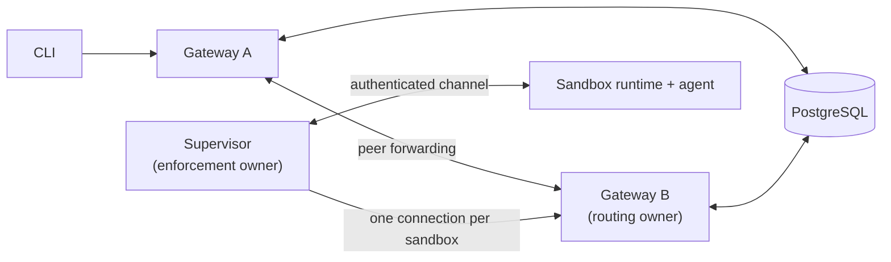
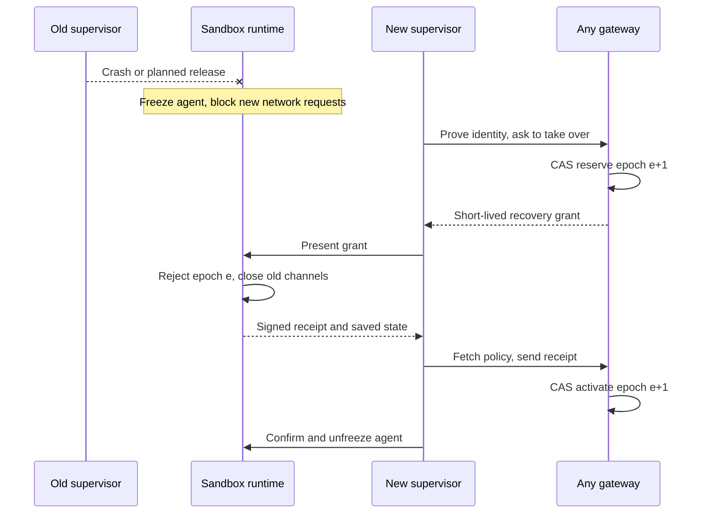
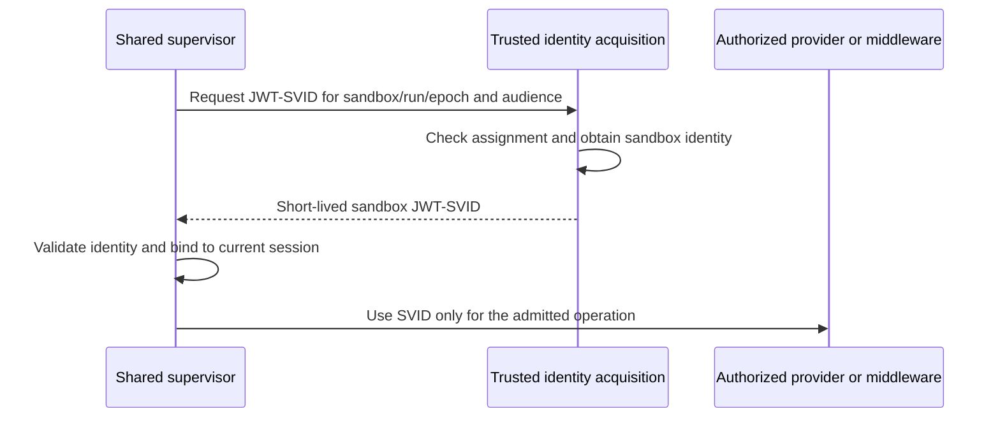

---
authors:
  - "@FrostGod"
state: draft
links:
  - https://github.com/NVIDIA/OpenShell/issues/4311
  - https://github.com/NVIDIA/OpenShell/issues/2385
  - https://github.com/NVIDIA/OpenShell/pull/3661
---

# RFC 0018 - Multi-sandbox and HA Supervisors

## Summary

This RFC proposes four ways to deploy supervisors so that one supervisor can watch several sandboxes and a failed supervisor can be replaced: per workspace, per node, per sandbox, and per gateway. It does not pick one yet. One goal of this RFC is to compare the four models and decide which to implement.

All four models share the same safety rules, listed here:

- One supervisor process can look after one sandbox or several.
- Each sandbox keeps its own policy, credentials, runtime connection, gateway session, and resource limits. Sharing a supervisor does not merge sandboxes or their permissions.
- Each sandbox has only one active supervisor at a time. Before a replacement takes over, the old supervisor must lose its power to act. This is called fencing.
- A replacement can keep the agent process running only if the sandbox runtime can safely recover. Otherwise, recovery starts a fresh sandbox run.
- If only a gateway fails, the supervisor reconnects to another gateway. This does not require replacing the supervisor or restarting the agent.

## Motivation

Today, Kubernetes runs the workload and the supervisor in separate Pods. Gateway HA handles a gateway failing. It does not replace a failed supervisor while keeping its workload running. Sharing supervisors would save Pods, but one failure would then affect more sandboxes.

Operators need to know three things: what fails together, what recovers without restarting the agent, and what isolation is left. The design must cover upgrades, crashes, network partitions, overload, and node loss. It must not promise connections that never drop, and it must not weaken enforcement.

### What the supervisor does

These duties apply to every deployment model, separately for each sandbox:

- **Prove who it is:** log in to the gateway and the sandbox runtime with credentials tied to that sandbox and run. Renew tokens and keep TLS connections trusted.
- **Keep the gateway link alive:** open the sandbox's control session, send heartbeats, receive connection requests, and reconnect when a gateway goes away or sends it elsewhere.
- **Load policy and configuration:** fetch, check, and apply approved policy, provider, and middleware updates, and report what is actually installed. It does not approve its own policy changes.
- **Start the agent safely:** attach to the chosen isolation backend, confirm the boundary and networking are ready, then ask the runtime to start the agent.
- **Decide which network requests are allowed:** check destinations against policy. Where configured, also check HTTP, API, and MCP operations, using the identity of the calling program that the runtime provides.
- **Provide the network path:** resolve DNS, open allowed connections upstream, proxy traffic, and run configured inspection and middleware. The agent does not get unrestricted direct network access.
- **Protect provider credentials:** fetch and refresh credentials and add them only to authorized requests. Prepare provider environment values for future commands only when explicitly configured.
- **Provide interactive access:** serve SSH, terminals, command execution, and file transfer. Ask the backend to run processes, carry I/O, resize terminals, and send signals inside the sandbox.
- **Forward allowed connections:** handle gateway relay requests and use the backend to reach services inside the sandbox without exposing the workload directly.
- **Report health and process state:** publish policy and provider readiness, endpoint observations, and the main process's exit result, so the gateway can show the real sandbox status.
- **Send audit and operational data:** forward logs and traces, record allow and deny decisions, and send activity summaries and policy-analysis proposals.
- **Manage its own sandbox lifecycle:** on exit or shutdown, close proxy and access tasks and release backend handles, without disturbing other sandboxes. The driver still cleans up infrastructure.

The sandbox runtime, not the supervisor process, owns the actual workload processes, the kernel isolation controls, and the checks of which executable is running. The runtime freezes or stops the workload when required supervision is lost. The gateway owns user authorization, policy approval, and durable control-plane state. Its compute driver creates and deletes runtime resources.

## Goals

- **Decide which deployment models to implement.** Compare the four proposed models (per workspace, per node, per sandbox, per gateway) on failure scope, recovery, isolation, Pod cost, and operating effort, and decide which to implement and which should be the default.
- **Define one set of safety rules** that every model follows, so the choice of model changes cost and failure scope but never weakens isolation.
- **Define how a failed supervisor is replaced**, and when the running agent can be kept.

## Non-goals

- Picking a model before it has been compared and tested. The four models below are proposals.
- Saving or live-moving agent memory from a failed node.
- Moving existing TCP, SSH, forwarding, or upstream HTTP connections to another supervisor.
- Running arbitrary external side effects exactly once.
- Backend-initiated suspend and wake ([#4352](https://github.com/NVIDIA/OpenShell/issues/4352)). This is a separate task, but the design leaves room for it: suspend can act as a planned release and wake as a new assignment.
- Removing the trusted sandbox runtime, the outer network fence, or per-sandbox authorization.

## Proposal

### 1. Four proposed models

Each deployment answers two questions: **where the supervisor runs** (per workspace, node, sandbox, or gateway) and **how a sandbox recovers** when its supervisor fails (restart or resume). The models are candidates to compare, not a decision. All four follow the safety rules in sections 2 to 5.

| Model | One supervisor serves | Good | Hard |
| --- | --- | --- | --- |
| Per workspace | A pool for one workspace | Trust and quotas stay inside the workspace. Fewer Pods. | One failure hits the whole pool. Small workspaces pay for spare capacity. |
| Per node | The sandboxes on one node (DaemonSet) | Traffic stays on the node. Pod count follows node count. | One failure hits the node, possibly across workspaces. No ready standby on the node. Fits poorly with backends that move sandboxes between nodes. |
| Per sandbox (today) | One sandbox, with an optional warm standby | Smallest failure. Simplest isolation. | Most Pods. Slow cold start. |
| Per gateway | A group tied to one gateway replica | Easy to run as a group. | Gateway rollouts and scale-in also move the group. Needs its own identity and spare capacity. |

In every model, supervisors run outside the gateway process and Pod: they parse traffic the agent controls, and the gateway Pod holds the signing keys.

Terms used below:

- **Workspace:** an OpenShell grouping, not always one Kubernetes namespace. Assign supervisors by immutable IDs, never by names, Pod IPs, or namespace.
- **Supervisor replica:** one real process or Pod. Inside it, each sandbox gets its own **session** with its own policy, credentials, gateway connection, queues, and cleanup.
- **Restart:** stop the old run and start a new one. Persistent files survive; process memory does not. This is how recovery works today.
- **Resume:** keep the agent's processes, freeze them briefly while a new supervisor takes over, then continue. Open network connections still break. If the node or runtime is lost, only restart is possible.

### 2. Two kinds of owner

Each sandbox has two owners that change independently:

- **Routing owner:** the gateway replica holding the sandbox's connection, which the supervisor opens. CLI requests reach the sandbox through it. It moves when gateways restart or rebalance (PR #3661). This already works.
- **Enforcement owner:** the one supervisor allowed to apply the sandbox's policy. It moves only when a supervisor is replaced. This RFC adds it.

A shared supervisor keeps a separate gateway connection for each sandbox, so sandbox A's connection may sit on gateway 1 and B's on gateway 2. The gateway never connects to the workload, and the workload never connects to the gateway.

A new per-sandbox record, `SupervisorAssignment`, names the enforcement owner. Gateways store it in PostgreSQL; supervisors and runtimes never talk to the database. It has a **lease**, a time limit on the owner's right to enforce that the owner renews through its gateway, and an **epoch**, a counter that goes up by one at every owner change. Gateways update it with compare-and-swap (CAS), a write that fails if someone changed the record first. The gateway's owner record carries the same epoch, and anything from an older epoch is rejected: relays, policy acknowledgements, readiness reports, and late cleanup. The same CAS also issues a new `gateway_token_id`, so the old supervisor's token stops working even though resume keeps the run.

This must work in both config modes. In **poll** mode (today's default), the supervisor fetches policy and credentials with its token, so the new token ID cuts the old owner off. In **push** mode ([#4320](https://github.com/NVIDIA/OpenShell/pull/4320)), the gateway sends them down the already-open session, so the CAS must also close every session from an older epoch. In both modes, the new supervisor first receives its config on a session at the reserved epoch, with no relays, and acknowledges it before activation.

**Ready** has one meaning: policy loaded, network mediation running, ownership current, gateway connected, and enforcement confirmed by the runtime. As today, a sandbox stays Ready through a graceful gateway handoff.

Any gateway can pick a replacement: a healthy, compatible candidate with free capacity. Healthy assignments stay where they are. This uses neither the gateway hash ring nor a global lock.

### 3. Safe handover (fencing)

The rule: **before a new supervisor acts, the old one must be unable to act.** This is called fencing.

Today a sandbox can only reconnect to the same supervisor process (RFC 0012), and the Kubernetes driver ties each sandbox to one supervisor Pod. Replacement therefore needs protocol and authorization changes, not just a new Pod template. Backends add an optional, versioned recovery extension; backends without it keep restart only.

How it stays safe:

- **Identity is checked.** The gateway's compute driver (for Kubernetes, `openshell-driver-kubernetes`) verifies the candidate's service account token with the Kubernetes TokenReview API and checks that the candidate may serve this sandbox; labels, namespace, and reachability prove nothing. The gateway then issues a short-lived `RecoveryGrant` bound to the candidate's key, sandbox, run, and new epoch. Launch credentials never authorize a takeover, and each candidate gets new TLS keys.
- **A missing heartbeat is not proof.** A new owner is reserved only after the old one released, its lease expired, or the runtime proved it cut the old one off.
- **The runtime enforces it.** It accepts only the newer epoch, closes old channels, and stays frozen until activation. A database row alone cannot stop a live socket.
- **If in doubt, stop.** If the runtime cannot freeze or verify enforcement, it stops the agent.

**Timing.** When the supervisor disconnects, the runtime freezes the agent and waits 30 seconds. If no authorized supervisor connects in time, the runtime ends the workload and the sandbox restarts as a new run. The gateway owner record takes 45 seconds to expire, so takeover moves the epoch instead of waiting:

`detect + fence + start candidate + restore state + confirm + margin < recovery window`

The 30-second window is today's fixed value and is tentative here. Make it configurable, and tune it from measured recovery times.

**A database outage never stops running sandboxes.** The lease is new, applies only to runs with resume enabled, and is checked only when a takeover is needed. The real fence is the runtime: it freezes the agent as soon as its supervisor disconnects. So while PostgreSQL is down, sandboxes with a connected supervisor keep running, and only takeovers wait. Restart-only runs have no lease and behave as today. The database must never reuse an epoch, even after failover or restore.

### 4. What survives, and what stays isolated

A new supervisor starts with an empty memory. It learns what is running from the sandbox runtime, which already tracks the agent's processes and commands, and gets the policy from the gateway. It never trusts what the agent says. If it cannot get back the policy version or the list of trusted programs, it refuses to resume.

During resume:

- A command the user ran (`openshell exec`) is never started a second time.
- Output lost during the switch is marked as cut off.
- Open network connections are closed, not replayed.
- Credentials are fetched again from the gateway.

| Today | Change | Still guaranteed |
| --- | --- | --- |
| One supervisor Pod per sandbox | Shared replicas plus per-sandbox assignments | Authorization is exact per sandbox and run. |
| Reconnect only to the same process | Takeover with a fresh grant and fencing | Never two owners. Launch tokens cannot take over. |
| Supervisor state only in memory | The runtime keeps what a new supervisor needs: running commands, policy version, trusted programs | No older policy comes back. No command runs twice. |
| Deleting a sandbox deletes its supervisor Pod | Deleting a sandbox closes only its session in the shared supervisor | Deleting one sandbox cannot affect another. |

- **Isolation does not get weaker.** No privileged Pods, host namespaces, or extra capabilities. Seccomp stays in the runtime. Anything needing more privilege gets its own security review.
- **The network fence needs work.** Today a Kubernetes NetworkPolicy lets only supervisors in the sandbox's own namespace reach it. A per-node or per-gateway supervisor usually lives in another namespace, so it would be blocked. Changing that policy in place stops every sandbox in the namespace, so each model needs its own reviewed policy instead.
- **One IP for many sandboxes.** All traffic from a shared supervisor leaves from one Pod IP. Outside firewalls and logs can no longer tell sandboxes apart by IP.
- **Sharing a process.** Each sandbox still gets its own policy, credentials, connections, logs, and limits inside the shared supervisor. A bug or compromise in that process can still reach every sandbox it serves, which a separate Pod would prevent.

### 5. Workload identity

These requirements apply to shared supervisors; they do not change identity acquisition for dedicated supervisors. Each sandbox MUST retain its own workload identity, even when sandboxes share a Kubernetes service account. A supervisor's service identity MUST NOT substitute for a sandbox's identity.

The supervisor requests a short-lived, audience-specific JWT-SVID on demand through a trusted identity-acquisition interface. The interface authorizes the requesting supervisor for the sandbox, run, and current ownership epoch. Direct [SPIFFE Workload API](https://spiffe.io/docs/latest/deploying/svids/) access occurs in a trusted component in the Sandbox Pod, which obtains the sandbox's SVID and returns it over the authenticated, encrypted runtime channel. The supervisor initiates that channel today; this proposal does not assume an existing sandbox-side gRPC client. Delegated acquisition is another option, but its authority and workload binding require separate review; node-wide delegation must not be treated as authorization for only the supervisor's assigned sandboxes.

The acquisition mechanism is backend-specific. Kata's host-to-guest UDS limitation is independent of supervisor topology. For example, a [Teleport bot](https://goteleport.com/docs/reference/machine-workload-identity/workload-identity/workload-identity-api-and-workload-attestation/) sidecar inside the Kata VM can expose a guest-local Workload API socket. This requires sandbox-scoped issuance authority and protection of the socket, bot credentials, and configuration from agent processes. This is a deployment option to validate, not a requirement to adopt Teleport. Sharing a Pod or UID does not establish runtime/agent separation; each backend must demonstrate that boundary without relying on a blanket denial of all agent Unix-socket use.

The supervisor MUST validate the SVID's signature, trust domain, validity, audience, and expected sandbox identity. When the gateway accepts an SVID for credential exchange or another sandbox operation, it MUST independently validate it and match its subject to the sandbox authenticated by that session. The expected identity mapping comes from trusted control-plane state, not caller-supplied IDs or headers. Both checks bind use to the current sandbox/run and ownership epoch. The acquisition and exchange protocols must specify the SVID form and required proof; an X.509-SVID certificate alone is not proof of possession, and private keys MUST NOT be forwarded to a shared supervisor.

Trusted middleware and other request handlers may use this interface when explicitly authorized. For example, a middleware can inject the sandbox's JWT-SVID into a configured `X-Workload-SVID` header so a receiving service or middleware can validate the workload identity and authorize it. The audience identifies that verifier. Acquisition and injection follow policy admission, remain bound to the configured destination, and replace any agent-supplied value for that header. SVIDs and reusable credential handles MUST NOT enter agent-visible state or responses, or appear in logs or traces. A required identity acquisition or validation failure prevents forwarding.

Cache SVIDs and exchanged credentials separately by sandbox/run, ownership epoch, provider or authorized handler, and audience, never beyond their validity. Refresh on demand before expiry. After handover, the replacement supervisor re-establishes the current identity binding before acquiring or using credentials; an old epoch cannot continue acquisition or reuse cached authority. Missing, expired, or mismatched identity fails closed without falling back to another sandbox or the supervisor's identity. Workload identity does not replace the recovery grants or fencing rules in section 3.

### 6. Operator settings, capacity, and failures

New settings choose the model, recovery mode, allowed fallbacks, spare capacity, per-sandbox quotas, and drain and recovery time limits. A workload's policy cannot widen them. Each run records the settings it started with, and operators see the effective mode. A failed resume starts a fresh run by default; ending the sandbox instead is an explicit operator choice.

- **Pod count:** about `N + R` for `N` sandboxes and `R` shared supervisors, versus `2N` today or `3N` with warm standbys. The number of gateway connections, `M`, stays one per sandbox (`M = N`), however small `R` is. If idle sandboxes release their sessions, size by active sandboxes.
- **Relay limits:** each gateway replica allows 256 unclaimed relays and each sandbox 32. The 32 cap only isolates a stuck supervisor that serves one sandbox, so add a gateway-side cap per supervisor replica.
- **Capacity planning:** cover sessions, throughput, memory, file descriptors, bandwidth, and the largest group that fails together. Spare capacity must be usable by the affected workspace. If the failure budget cannot be met, reject the sandbox or mark HA as degraded.

| Event | What happens |
| --- | --- |
| Gateway fails or rolls out | The supervisor moves each sandbox's connection to another gateway. The sandbox itself never connects to a gateway. No supervisor change, no agent restart. If a per-gateway group is drained with its gateway, follow the supervisor upgrade row. |
| Supervisor crashes; runtime alive | Freeze, fence, then resume if supported and in time. Otherwise restart or stop, per policy. |
| Network partition | No takeover without fencing. The old owner's lease expires. Direct workload egress is never opened. |
| No suitable candidate | Retry within limits and report degraded. Never widen scope or switch backend. |
| Workload node or runtime lost | Restart if policy allows. Process memory is lost. |
| Workload node drain | Draining evicts the workload Pods too, so this is the node lost case in every model. |
| Supervisor upgrade, scale-in, or drain of a supervisor-only node | Stop new assignments, hand each session over with fencing within the grace period, then stop. |
| Sandbox stop or delete, or authority revoked | Cancel grants. Cleanup wins over a pending recovery and does not touch other sessions. |

Operations notes:

- Draining a gateway does not drain supervisors, and the reverse.
- A per-node supervisor uses a supervisor on another node only if the operator allows it.
- Spread supervisors across nodes and reserve resources for them. Extra Pods during an upgrade do not replace a standby for crashes. Pod disruption budgets do not prevent crashes ([Kubernetes disruptions](https://kubernetes.io/docs/concepts/workloads/pods/disruptions/)).
- Show operators who owns each sandbox, how recoveries went, and spare capacity. Keep sandbox IDs out of metric labels.
- Measure how long agents stay frozen, and publish recovery times for each backend.

### 7. Who does what, and compatibility

- **Gateway:** assignments, grants, and routing.
- **Compute driver:** creates candidates and does fenced cleanup. Its reconciler, which today suspends a sandbox whose dedicated supervisor Pod is missing or replaced, must read `SupervisorAssignment` instead, under a fenced singleton lease.
- **Runtime and backend:** fencing and process state.
- **Supervisor:** separate per-sandbox contexts and approved configuration.
- **Controllers and Helm:** pools, placement, resources, and disruption settings, with no power to authorize a takeover.

This work targets the Kubernetes driver only, and all of it sits behind a Kubernetes driver feature flag that is off by default. Existing installations keep today's behavior (per sandbox, restart only) unless operators opt in. Mixed versions reject resume they do not support, and a running sandbox keeps the mode it started with. Docker, Podman, VM, and MXC keep current behavior until each passes the conformance tests.

## Implementation plan

1. Agree on the shared safety rules, and change RFC 0012 so a different supervisor can take over a sandbox.
2. Build takeover with one supervisor per sandbox first, so sharing cannot hide ownership bugs.
3. Prototype the four models and test their failure cases on a multi-node cluster, with a security review.
4. Measure recovery time and noisy neighbors, then **decide which models to implement** and which is the default. Record the decision in this RFC.
5. Release the chosen models behind opt-in settings, with docs and a rollback path.

Some details are left to implementation and are out of scope for this RFC: how a per-node supervisor is bound to a sandbox, whether the lease is per replica or per sandbox, how launch material reaches a shared or replacement supervisor, and how the lease is renewed.

## Risks

- Shared processes widen the damage from a compromise or a crash. Scope separation and quotas reduce accidental interference, but some deployments may still need dedicated supervision.
- During a PostgreSQL outage, a supervisor that fails cannot be replaced, so its sandboxes fall back to restart. Longer leases slow down takeover; shorter leases need more renewals. Benchmark and check the full timeout budget.
- Recovering security and execution state is much harder than reconnecting a stream. If the state cannot be trusted, resume must be refused, even if restarting is inconvenient.
- Comparing four proposed models makes the matrix of configurations to support and test larger. Release only combinations that have been validated, and show which guarantees are not met. A higher replica count is not proof of HA.

## Alternatives

- **Restart-only recovery:** works for all four deployment models without keeping the agent's process. It is simpler when restarting the workload is acceptable, but it does not recover a running process.
- **Rely on Kubernetes restarts alone:** brings Pods back, but it does not get around authorization that is tied to a process, and it does not recover the state of a running boundary. It cannot give safe resume on its own.
- **Active-active supervision of one sandbox:** creates conflicting owners of policy, processes, and credentials. Active-active pools across different sandboxes are still supported. Two owners of the same boundary at once are not.
- **An external proxy or shared service without the supervisor contract:** can centralize upstream networking, but it cannot replace process operations, executable identity, gateway sessions, and boundary enforcement.

## Related work

- [Issue #4311: Multi-sandbox and HA Supervisors](https://github.com/NVIDIA/OpenShell/issues/4311): the original work item for supervising many sandboxes and for high availability.
- [RFC 0012: Isolation Backend](https://github.com/NVIDIA/OpenShell/blob/e1f3c82caa3ed3b65de22889ae7ef32a774878ef/rfc/0012-isolation-backend/README.md): roles that do not depend on placement, strict isolation for each boundary, and today's same-process recovery limit. This draft extends recovery. It does not change the enforcement rules.
- [Kubernetes driver](https://github.com/NVIDIA/OpenShell/blob/e1f3c82caa3ed3b65de22889ae7ef32a774878ef/crates/openshell-driver-kubernetes/README.md) and [runtime authentication](https://github.com/NVIDIA/OpenShell/blob/e1f3c82caa3ed3b65de22889ae7ef32a774878ef/crates/openshell-sandbox-backend/src/sandbox_auth.rs): today's Pod identity and the limits on replacement processes.
- [Gateway HA documentation](https://github.com/NVIDIA/OpenShell/blob/e1f3c82caa3ed3b65de22889ae7ef32a774878ef/docs/kubernetes/high-availability.mdx) and [PR #3661](https://github.com/NVIDIA/OpenShell/pull/3661): placement of gateways by hashing, and durable routing ownership. Do not confuse these with enforcement ownership.
- [Issue #2385](https://github.com/NVIDIA/OpenShell/issues/2385): an earlier proposal for shared supervision, with Pod-density requirements.

## Open questions

- Which of the four proposed models should we implement, and which should be the default?
- What capacity and recovery targets must each of the four models meet, and in what order should they be delivered?
- What lease, clock-skew, startup, and recovery limits can be reliably reached?
- Which local-node and gateway-group affinity rules may operators relax?
- Which security and execution state must be saved before resume is safe?
- Is the exposure from a compromised shared process acceptable, or do we need separate worker processes?

## Verdict

We are not picking one model over the others. Teams have different requirements for failure scope, isolation, and security, so one choice cannot fit every deployment. All four models share the safety rules in this RFC, so adding a model later does not change those rules.

Implementation starts with the per-gateway model, which is already in progress. We will add the per-node, per-workspace, or warm-standby per-sandbox models when a deployment needs them, each behind its own opt-in setting and only after it passes the failure tests.
