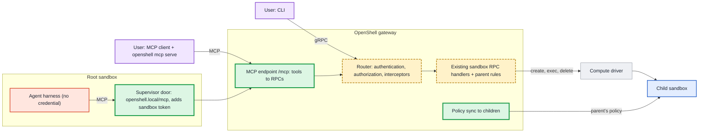

---
authors:
  - "@patkraw"
state: review
links:
  - https://github.com/NVIDIA/OpenShell/issues/4574
  - https://github.com/NVIDIA/OpenShell/pull/4721
---

# RFC 0021 - Sandboxed Subagents

## Summary

This RFC lets a sandbox have child sandboxes, so an agent can hand work to a
sub-agent or a tool that runs in its own isolated sandbox. Today a lead
agent's workers run inside the lead's sandbox and share its files,
credentials and network access. With child sandboxes, each worker gets its own
filesystem and processes, while the gateway keeps every child within what its
parent is allowed to do.

A user creates a child from the CLI with
`openshell sandbox create --name worker1 --parent lead`. An agent inside a
root sandbox creates one through a small set of MCP tools at
`http://openshell.local/mcp`, with no token: the sandbox's supervisor
identifies it. The tools let the agent create, list and delete its children,
run commands in them, wait for long-running jobs and read their logs. Users
can call the same tools from the host through `openshell mcp serve`, a local
bridge that reuses their CLI login.

The design is deliberately small. Trees are one level deep: only a root, a
sandbox without a parent, can be a parent. A child always uses its parent's
policy, which the gateway copies at creation and keeps in sync, and gets a
subset of its parent's providers, so taking access away from the parent takes
it away from its children too. An agent cannot pick an image, but it can pick
a template that a user has marked for agents. Each root may have a limited
number of children, and a parent cannot be deleted while it has children. The
MCP tools are built on the existing sandbox RPCs and go through the gateway's
normal authorization path. The feature is experimental and off unless the
operator enables it. A child cannot yet have a narrower policy than its
parent; that is the planned next step.

## Motivation

Agent harnesses split work across sub-agents: a lead agent plans the work and
hands parts of it to workers. Today those workers run inside the lead's
sandbox, as threads or processes next to it, so they share its files,
credentials and network access.

We want each sub-agent to run in its own sandbox. That needs three things
OpenShell does not have today:

- **A way for an agent to create a child.** Only users can create sandboxes
  today. An agent inside a root sandbox gets a small set of MCP tools to create
  children, run work in them and collect the results.
- **A relationship between sandboxes.** A sandbox can record a parent. For now
  a parent's children cannot have children of their own, so trees are one
  level deep.
- **The same workflow for users.**
  `openshell sandbox create --name worker1 --parent <name>` works like creating
  any other sandbox, with the same options. Users who work through an MCP
  client can do the same with the MCP tools.

Starting with one level keeps the design small, so we can learn how sandboxed
sub-agents are used before adding deeper trees or finer-grained permissions.

## Non-goals

- **Deeper trees.** A child cannot create children, and every child is an
  ordinary sandbox, whatever runs in it. Deeper trees are future work.
- **A child policy different from its parent's.** Children cannot narrow or
  widen the parent's policy, or propose changes to it, in this version; a
  change to the parent's policy reaches every child. Narrowing is planned for
  v1.
- **Choosing any image from inside a sandbox.** An agent's children copy its
  image and resources, or come from a template an administrator has approved
  for agents.
- **Copying the parent's files into a child.** A child starts from an image,
  not from a copy of its parent's workspace. Files move between them only
  through commands run with `exec`, for example a tar archive sent on stdin.
- **Storing results in the gateway.** A child's output stays in the child until
  its parent reads it.
- **Deciding when to use sub-agents.** OpenShell does not change how a harness
  splits work or turn off its built-in sub-agents. The agent decides when to
  create a child.
- **Messaging between agents.** How running agents talk to each other is a
  separate proposal.

The review on this pull request and in the design document shaped these
choices; the [decision record](appendices/decision-record.md) lists each one
and who proposed it.

## Proposal

### Overview

A sandbox without a parent is a root; a sandbox with one is a child. Children
are ordinary sandboxes, with the same lifecycle, commands and policy
enforcement, except for these rules:

- **Parent link:** a sandbox gains a read-only `parent` field, and a create
  request can name a parent.
- **One level deep:** only a root can be a parent.
- **Policy:** a child always uses its parent's policy. The gateway copies it
  into the child at creation and keeps it in sync.
- **Providers:** a child gets a subset of its parent's providers.
- **Image:** an agent cannot choose an image. It can choose a template that a
  user has marked for agents; otherwise the child copies its parent's image.
- **Limits:** each root may have a limited number of children, and a parent
  cannot be deleted while it has children.
- **Off by default:** the feature is experimental and off unless the operator
  sets `experimental_enable_child_sandboxes`.

Three kinds of caller create and manage children, and all of them end up in
the existing sandbox RPCs:

- **A user with the CLI** runs
  `openshell sandbox create --name worker1 --parent <name>` and the other
  sandbox commands as today.
- **A user with an MCP client** on the host runs `openshell mcp serve`, a local
  bridge that reuses the CLI login, and calls the MCP tools.
- **An agent inside a root sandbox** calls the MCP tools at
  `http://openshell.local/mcp`. Its supervisor attaches the sandbox's token, so
  the agent never holds a credential, and the gateway treats the sandbox as the
  caller.



The MCP endpoint adds no new authority. It turns each tool call into the
matching sandbox RPC and sends it through the same router as any gRPC call, so
authentication, authorization and operator interceptors apply to every
caller. A user can do through MCP exactly what the CLI allows. A sandbox can
act only on its own children.

### Parentage

A child records its parent in one gateway-owned, read-only field on the
sandbox, next to `created_from_workload_template`:

```proto
message Sandbox {
  // ... existing fields ...
  // Set by the gateway when the sandbox is created as a child. Absent on roots.
  // Never changes after creation.
  SandboxParent parent = 21;
  // Set by the gateway at creation: the user who created it, or
  // `sandbox:<id>` when a root sandbox created it through MCP. Never changes
  // after creation. Empty when another principal, such as an operator,
  // created it, and on sandboxes created before this field.
  string created_by = 22;
}

message SandboxParent {
  string name = 1;  // the parent's name, for display
  string id = 2;    // the parent's id; names can be reused after a delete
}

message CreateSandboxRequest {
  // ... existing fields ...
  // Name of the root sandbox to create this sandbox under.
  string parent = 10;
}
```

The gateway stores the parent's id so that deleting a parent and creating a
new sandbox with the same name never re-attaches the old children. Older
records have no `parent` field and are read as roots, so no migration is
needed.

When a request names a parent, the gateway checks, in order:

1. Child sandboxes are enabled on this gateway.
2. The parent exists and is in the same workspace.
3. The parent is not being deleted.
4. The parent has no parent of its own. Otherwise the request fails with
   "only one level of child sandboxes is supported".
5. The request carries no policy (see [Policy](#policy)).
6. Any providers named are attached to the parent (see [Providers](#providers)).

Under the lock on the parent, the gateway checks the parent and the providers
again, so a parent deleted or changed meanwhile is refused with "parent
sandbox '<name>' is no longer available", and then checks that the parent
has fewer children than `max_concurrent_children` (see
[Gateway configuration and limits](#gateway-configuration-and-limits)).

**Who sets the parent.** For a user, `parent` is optional: without it the
request creates a root, as today. For a sandbox calling through MCP, the
gateway sets `parent` to the calling sandbox, taken from its token. A sandbox
cannot name a different parent and cannot create a root, so an agent cannot
escape the one-level limit by leaving `parent` out.

**From the CLI**, `--parent` works with every other `sandbox create` option:

```shell
openshell sandbox create --name lead --from codex-agent:local \
  --provider openai --provider anthropic --policy team.yaml
openshell sandbox create --name reviewer --parent lead \
  --from claude-agent:local --provider anthropic --cpu 2 --memory 4Gi
openshell sandbox create --name nested --parent reviewer
# error: only one level of child sandboxes is supported
```

`openshell sandbox list` shows each sandbox's parent, and
`openshell sandbox list --parent lead` lists one parent's children.

**Children created by agents and by users.** A child can be created by a user
(CLI, SDK or MCP) or by its parent sandbox (MCP). The two differ only in what
the creator may choose:

| | Created by the parent sandbox (MCP) | Created by a user (CLI, SDK or MCP) |
|---|---|---|
| Create inputs | `name`, and optionally `template` and `providers` | CLI: every `sandbox create` option except a policy; MCP: `name`, `parent`, `image`, `providers` |
| Image and resources | Copied from the parent, or from a template approved for agents | Chosen by the user; default as for any sandbox |
| Providers | All of the parent's, or a subset | All of the parent's, or a subset |
| Main command | None; always idle | Optional; idle without one |
| Parent | Always the caller | Any root the user can access |
| Retry with an existing name | Returns the child with `already_existed: true` | MCP: returns the sandbox with `already_existed: true`; CLI: "already exists" error |
| Creator check | The root's `created_by` user is rechecked | The user is checked as the caller |

After creation, both are the same kind of child: the same policy sync,
lifecycle, limits and parent link. The audit log records which path created
each child.

Agents get fewer choices because an agent can be steered by content it reads,
while a user is accountable for what they create. A free choice of image would
let an agent run any code from any registry with the parent's provider
credentials; free resources would let it exhaust the cluster, since the limit
counts children, not their size; free labels and environment could spoof what
operators and interceptors match on or override what the sandbox relies on;
and a main command would end the child before its results can be collected.

**Templates give agents a choice of image without a free choice.** A lead
often needs children that run different harnesses, and installing every
harness in one image gives every child all of them. An agent can instead name
a sandbox workload template, which holds an image, environment and resources
but no policy. Only templates that an administrator labels
`openshell.ai/agent-usable: "true"` are accepted from agents, and templates
with driver configuration are refused, because driver
configuration can change how the runtime isolates the sandbox. Templates are
created by workspace administrators, so an agent can only pick from images a
person approved. Operator interceptors still see the resulting create request,
so rules such as allowed images apply as they do to any create. An agent
does not need to be told the names: `tools/list` offers the templates it may
use on `create_sandbox`, up to 50, as the allowed values of `template` and,
in the tool's description, each template's name with its image.

**No GPU without a template.** A child created without a template copies the
parent's image, CPU and memory, but not a GPU. A child that needs a GPU comes
from an approved template that asks for one. With or without a template, a
child created by an agent keeps its root's runtime class and user namespaces,
so a template cannot weaken how the child is isolated.

**Agents can narrow their children's providers.** A child created by an agent
gets all of its parent's providers unless the agent names a subset, so each
child can hold only the credentials its harness needs. Naming a provider the
parent does not have is refused, as it is for users. A subset can only remove
access, so it needs no further check.

```text
create_sandbox {name: "reviewer", template: "claude-agent", providers: ["anthropic"]}
create_sandbox {name: "coder", template: "codex-agent", providers: ["openai"]}
```

### Policy

A child always runs under its parent's policy. It has no policy of its own to
set, edit or widen. The [policy sync appendix](appendices/policy-sync.md)
diagrams the flow and its edge cases.

**At creation** the gateway copies the parent's current policy into the
child's policy history and records which parent version it came from, for
example "copied from `lead` version 7". A request that carries a policy for a
child is refused with "a child sandbox uses its parent's policy; omit the
policy". This applies to the SDKs; the CLI refuses `--policy` with
`--parent` before sending. MCP's `create_sandbox` has no policy argument, so
a call that passes one is refused as not available over MCP. The CLI also
ignores the `OPENSHELL_SANDBOX_POLICY` environment variable when `--parent` is
set and prints a one-line note, so a policy left in the user's shell does not
cause a confusing error.

**When the parent's policy changes**, the gateway copies the new version into
each child and delivers it the same way it delivers any policy update. One
function does this: for each child, compare the parent version it was copied
from with the parent's latest version, and copy and deliver if the child is
behind. The write is conditional on the child's recorded parent version, so a
child only ever moves forward: a slow or repeated run can never replace a newer
copy with an older one, and running it twice changes nothing. The gateway runs
it after the parent loads a new policy, at gateway start, and when a child's
supervisor connects.

**Delivery checks the parent itself**, so a child's safety never depends on a
sync reaching it. Every time the gateway builds a child's configuration or
provider credentials, it reads the parent's record. It refuses the child,
which then denies all new network access, while the parent is missing, is
blocked, or has loaded a version the child's copy has not reached; that
refusal also starts a sync for the child. It serves the child only the
providers both the child and the parent have. Every supervisor's
configuration is rebuilt at least every 30 seconds, so a missed or failed sync
is retried that often with no separate retry loop.

```text
lead:      v6 ──── v7 ──────────── v8
reviewer:  v1 (from lead v6) ─ v2 (from lead v7) ─ v3 (from lead v8)
```

Each child keeps its own history and its own load status, so a child that
fails to load a version never marks the parent's version as failed, and the
reverse. Delivery is asynchronous, as it is for every sandbox today: a child
normally applies a new version within seconds of the parent. After a parent
policy change, a child may be refused, with no new network access, until the
copy lands and its configuration is rebuilt; at most about 30 seconds. A parent's policy follows the existing rules for
running sandboxes: Landlock and process rules cannot change after creation, and
filesystem rules can only gain paths, which take effect on the next start.
Because children only receive versions their parent accepted, the same limits
hold for children.

**Children cannot change their policy.** The gateway refuses policy updates
addressed to a child, from any client. At startup a supervisor normally adds
required filesystem paths to its policy and writes the result back to the
gateway. For a child the gateway answers that write with success and stores
nothing, and the supervisor re-reads the stored copy, so the child keeps
exactly its parent's policy. Supervisors need no change for this. A path the
child's image needs but the parent's policy lacks is therefore not added.

**Children always fail closed.** If a child cannot load its copy, it denies
all new network access, whatever failure mode the gateway uses for other
sandboxes: a child that kept an older copy could keep access its parent just
lost. If a parent under `fail_closed` rejects a new policy and blocks all new
access, its children are blocked too, and new children cannot be created,
until the parent loads a fixed policy. A parent that keeps its last valid
policy instead keeps its children on their last copy.

**Children cannot request more access.** A child's policy proposals through
`policy.local` are refused with "child sandboxes use their parent's policy;
change the parent's policy instead". Denials are still logged on the child, so the lead
or a user can see what it needed. The lead can propose a change to its own
policy; once approved, it reaches every child. A global policy, when active,
applies to parents and children as it does to every sandbox today.

**Trade-off.** Because children share their parent's policy, the parent must
hold every permission any of its children needs, even ones the parent never
uses. Narrowing a child's policy at creation, planned for v1, lets a child
have less than its parent but does not remove the parent's access. A policy for
a whole tree or group of sandboxes, which could, is future work.

### Providers

A provider holds a credential, such as a model API key, that the supervisor
adds to a sandbox's outgoing requests, and attaching one also opens the network
to that provider's endpoints. Children can use only providers attached to
their parent.

- **From the CLI**, `--parent` without `--provider` attaches all of the
  parent's providers. Naming providers picks a subset. Naming a provider the
  parent does not have is refused.
- **Through MCP**, a child created by a sandbox gets all of the parent's
  providers unless the sandbox names a subset. A user calling through MCP can
  pick a subset, as with the CLI.

```shell
# lead has openai and anthropic
openshell sandbox create --name reviewer --parent lead --provider anthropic
openshell sandbox create --name helper --parent lead --provider github
# error: provider 'github' is not attached to parent 'lead'
```

When the parent's providers change:

- **The parent loses a provider:** its children lose it too. Provider changes
  are not policy versions, so the sync compares each child's providers with the
  parent's separately and detaches any the parent no longer has. Revoking a
  credential on the lead therefore reaches the whole tree.
- **The parent gains a provider:** existing children are unchanged. New
  children get it.
- **Attaching a provider to a child later** follows the same rule as at
  creation: only providers the parent has.

Because each child's providers add their own endpoints to its effective
policy, a parent and a child that use different providers can have different
effective network rules while sharing the same authored policy.

### MCP endpoint and tools

The gateway serves an MCP endpoint at `/mcp` on its existing port. It is one
MCP server with a fixed set of tools, not a proxy for other MCP servers. Each
tool call becomes the matching sandbox RPC and goes through the gateway's
normal router, so authentication, authorization and operator interceptors run
exactly as they do for gRPC. The router accepts a sandbox caller on these RPCs
only for requests that `/mcp` dispatches inside the gateway process; direct
gRPC calls from a sandbox stay refused (see
[Authorization and audit](#authorization-and-audit)).

**From inside a sandbox**, an agent calls `http://openshell.local/mcp`. The
sandbox's supervisor serves that address, the same way it serves
`policy.local`. It drops any credentials or identity headers the agent sent,
attaches the sandbox's existing session token and forwards the call to the
gateway. The agent never holds a token. Only roots can create children, but
every sandbox can reach the endpoint, so a child gets a clear refusal instead
of a connection error. The supervisor opens one gateway connection for the
door on first use and reuses it, with the token attached to each request, and
allows 8 door requests at a time; another gets `503` and should retry.

**From the host**, a user adds `openshell mcp serve` to their MCP client's
configuration. The client starts it as a local process, and it forwards each
message to `/mcp` over the CLI's own connection and login, acting in the
CLI's `--workspace`. This works with gateways that use mTLS client
certificates or the edge tunnel, which most MCP clients cannot use, and the
bridge refreshes an OIDC login for as long as it runs. Its stdout carries MCP
messages only. With no usable login it still starts and answers each call
with an error that says how to log in; it never starts an interactive login.
A call that the gateway rejects as unauthenticated is sent once more after a
refresh; nothing else is retried, because a tool call such as `exec` may
already have run.

```json
{"mcpServers": {"openshell": {"command": "openshell", "args": ["mcp", "serve"]}}}
```

**Tools.** Every caller sees the same six tools; whether a call is allowed is
decided when it is made. Arguments only users may send are described as
"(users only)", and `template` as "(sandboxes only)"; a caller that sends the
other kind gets a clear refusal. A sandbox's list also names its templates.

| Tool | What it does | RPC |
|---|---|---|
| `create_sandbox` | Create a sandbox and wait until it is ready, up to 45 s | `CreateSandbox` |
| `list` | List sandboxes and their state | `ListSandboxes` |
| `exec` | Run a command; with `background: true`, start a job and return its id | `ExecSandbox` |
| `wait` | Wait for a job, up to 40 s | `ExecSandbox` |
| `delete` | Delete a sandbox | `DeleteSandbox` |
| `logs` | Read a sandbox's logs, such as startup errors and policy denials | `GetSandboxLogs` |

What a caller can do depends on who it is:

- **A sandbox** acts only on its own children. `create_sandbox` takes a
  `name` and, optionally, a `template` and `providers`. Without a template the
  child copies the caller's image, CPU and memory; without `providers` it gets
  all of the caller's. Its parent is always the caller. `list` shows only its
  children, and `logs` returns only a child's own lines, not the gateway's
  lines about it. Its `tools/list` names the templates it may use on
  `create_sandbox`; a client that keeps its first tool list sees a template
  added later only after it reconnects.
- **A user** acts on any sandbox the CLI would let them act on, in the
  bridge's workspace. `create_sandbox` accepts `name`, `parent`, `image` and
  `providers`; without `parent` it creates a root. `list` accepts a `parent`
  to show one root's children. Other create options, such as `template`,
  `cpu`, `memory`, `env`, `labels`, `command` and `policy`, and `env` on
  `exec`, are refused with a pointer to the CLI in this version. Files can be
  placed in a sandbox over MCP with `exec` and stdin, for example as a tar
  archive.

**Tool descriptions.** The model learns how to use the tools from their MCP
descriptions, so these state what a model would not guess: work longer than
45 seconds needs `background: true`; a child runs one background job at a
time, so parallel work needs more children; `running` from `wait` means
call it again, not that the job failed; a child never contacts its parent on
its own, so results come only from `exec` and `wait`; and a child should be
deleted when its work is done. The `wait` description adds that job output is
the child's data.

**Retries.** If a sandbox calls `create_sandbox` with the name of a child it
already has, the gateway returns that child with `already_existed: true`, its
creation time and its state, and does not count it again. This makes a retry
after a lost reply safe, and tells the model when a name was already in use.
A name taken by any other sandbox in the workspace is refused with
`already_exists`; this tells a sandbox only that the name is in use, which it
needs to know to pick another. A user calling through MCP gets
`already_existed: true` for any sandbox of that name in the workspace. From the CLI the existing "already exists" error applies.

**Protocol.** The endpoint speaks the 2025 MCP revisions (2025-06-18 and
2025-11-25) that most harnesses use today, without MCP sessions, so any
gateway replica can answer any call. Replies are plain JSON. Every call ends
before the 60-second limit of the sandbox door and of common MCP clients: a
foreground `exec` stops waiting after at most 45 seconds plus a 5-second
grace, and `wait` polls at most 40, which leaves room for reading a finished
job's output. A job still running at the
end of a `wait` is reported as `running`, and the caller calls `wait` again. Streamed
progress and the 2026-07-28 revision are planned for v1.

### Running work and collecting results

A child that an agent creates through MCP always starts idle: its main process
is a shell that waits. All work runs through `exec`, so the child stays ready
and its files stay readable until it is deleted. A harness inside the child is
just a command, so a Codex lead can run Claude Code in a child as long as the
image contains it.

A user can give a child a main command, as with any sandbox; without one, the
child starts idle. When a main command ends, the sandbox completes and `exec`
and `wait` no longer work on it, as for any sandbox today, so a child whose
results are needed should start idle and run its work with `exec`.

**Short commands** run in the foreground. `exec` returns the exit code, stdout
and stderr. Each stream keeps its first and last 16 KiB, cut on character
boundaries, with a marker between them, because errors usually appear at the
end, and its `truncated` flag is set. The timeout is 30 seconds by default and
45 at most. A command that reaches it is reported as timed out, but it may
keep running in the child: the gateway's `exec` does not stop a command whose
caller has gone, today for any sandbox. The reply says so and points to
`background: true` for long work. Deleting the child stops everything;
stopping a timed-out command is future work.

```text
exec {name: "box", command: ["cargo", "test"]}
→ exit 0 · stdout: "test result: ok. 214 passed"
```

**Long work**, such as a sub-agent, runs as a background job. `exec` with
`background: true` returns a job id at once, and `wait` returns the job's
result in the same shape as a foreground `exec`, or `running` after its limit
(30 seconds by default, 40 at most) so the caller can call it again. A
background job has no time limit of its own; it runs until it ends or the
child is deleted. The job id is chosen by the gateway and the child together:
a number the child assigns, and a random part from the gateway, such as
`3-9f2c41ab`. A start retried after a lost reply is refused because a job is
already running, and the refusal names that job.

```text
create_sandbox {name: "reviewer"}
exec {name: "reviewer", command: ["claude", "-p", "Review the diff"], background: true}
→ job: 1-9f2c41ab · running
wait {name: "reviewer", job: "1-9f2c41ab"}
→ running
wait {name: "reviewer", job: "1-9f2c41ab"}
→ completed · exit 0 · stdout: the review
delete {name: "reviewer"}
```

The result is the harness's stdout. One-shot modes such as `pi -p`,
`codex exec` and `claude -p` print the final answer there, so the parent needs
no result file.

**Follow-up turns.** Each turn is a new background job in the same working
directory. The parent asks for structured output, keeps the harness's
conversation id and passes it to the next turn; OpenShell never stores
conversation ids. A child cannot ask its parent anything while a job runs: it
ends its turn with the question, and the parent answers in the next turn.

**How jobs work.** Every step is a short `exec` of a fixed script built into
the gateway. The caller's command reaches it as separate arguments and runs as
`"$@"`; it is never pasted into the script. A start claims the next job number
by creating `/tmp/openshell/jobs/<n>/`, starts the command detached with its
output in files, and returns at once. `wait` reads the job's state every two
seconds: **completed** when its exit file exists, **running** while its
recorded process is alive, and **lost** otherwise, for example after the child
restarted. A job id that names no job in the child, such as an earlier job
whose folder a later start removed, gets **not_found**. The
[background jobs appendix](appendices/background-jobs.md) gives
the details.

**One background job at a time.** Starting another while one is running is
refused with an error that names the running job; parallel work uses more
children. Foreground `exec` stays available while a job runs, for example to
`tail` its output, which `wait` does not return until the job completes. A
single job cannot be cancelled in this version; deleting or stopping the child
ends all of its work. `wait` only reads a job's state, so calling it again is
always safe.

Job output is written by the child, so the parent receives it as data from the
child, not as facts the gateway has checked. The gateway stores no output:
a job's result lives in the child and can be read until the next job starts
there or the child is deleted, which is one reason deleting a parent with
children is refused (see [Lifecycle](#lifecycle)). Jobs need a POSIX `sh` with
common utilities, `/proc` and a writable `/tmp` in the child (see the
[background jobs appendix](appendices/background-jobs.md#requirements)); a
parent whose policy does not let `/tmp` be written has children that cannot
run jobs, and a start says so.

### Gateway configuration and limits

Child sandboxes are experimental and off by default. An operator enables them
in the gateway configuration:

```toml
[openshell.gateway]
experimental_enable_child_sandboxes = true
max_concurrent_children = 10
```

The gateway reads both settings at startup; changing them needs a restart.

**`experimental_enable_child_sandboxes`** (default `false`) controls only the
creation of new children, from the CLI and MCP alike. When it is off, a create
request with a parent is refused with "child sandboxes are disabled on this
gateway". Children that already exist keep their policy sync, and users can
still list, run commands in, read the logs of and delete them from the CLI.
Turning the setting off never deletes children, and policy changes keep
reaching them, so a revocation on a parent still applies. The policy sync
therefore runs whatever the setting says: delivery refuses a child whose copy
is behind its parent's, so a sync stopped by the setting would cut existing
children off at their parent's next policy change.

The setting also controls the MCP endpoint: `/mcp` is served only while it is
on, for users and sandboxes alike, so a gateway that has not opted in exposes
no new endpoint. With the setting off, agents cannot reach their existing
children over MCP. When the feature leaves experimental, `/mcp` is always
served and the setting controls only the creation of children.

**`max_concurrent_children`** (default `10`) limits how many children each
parent can have at once. The limit applies to each parent separately; it is not
a pool shared across the gateway, and the parent does not count itself. `0`
means no children even when the feature is on. The gateway refuses values above
1,000 at startup.

Every child that exists counts, whether it is starting, running, stopped or
failed, because a stopped child still holds a name and storage. A child keeps
its slot until its delete finishes, because its compute resources may still
run until then; a refusal says how many children are still being deleted, so
an agent knows to retry. Creating a child takes the gateway's mutation lock on
the parent as well as on the new child, then re-reads the parent, counts its
children and inserts the child's record. On PostgreSQL the lock is also held
in the database, so two creates for the same parent cannot both take the last
slot, even across gateway replicas. Deleting a root takes the same lock, so a
delete waits for a create of its child on any replica and then refuses; other
lifecycle paths keep their lock within one gateway process. The limit lives in the create
path; operators who need other quotas can add them with gateway interceptors.

The other limits are fixed in this version:

| What | Limit |
|---|---|
| `create_sandbox` wait until ready | 45 s; a child still starting is returned as it is |
| Foreground `exec` timeout | 30 s by default, 45 s at most, plus a 5 s grace |
| `background: true` with `timeout_s` | Refused; a background job has no time limit |
| `wait` | 30 s by default, 40 s at most, checking every 2 s |
| `exec` and `wait` output | First and last 16 KiB of each stream |
| `exec` stdin | 512 KiB |
| `logs` | 200 lines by default, 2,000 at most, 64 KiB per reply |
| Templates offered to an agent | 50 |
| MCP request body | 2 MiB |
| Sandbox door | 8 calls at once per sandbox (503 beyond that), 2 MiB request (413), 4 MiB reply (502), 60 s per call (504) |

### Lifecycle

Children follow the ordinary sandbox lifecycle. The parent relationship adds
three rules.

**Stopping a parent does not touch its children.** A stopped or crashed parent
keeps its record, and its children keep running under their last copy of its
policy. When the parent starts again it can collect their results. Stopping or
restarting a child works as for any sandbox; on reconnect the child receives
the parent's latest policy.

**Deleting a parent that has children is refused**, in the same way a
workspace cannot be deleted while it still holds sandboxes. Children whose
delete has started do not block it, although they still count toward the
limit until their delete finishes. The caller
deletes the children first, from the CLI or with the MCP `delete` tool:

```shell
openshell sandbox delete lead
# error: sandbox 'lead' has 3 child sandboxes; delete them first
openshell sandbox delete reviewer coder helper
openshell sandbox delete lead
```

A child's job output lives only inside the child, so this rule keeps a single
command from discarding results nobody has collected. A sandbox calling
`delete` through MCP can delete only its own children, which have no children
of their own.

**A child whose parent is missing is stopped.** Because creating a child and
deleting its parent take the same lock on every replica, a child can lose its
parent only through a crash or a bug. Such a child is refused configuration at once, so it denies
new network access. When its supervisor reconnects or the gateway starts, the
gateway stops it as `openshell sandbox stop` would, which ends its processes
and with them its use of credentials and any open connections. The record and
files stay, so a user can inspect the child, read its logs and delete it.
Starting it again is refused, because nothing would keep its policy in line
with a parent, and it never receives a default policy.

### Authorization and audit

**Authenticating `/mcp`.** The `/mcp` handler runs the gateway's existing
authenticator chain: a sandbox session token yields a sandbox caller, and an
OIDC bearer token or a user's mTLS client certificate yields a user. An
operator certificate and anonymous callers are refused. Each tool call then goes through the gRPC router with the real
caller, plus an in-memory marker that says it came from `/mcp`, so
interceptors see the real caller and nothing from the network can carry the
marker.

**Browsers are refused.** Any request to `/mcp` that carries an `Origin`
header is refused. Browsers always send one on a cross-site request, while
the bridge and the supervisor door never do, so a web page cannot drive
`/mcp` with a user's session.

**Sandbox callers** reach exactly six methods, and only through `/mcp`:
`CreateSandbox`, `ListSandboxes`, `ListSandboxTemplates`, `ExecSandbox`,
`DeleteSandbox` and `GetSandboxLogs`. Every other method keeps its current
rule. A sandbox acts only on its own children and on templates approved for
agents; any other sandbox name, including its own and a sibling's, reads as
"not found", so names cannot be probed.

**User callers** keep exactly the permissions they have today, whether they use
the CLI, an SDK or MCP. Nothing in this RFC lets a user do more than before.

| Action | User (CLI, SDK or MCP) | Root sandbox (MCP) | Child sandbox (MCP) |
|---|---|---|---|
| Create a root | yes | no | no |
| Create a child | under any root they can access | under itself only | no |
| List, exec, wait, logs, delete | sandboxes they can access | its own children | nothing |
| Change a child's policy | no (change the parent's) | no | no |

**The user who started the root must still have access.** Each sandbox
records who created it in a read-only `created_by` field: a user, or
`sandbox:<id>` for a child an agent created. Every time a root creates a child
through MCP, the gateway checks that the root's user is still a member of the
workspace with at least the user role; if not, the create is refused with
"the user who started this sandbox no longer has access". Existing children
keep running. The check fails closed for roots without a recheckable user.

**Credentials.** The supervisor attaches the sandbox's existing session token
to MCP calls. The agent never receives it, and it is not a new credential. A
token that can be used only for `/mcp` is planned for v1.

**Audit.** Every MCP tool call is logged as one OCSF API Activity event with
the caller, the user it acts for, the outcome and the main arguments, so an
operator can answer "which sandbox created this one, for which user, and what
did it run". Output, stdin and environment values are never recorded.

The [authorization appendix](appendices/authorization.md) gives the checks per
method, the recorded creator and the audit fields in full.

### Compatibility

The change is additive. With `experimental_enable_child_sandboxes` off, which
is the default, the gateway behaves as today and serves no `/mcp`. Sandboxes
created without `--parent` are unchanged. The new `parent`
fields are optional, and records written before this change read as roots, so
existing gRPC clients and stored sandboxes need no migration. Regenerated SDKs
expose the new fields.

A supervisor older than this change does not serve `openshell.local`, so
agents in sandboxes started from an older supervisor image cannot reach the MCP
tools until the image is updated. Host users can use `/mcp` as soon as the
gateway supports it and the setting is on. Children need no supervisor
change: the gateway accepts and drops a child's startup policy write-back
from any supervisor version.

## Implementation plan

Each phase is a separate pull request with its own tests. Child creation stays
behind `experimental_enable_child_sandboxes` throughout, so a partly finished
feature is never reachable on a default gateway.

1. **Configuration.** Add `experimental_enable_child_sandboxes` and
   `max_concurrent_children` to the gateway configuration, with defaults,
   range checks and documentation in the gateway configuration reference.
2. **Parentage from the CLI.** Add `CreateSandboxRequest.parent`, the
   read-only `Sandbox.parent` and `Sandbox.created_by` fields, `--parent` on
   `sandbox create` and `sandbox list`, and the refusal to delete a parent
   with children. The create path checks the feature, the parent, the depth, the absence of a policy, the
   provider subset and the per-parent limit. A new child starts with a copy of
   the parent's current policy. Regenerate the SDKs.
3. **Policy and provider sync.** Add the sync that copies a parent's policy and
   provider removals into its children, run after parent changes, at gateway
   start and when a child connects. Refuse policy writes and proposals for
   children, and accept and drop their supervisors' startup write-back.
4. **MCP for sandboxes.** Add the `openshell.local` door to the supervisor and
   the `/mcp` endpoint to the gateway. Tools call the existing RPCs through the
   router; sandbox callers act only on their own children, and the root's user
   is rechecked on every create. Include the `template` and `providers`
   arguments for sandbox callers, the `openshell.ai/agent-usable` check and
   the approved templates in a sandbox's tool list.
5. **Results.** Foreground `exec` with the output cap, background jobs and
   `wait`.
6. **MCP for users.** Accept user callers on `/mcp` and add
   `openshell mcp serve`.
7. **Documentation and end-to-end tests.** Publish user documentation for the
   CLI, the MCP tools and the gateway settings, and add end-to-end tests that
   create, use and delete children from the CLI and from an agent in a sandbox.

All seven phases are built on the
[`feat/child-sandboxes/patkraw`](https://github.com/patkraw/OpenShell/tree/feat/child-sandboxes/patkraw)
branch. The proof of concept on the
[`gateway-mcp-poc`](https://github.com/patkraw/OpenShell/tree/gateway-mcp-poc)
branch implements the door, the `/mcp` endpoint and child creation for the
earlier draft of this RFC. Its MCP protocol handling and supervisor door can be
reused; its grants, lineage store and result files are not part of this design.

## Risks and known limits

- **Parents hold their children's permissions.** A child can use only what its
  parent has, so a lead that delegates email to a child must itself be allowed
  to send email. Users should give leads only the access their workers need.
  Narrowing in v1 lets a child have less than its parent, but the parent keeps
  its access; only a policy for a whole group of sandboxes, which is future
  work, would remove it.
- **A child's policy is written for its parent's image.** A child that runs a
  different image, from a template or a user's `--image`, keeps the parent's
  binary paths, filesystem paths and process user. Programs at other paths
  are denied network access and paths the parent's image lacks are
  inaccessible. If none of the listed filesystem paths exist in the child's
  image, the default `best_effort` Landlock mode runs it without filesystem
  rules and logs a high-severity finding. Narrowing a child's policy is the
  planned fix.
- **An approved template is approved for every agent in the workspace.** The
  `openshell.ai/agent-usable` label is per template, not per parent.
  Administrators should label only templates whose image they would let any
  agent there run, and whose paths and users match the policies of the roots
  that will use them.
- **Agents start sandboxes on their own.** Within the limit, a prompt-injected
  agent can start children and run commands in them. Children cannot exceed
  the parent's policy, the limit caps how many run at once, and every call is
  audited.
- **Revocation is not instant.** If the parent loses access and the sync
  fails, the child keeps its old copy until its next configuration rebuild,
  about 30 seconds. A provider the parent loses reaches a running child the
  same way; testing measured about 15 seconds.
- **The MCP door uses the sandbox's session token.** That token can do more
  than call `/mcp`, so the agent must never be able to read it. With the
  Docker driver, the supervisor's credentials live in a volume mounted only
  into the supervisor's container; the workload's container does not mount
  it, and an end-to-end test checks this from both sides. A token limited to
  `/mcp` is planned for v1.
- **Background jobs were checked on Docker only.** They assume a process
  started with redirected input and output outlives the `exec` that started
  it, and that `/tmp` is writable. An end-to-end task exists for Podman but
  does not run in CI yet; Kubernetes and VM drivers are still to be checked.
- **Downgrading the gateway turns children into roots.** An older gateway drops
  the `parent` field the next time it saves a child's record. Before
  downgrading, delete all children.
- **Smaller limits.** A foreground `exec` that times out keeps running until
  the child is deleted. A parent policy that cannot be copied refuses its
  children until it is fixed. Children created by agents get no GPU without a
  template. Roots with driver configuration cannot create children through
  MCP; use the CLI. `openshell mcp serve` through the edge tunnel
  has only a manual test, not run in CI.

## Future work

- **Finding a parent's children by an index.** Children are found by scanning
  the parent's workspace, after every root policy load and for each child
  that delivery refuses as behind. A lookup indexed by parent id would remove
  that cost on gateways with many sandboxes.
- **Telling clients when templates change.** A sandbox's tool list is built
  when the client asks for it. MCP's `notifications/tools/list_changed` needs
  a session, which this version does not keep, so a client sees a new
  template only when it lists the tools again.
- **More create options over MCP for users**, such as `template`, resources,
  environment, labels and a policy for roots.
- **Stopping a timed-out command**, and output while a job runs.
- **Deleting a parent with its children in one step.** `--with-children` on
  `sandbox delete` and `with_children: true` on the MCP `delete` tool would
  delete the children first and the parent last. It needs its own design for
  the order of deletes, a child delete that fails partway, children created
  during the delete.
- **Narrowing a child's policy.** A child created with a stricter policy than
  its parent, checked to fit inside the parent's.
- **Child policy proposals.** A child's proposal routed to its parent's inbox,
  approved only by a person, never automatically.
- **Deeper trees and groups.** More than one level of children, or a group of
  sandboxes with its own limits and policy, for teams of agents that are not a
  simple tree.
- **Communication between agents.** Creating children always forms a tree, but
  agents may need to talk in other patterns, including cycles. How running
  agents discover and message each other is a separate proposal.
- **Progress and newer MCP revisions.** Streamed progress during long calls and
  the 2026-07-28 MCP revision.
- **A token for `/mcp` only**, and a native detach option on `ExecSandbox` to
  replace the job wrapper.
- **Cancelling a single job.** An optional argument that ends one job's
  process group and returns its output so far, so a parent can stop a stuck
  job without deleting the child, its files and its other jobs. Deferred until
  the job wrapper is proven, because a harness can start processes outside the
  group and a cancel can race with the job finishing.
- **A CLI over the door**, for harnesses that use skills and shell commands
  instead of MCP.
- **Harness integration.** Configuration that turns off a harness's built-in
  sub-agent tool, so its sub-agents run in OpenShell sandboxes instead.

## Alternatives

- **A child points at its parent's policy** instead of holding a copy.
  Rejected: the gateway delivers, records and reports policy per sandbox, so a
  shared record would mix the child's load status with the parent's and still
  need every change to notify children.
- **A one-time copy at creation**, managed separately afterwards. Rejected:
  revoking access on the parent would not reach its children, and a child
  could become wider than its parent.
- **A lifetime budget** of children ever created. Not chosen: a long-running
  lead that cleans up after itself would still run out. It can be added later
  if runaway loops appear.
- **Any sandbox in a tree may create children.** Not chosen for this version,
  to keep one simple rule and learn how one level is used first.
- **MCP calls the handlers directly**, skipping the gRPC router. Rejected:
  operator interceptors, such as rules on allowed images, would never see
  sandboxes created through MCP.
- **Sandboxes call the gRPC API directly.** Rejected: it would expose the whole
  create surface to sandboxes, including every future option. The MCP path
  accepts a narrow request and fills in the rest from the parent.
- **An MCP server in the supervisor**, like `policy.local`. Rejected: host users
  have no supervisor, every running sandbox would need upgrading when MCP
  changes, and the checks would still live in the gateway.
- **The agent holds its own gateway credential.** Rejected: a prompt-injected
  agent could copy the token and use it from anywhere.
- **Skills and a CLI instead of MCP.** MCP came first because most harnesses
  already speak it; a CLI over the same door is future work.
- **Grants**, from the earlier draft: per-tree limits on depth, breadth, total,
  expiry and programs, with each child's policy checked by the prover.
  Reviewers found it more than a first version needs.

## Prior art

- **Harness sub-agent limits.** Claude Code, Qwen Code, Gemini CLI and Pi cap
  sub-agent depth or concurrency inside the harness. This RFC moves the limit
  outside the agent's reach.
- **AWS instance metadata and the SPIFFE workload API.** A workload gets its
  identity from a trusted local component and never stores a long-lived
  secret. The supervisor door follows this pattern, as OpenShell's provider
  credential injection already does.
- **OpenShell RFC 0010 (gateway interceptors)** and **RFC 0011 (workspaces).**
  MCP calls run through interceptors, and workspace membership remains the
  access model; the root's user check builds on it.
- **The earlier draft of this RFC** and its proof of concept on the
  `gateway-mcp-poc` branch, which tested the door, the MCP endpoint and
  sub-agents in Pi, Codex, OpenCode, Qwen Code and other harnesses.

## Open questions

- **Background jobs on other drivers.** Docker is checked. Confirm on
  Kubernetes, Podman and VM drivers that a job keeps running after its `exec`
  ends and that a child created without a command stays ready.
- **The session token on other drivers.** Docker is checked. Confirm on
  Kubernetes, Podman and VM drivers that the agent process cannot read the
  sandbox's session token.
- **Automation identities.** Roots created by identities without workspace
  membership cannot create children through MCP in this version. Whether some
  automation identities, such as CI service accounts, should be rechecked
  another way is open.
- **Harness permission checks in children.** A harness running unattended in a
  child cannot get approval from a person, so it declines edits or commands
  unless it is told how much it may do without asking. Whether the guidance
  given to parents keeps some of the harness's own checks, so some tasks fail,
  or turns them off and relies on the child's sandbox policy alone, is open.
- **gRPC from inside sandboxes.** The door carries MCP only. Whether SDK code
  inside a sandbox should later reach the same RPCs, for example over gRPC-Web
  or Connect, is open.

## Appendices

- [Policy sync between parents and children](appendices/policy-sync.md)
- [Background jobs](appendices/background-jobs.md)
- [End-to-end walkthrough](appendices/walkthrough.md)
- [Authorization and audit details](appendices/authorization.md)
- [Decision record](appendices/decision-record.md)
