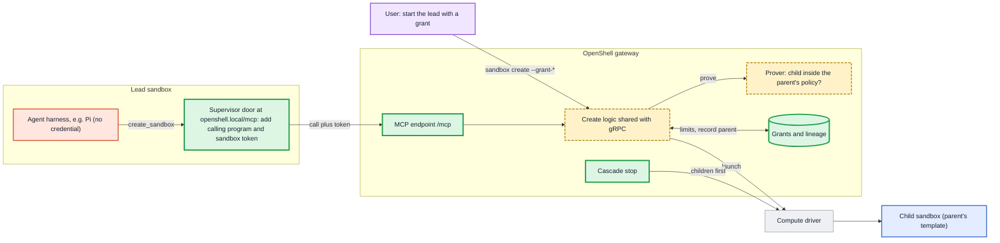
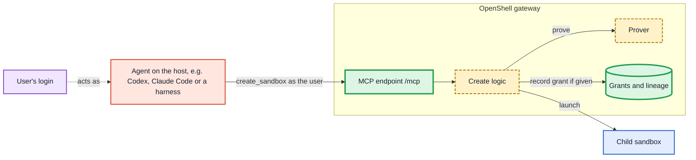

---
authors:
  - "@patkraw"
state: review
links:
  - https://github.com/NVIDIA/OpenShell/issues/4574
  - https://github.com/NVIDIA/OpenShell/pull/4721
---

# RFC 0021 - OpenShell MCP Server for Creating Sandboxes

## Summary

This RFC proposes letting agents create sandboxes through the OpenShell MCP
server, an MCP endpoint served by the OpenShell gateway at `/mcp`. It is one MCP
server, not a gateway or proxy for other MCP servers. An agent running in a sandbox can create sub-agents
(`kind: agent`) and tool sandboxes (`kind: tool`). Every request is identified
by OpenShell, proved against a ceiling with the policy prover, limited by a
grant that the user sets when starting the tree's first sandbox or attaches to
it later, and recorded in a lineage so that stopping a parent stops its children
first.

The MCP endpoint is meant to expose more of OpenShell's control plane to
harnesses over time. Creating child sandboxes is its first use case, and the
only one this RFC designs.

The contract is a gRPC API for child sandboxes, exposed through the SDKs, the
CLI and an MCP endpoint, so a harness can integrate at whichever level suits it.
Agents inside a sandbox reach the gateway through a door in their own supervisor
at `http://openshell.local`, which is open in every sandbox. The supervisor
identifies the calling program, attaches it and a token bound to the sandbox,
and forwards the call; the agent never holds a credential. Agents and tools
running on the host call the same endpoint with the user's login and create
sandboxes as the user would with the CLI. In every case the gateway makes every
decision, and a sandbox without a grant cannot create sandboxes at all.

## Motivation

Agent harnesses increasingly split work across sub-agents. A lead agent plans
the work and delegates parts of it; workers implement, test and review.
Running each agent in its own sandbox lets each one have only the access its
part of the task needs, and keeps one compromised agent from reading another's
files or credentials. OpenShell is well placed to provide that isolation, but
today a sandbox cannot create another sandbox, and nothing in OpenShell bounds
what a delegated agent receives.

- **Only users can create sandboxes.** `CreateSandbox` is declared with
  `auth_mode: "bearer"` in `proto/openshell.proto`, and the gateway router
  refuses it for sandbox principals because it is not in the
  `is_sandbox_callable` allowlist (`crates/openshell-server/src/multiplex.rs`).

- **Harnesses work around this with host services.** Prototypes for Pi and
  OpenWorker run a service on the host that holds a user credential and creates
  sandboxes when an agent asks. Each such service is harness-specific, keeps its
  security checks outside OpenShell, and becomes a second source of truth for
  who may create what. Operators have to trust and audit each one separately.

- **Nothing bounds a new sandbox's policy.** At create time the gateway runs
  validation and safety checks, but nothing proves that a delegated sandbox
  gets no more than its creator was allowed. `openshell-prover` already
  implements `check_within_boundary`, whose documentation describes exactly
  this use ("a policy a parent agent writes for a subagent"), but its only
  caller is the standalone CLI.

- **There is no lineage.** OpenShell records no parent, creator or tree for a
  sandbox. A crashed lead leaves its workers running, and there is no limit on
  how many sandboxes one delegated task can create.

- **Sandboxes from sandboxes is a general need.** Sub-agents are one use.
  Reinforcement learning environments such as Hugging Face's OpenEnv and
  NVIDIA NeMo Gym run an agent in one environment and start isolated
  environments for it to act in, evaluate or score; an agent on a developer's
  machine asks for a sandbox to try something safely. Each of these needs a
  sandbox to start other sandboxes, within limits, without holding a user
  credential.

- **Harness limits are suggestions.** Claude Code, Qwen Code, Gemini CLI and Pi
  each cap sub-agent depth or concurrency, but those limits are enforced by the
  harness, which runs inside the sandbox next to the agent. An agent that has
  been manipulated through a prompt injection can call the creation path
  directly and bypass them.

Leaving the design unchanged means every harness that wants sandboxed
sub-agents builds and operates its own credential-holding service, with its own
checks and its own failure modes, and OpenShell cannot answer "who created this
sandbox, for whom, and was it allowed".

## Non-goals

- **Other control-plane tools on the MCP endpoint.** Each later set of tools
  gets its own proposal that names its RPCs and who may call them.
- **Agent-to-agent messaging and shared task boards.** How agents in a tree
  talk to each other is a separate proposal.
- **Per-tool permissions for other MCP servers**, such as "GitHub MCP, read
  tools only". Children get other MCP servers only whole, as REST rules (see
  [Other MCP servers](#other-mcp-servers)).
- **Per-tool-call approval inside a harness.** Harnesses keep their own
  approval prompts; this RFC covers the sandbox boundary, not the harness's
  decisions within it.
- **In-process sub-agents and writable folders shared between sandboxes.**
  Children receive read-only copies of inputs and return results through
  files.
- **Shared or highly available supervisors** (RFC 0018). This design keeps
  identity per sandbox so that it remains valid when one supervisor process
  serves several sandboxes.
- **A single prompt for requests outside a grant.** v1 refuses requests beyond
  the grant's limits; the user raises them with `openshell grant update`.
  Access the parent lacks goes through the existing proposal flow (see
  [Asking for more than the parent has](#asking-for-more-than-the-parent-has)).
  A single prompt that shows the child's request and approves it in one step is
  future work.
- **Storing results or streaming them.** The gateway never keeps a child's
  output. A child leaves its result in a file in its own sandbox, and the
  parent's `wait` returns it (see [Returning results](#returning-results)).
  Progress updates and messages between running agents are future work (see
  [Agent-to-agent communication through the gateway](#agent-to-agent-communication-through-the-gateway)).

## Proposal

### Overview

The gateway gains a child-sandbox API and an MCP endpoint, `/mcp`, served on
the existing gateway port. The MCP endpoint is a thin adapter over the API, and
both use the same create logic as the gRPC `CreateSandbox` handler, so every
caller gets identical validation and security checks (see
[Interfaces](#interfaces-api-sdk-cli-and-mcp)). Four new pieces sit behind
them: grants, lineage, the boundary proof, and lifecycle management for trees.
Two kinds of caller reach the gateway.

**Harness inside a sandbox.** This is the main case. The user starts a lead
sandbox with a grant. The lead's harness connects to `http://openshell.local/mcp`,
which the lead's supervisor serves. The supervisor identifies the calling
program, attaches it and the sandbox's token, and forwards the call. The gateway
authenticates the sandbox, checks the program and the grant, proves the child's
policy, records lineage and launches the child through the compute driver.



**Agent or tool on the host.** An agent on the user's machine, such as Codex,
Claude Code or a host harness, calls the same endpoint with the user's login
(OIDC bearer or mTLS client certificate). There is no supervisor and no door.
The caller is the user, so it creates top-level sandboxes exactly as the user
could with the CLI, subject to the same workspace roles; no grant is needed. If
it gives a new sandbox a grant, that sandbox can create children as described
below. The host agent itself is not contained by OpenShell, only the sandboxes
it creates are.



The endpoint lives in the gateway rather than in each sandbox's own supervisor
(one per sandbox, running outside the agent's container) for three reasons. Host agents have no supervisor, so a supervisor-hosted server would
need a second path for them. Keeping the decision in one component means there
is one implementation of the security checks and no second copy to drift. And
MCP revisions change quickly; a gateway-hosted server is upgraded once, while a
supervisor-hosted one would need every running sandbox's supervisor to keep up.
MCP's sessionless revision also fits gateway high availability, since any
replica can serve any request. The split follows the zero-trust pattern of
deciding centrally and enforcing at the workload: the gateway decides, the
supervisor enforces reachability next to the sandbox.

### Interfaces: API, SDK, CLI and MCP

The contract is a gRPC service. The SDKs, the CLI and the MCP endpoint are
surfaces over it, and each MCP tool maps to one RPC. A harness that wants deep
integration calls the SDK from its own code and decides itself when to create a
child; a harness or agent that already speaks MCP needs only a configuration
entry. Nothing about the security model depends on which surface is used.

```proto
service SandboxChildren {
  rpc CreateChildSandbox(CreateChildSandboxRequest) returns (CreateChildSandboxResponse) {
    option (authorization) = { auth_mode: "dual" workspace_role: "user" scope: "sandbox:write" };
  }
  rpc WaitChildSandbox(WaitChildSandboxRequest) returns (WaitChildSandboxResponse) {
    option (authorization) = { auth_mode: "dual" workspace_role: "user" scope: "sandbox:read" };
  }
  rpc ExecChildSandbox(ExecChildSandboxRequest) returns (ExecChildSandboxResponse) {
    option (authorization) = { auth_mode: "sandbox" };
  }
  rpc GetChildSandboxFile(GetChildSandboxFileRequest) returns (GetChildSandboxFileResponse) {
    option (authorization) = { auth_mode: "sandbox" };
  }
  rpc StopChildSandbox(StopChildSandboxRequest) returns (StopChildSandboxResponse) {
    option (authorization) = { auth_mode: "dual" workspace_role: "user" scope: "sandbox:write" };
  }
  rpc ListChildSandboxes(ListChildSandboxesRequest) returns (ListChildSandboxesResponse) {
    option (authorization) = { auth_mode: "dual" workspace_role: "user" scope: "sandbox:read" };
  }
  rpc GetSandboxLimits(GetSandboxLimitsRequest) returns (GetSandboxLimitsResponse) {
    option (authorization) = { auth_mode: "dual" workspace_role: "user" scope: "sandbox:read" };
  }
}
```

`auth_mode: "dual"` admits both user and sandbox principals. For sandbox
principals each handler applies a child-scope guard, in the style of
`ensure_sandbox_principal_scope`: a sandbox may create children only under its
grant and act only on its own descendants, and is refused with
`NOT_YOUR_CHILD` otherwise. `ExecChildSandbox` and `GetChildSandboxFile` are
sandbox-only: users already have `ExecSandbox`. They apply the same guard, refuse
`exec` on an agent child with `WRONG_KIND`, log every command, and then run the
existing `ExecSandbox` handler inside the gateway (`get_file` runs `cat` on the
path). `ExecSandbox` itself keeps its current authorization; sandboxes are not
given access to it.

| Surface | Used by | How it reaches the gateway |
|---------|---------|----------------------------|
| gRPC / SDK (Rust, Python, TypeScript, Go) | Harnesses integrating in code; services such as RL environment runners | From the host: the user's login. From a sandbox: not in v1; the door carries MCP only, and gRPC through the door comes later (see [Open questions](#open-questions)). |
| CLI | Users and scripts | The user's login |
| MCP `/mcp` | Any MCP-capable agent or harness | From a sandbox: through the door. From the host: the user's login. |

The door is the only way code inside a sandbox reaches the gateway, so what it
forwards decides which surfaces work from inside. The door forwards MCP's
Streamable HTTP binding over HTTP/1.1, with JSON responses only in v1 (see [The
supervisor door](#the-supervisor-door)). The gRPC service runs on HTTP/2; in v1
the door carries MCP only, so code inside a sandbox uses MCP and the gRPC
service is used from the host. Carrying gRPC through the door comes later
(leaning towards gRPC-Web or Connect; see [Open questions](#open-questions)).

### Grants

A grant is a budget for one tree of sandboxes, set by the user. It answers four
questions: may this tree create sandboxes at all, how large may it grow, which
program may ask, and whether agents may write their children's policies
(`child_policy`). What a child may be given is not part of the grant: every
child is bounded by its parent's policy (see
[Ceiling and policy proof](#ceiling-and-policy-proof)).

**Creation.** A grant is usually created when the user starts the tree's first
sandbox, called the holder. There is no grant file; the grant is part of the
create request:

```shell
openshell sandbox create \
  --from pi-agent:local \
  --provider pi-nvidia \
  --policy lead.yaml \
  --grant-max-depth 1 --grant-max-breadth 2 --grant-max-total 3 \
  --grant-expires 4h --grant-program /usr/local/bin/node \
  -- pi
```

The `--grant-*` flags are the same as those of `openshell grant create`, with a
`grant-` prefix: `--grant-max-depth`, `--grant-max-breadth`, `--grant-max-total`,
`--grant-expires`, `--grant-program` and `--grant-child-policy`. Any of them
gives the new sandbox a grant, and `--grant-program` is then required. The CLI
builds a `SandboxGrantSpec` on `CreateSandboxRequest` from them.
Only a user principal may set it; the gateway rejects the field from any other
principal. The holder's policy is the ceiling for its children.

**Adding a grant to a running sandbox.** A user often finds that a sandbox
needs sub-agents only after starting it. `CreateSandboxGrant` attaches a grant
to an existing top-level sandbox, which becomes the holder from then on:

```shell
openshell grant create lead \
  --max-depth 1 --max-breadth 2 --max-total 3 --expires 4h --program /usr/local/bin/node
```

The same rules apply as at creation: only a user may call it, and the holder's
current policy becomes the ceiling for its children. A sandbox that is itself a
child cannot be given a grant of its own; its tree's grant already covers it.

**Replacing a grant.** `grant create` on a holder whose grant was revoked or has
expired attaches the new grant to the running tree: every sandbox in the tree
moves to the new grant, and the sandboxes still running count toward its
`max_total`. While the holder's grant is active, `grant create` is refused with
`ALREADY_EXISTS`. Replacing an expired grant requires the same right as
changing it (below).

```proto
message SandboxGrantSpec {
  // Levels of agents below the holder. 1 means the holder's agent children
  // cannot create agents. Tool sandboxes do not count against depth.
  uint32 max_depth = 1;
  // Children per parent.
  uint32 max_breadth = 2;
  // Sandboxes in the whole tree, including the holder.
  uint32 max_total = 3;
  // Grant lifetime.
  google.protobuf.Duration expires_after = 4;
  // Absolute path of the executable allowed to use the door,
  // for example /usr/local/bin/node for a Node-based harness.
  string program = 5;
  // NARROW (default): agents write their children's policies, any section the
  // prover checks, within their own policy. INHERIT: every child receives its
  // parent's policy unchanged.
  ChildPolicyMode child_policy = 6;
}

message CreateSandboxRequest {
  // ... existing fields ...
  SandboxGrantSpec grant = 20;
}
```

**One grant per tree.** Children and grandchildren draw from the same grant.
When a child creates its own child, the gateway charges the shared counters and
checks an agent child's depth against the same `max_depth`. A tool sandbox runs
no agent and cannot create children, so it never makes the tree deeper; depth
limits delegation, not the commands an agent runs. Tool sandboxes therefore
ignore the depth limit, so an agent at the bottom of the tree can still run
commands in tool sandboxes of its own; they count toward breadth and total like
any child. A child never uses more than the grant has left, so the user
confirms the tree's limits once and sees no further prompts however deep the
tree goes. The alternative, a new grant
per level, would put a prompt in front of the user every time a worker
delegated.

**No grant, no children.** A sandbox started without a grant cannot create
sandboxes. `create_sandbox` is listed for it like for any sandbox (see
[Refusals](#refusals)), and a call is refused with `NOT_ALLOWED`. The safe
default is that a sandbox never gains the ability to create sandboxes unless the
user said so.

**Set up front.** In v1 the grant is the only approval. A request inside it
proceeds without prompting anyone; a request outside it is refused with
`LIMIT_REACHED` and the agent adapts. This matches how OpenShell is used today,
from the CLI, and needs no new approval interface. Access the parent lacks goes
through the existing proposal flow (see [Asking for more than the parent
has](#asking-for-more-than-the-parent-has)); a single prompt for requests
outside the grant is future work.

**Only the user changes a grant.** The user can widen, shrink or revoke a grant
while the tree runs:

```shell
openshell grant list                        # find the grant id, e.g. gr-1a2b3c4d
openshell grant update gr-1a2b3c4d --max-depth 2 --max-breadth 3 --max-total 6
openshell grant revoke gr-1a2b3c4d
```

`grant update` changes only the limits it is given; `expires`, `program` and
`child_policy` are changed by revoking the grant and creating a new one for the
same sandbox (see Replacing a grant). Changes
apply to the next call: a sandbox that had no depth left can create children as
soon as the user raises `max_depth`, with no policy change, and an existing
child keeps its policy. No sandbox can change a grant, including through the
OpenShell MCP server, and every change is audited. If an agent could widen its own grant,
the grant would mean nothing.

```proto
rpc CreateSandboxGrant(CreateSandboxGrantRequest) returns (SandboxGrantResponse) {
  option (authorization) = { auth_mode: "bearer" workspace_role: "user" scope: "sandbox:write" };
}
rpc ListSandboxGrants(ListSandboxGrantsRequest) returns (ListSandboxGrantsResponse) {
  option (authorization) = { auth_mode: "bearer" workspace_role: "user" scope: "sandbox:read" };
}
rpc GetSandboxGrant(GetSandboxGrantRequest) returns (SandboxGrantResponse) {
  option (authorization) = { auth_mode: "bearer" workspace_role: "user" scope: "sandbox:read" };
}
rpc UpdateSandboxGrant(UpdateSandboxGrantRequest) returns (SandboxGrantResponse) {
  option (authorization) = { auth_mode: "bearer" workspace_role: "user" scope: "sandbox:write" };
}
rpc RevokeSandboxGrant(RevokeSandboxGrantRequest) returns (RevokeSandboxGrantResponse) {
  option (authorization) = { auth_mode: "bearer" workspace_role: "user" scope: "sandbox:write" };
}
```

`ListSandboxGrants` and `GetSandboxGrant` return only grants the caller may
manage, and `UpdateSandboxGrant` and `RevokeSandboxGrant` refuse anyone else:
the grant's user or a Workspace Admin of the grant's workspace. The check runs
before any change.

**Harness limits are per-request reductions.** A harness may send its own
`limits` with a create request, for example "a lead has at most two workers",
and that request is held to the lowest of the harness's value, the grant's and
the operator's cap from gateway configuration. Because the workload sends them,
a compromised agent can omit them on its next call, so they are a convenience
for well-behaved harnesses, not a boundary. The enforced limits are the grant
and the operator caps, which no sandbox can change; a harness that wants a
lower limit enforced asks the user to set it in the grant.

**Storage.** Grants are stored in the existing objects table as a new object
type, `sandbox_grant`, scoped to the holder's workspace. The counters (`total`
and per-parent children) live in the grant record and are updated with
`WriteCondition::MatchResourceVersion`, so two concurrent creates cannot both
take the last slot. A create reserves its slot before calling the compute
driver and releases it if the driver fails.

### Lineage

Each sandbox created under a grant has a `Lineage` record:

```proto
message SandboxLineage {
  string sandbox_id = 1;
  // Parent sandbox id, empty for the holder.
  string parent_sandbox_id = 2;
  // The user the tree acts for.
  string root_subject = 3;
  string workspace = 4;
  SandboxKind kind = 5;          // AGENT or TOOL
  SandboxLifetime lifetime = 6;  // UNTIL_STOPPED or UNTIL_EXIT
  uint32 depth = 7;              // 0 for the holder
  string grant_id = 8;
  google.protobuf.Duration idle_timeout = 9;  // tool sandboxes
}
```

The record is stored as the object type `sandbox_lineage`, keyed by sandbox id,
with an index on `parent_sandbox_id` for cascade stop. A child's workspace is
always its parent's.

Lineage is deliberately a separate record rather than an owner field on the
sandbox. RFC 0011 gives sandboxes no owner: access comes from workspace
membership, and any user in a workspace can act on its sandboxes. Lineage does
not change that model. It is used only for decisions about trees (cascade stop,
"a sandbox acts only on its own descendants") and for audit attribution.

### Ceiling and policy proof

At a glance, the cases this section and the following ones cover:

| # | Situation | What the child gets | Result |
|---|-----------|---------------------|--------|
| 1 | The agent writes a narrower policy, such as `/sandbox` read-only or GitHub read-only | its own policy | Created; proved within the parent |
| 2 | The agent omits the filesystem, process or Landlock section | the parent's section | Created |
| 3 | The agent omits network rules | no network access | Created |
| 4 | The agent asks for more than the parent has, such as `POST /repos/**` | nothing | `EXCEEDS_CEILING`, with a counterexample and a hint |
| 5 | The parent needs to pass on more than it has | the parent proposes the rule for itself through `policy.local`; after the user approves, the agent retries | Created on retry |
| 6 | The agent lists a path the parent does not list | nothing | `UNSUPPORTED_RULES`; the prover is conservative with paths |
| 7 | The agent sets a network middleware | nothing | Refused; middlewares are not proved |
| 8 | The parent has MCP rules and `child_policy: narrow` | MCP endpoints are dropped from the ceiling before the proof | Created for everything else; MCP rules cannot be passed on |
| 9 | `child_policy: inherit` and no policy in the request | the parent's policy unchanged, MCP rules included | Created; no proof needed |
| 10 | `child_policy: inherit` and a policy in the request | nothing | Refused |
| 11 | A later write to a child's policy (`UpdateConfig`, policy sync, approved proposal) | proved again against the parent | Refused if it would widen the child past the parent |
| 12 | The parent's policy shrinks after the child starts | the child keeps its policy | Out of scope; see [#3808](https://github.com/NVIDIA/OpenShell/issues/3808) |
| 13 | The global policy is in `maximum` mode | proved against the parent and the global policy | `EXCEEDS_GLOBAL_POLICY` if over |
| 14 | The global policy is in `replace` mode and the request has a policy | nothing | `GLOBAL_POLICY_ACTIVE` |

**A child's ceiling is its parent's policy.** When a sandbox creates a child,
the gateway proves the child's policy against the parent's current policy,
without provider layers. The lead's children are bounded by the lead's policy,
its grandchildren by its children's policies, and so on, so each level can only
narrow: `child ≤ parent ≤ global maximum`, the model in the spike on agents
setting maximum policies for spawned agents
([#2025](https://github.com/NVIDIA/OpenShell/issues/2025)). A single tree-wide
ceiling, the lead's policy, would let a child that was given only GitHub read
access create a grandchild with everything the lead has.

Because the ceiling is the parent's policy at the moment of the create, a
parent whose policy has grown through an approved proposal can pass that access
on, and one whose policy has shrunk cannot. Children already running when a
parent's policy shrinks keep their policy; revalidating them is the subject of
[#3808](https://github.com/NVIDIA/OpenShell/issues/3808), "revalidate running
subagents when ancestor authority changes".

**What the agent writes.** The agent may narrow every section of the child's
policy that the prover checks: `network_policies`, `filesystem_policy`,
`process` and `landlock`. A filesystem, process or Landlock section it omits is
copied from the parent; network rules it omits are none, so a child has no
network access unless the agent asks for it. The whole policy is then proved
against the parent's. A read-only reviewer, for example, is the parent's
filesystem section with `/sandbox` moved from `read_write` to `read_only`.
Network middlewares are not proved and cannot be set for a child.

The prover is conservative with filesystem paths: a child that lists a path the
parent does not list, or depends on an unresolved image working directory, is
refused as `UNSUPPORTED_RULES` rather than proved. Narrowing that keeps the
parent's paths and moves them to read-only, or drops them, is proved.

**The proof.** The gateway serializes the ceiling and the candidate with
`openshell_policy::serialize_sandbox_policy`, parses both with
`openshell_prover::containment::parse_policy_str`, and calls
`check_within_boundary` on a blocking thread with a 10 second timeout. Only
`Within` lets creation continue:

| Prover result | Error returned to the agent |
|---------------|-----------------------------|
| `Within` | none; creation continues |
| `Exceeds` | `EXCEEDS_CEILING`, with the prover's counterexample and a hint on how to ask for more, so the agent can narrow its request or widen its own policy and retry |
| `Unsupported` | `UNSUPPORTED_RULES`, naming the rule the prover cannot model |
| `Inconclusive` | `PROVER_INCONCLUSIVE` |

Returning the counterexample matters: it tells the agent which request
(`POST api.github.com/repos/...`) is outside the ceiling, which is usually
enough for it to correct its policy without involving the user.

**Later policy writes.** The same check runs on every later write to the policy
of a sandbox that has a lineage, whatever the source: `UpdateConfig`, policy
sync from the supervisor, or an approved proposal. A sandbox in a tree can
never be widened past its ceiling after it starts.

**Global policy as a maximum.** A gateway-global policy is meant to state what
no sandbox on the gateway may exceed. Today it does that by replacing every
sandbox's policy, which also removes every narrower one, so trees of sandboxes
with least privilege cannot exist under it. This RFC adds a second mode in which
the global policy is the gateway's outermost ceiling:

```toml
[openshell.gateway]
# "replace" (current behavior) or "maximum"
global_policy_mode = "maximum"
```

In `maximum` mode each sandbox keeps its own policy, provider layers stay
active, and the gateway proves that every policy fits inside the global one: a
grant holder's policy when it is created or given a grant, every child policy,
and every later policy write. A policy that does not fit is refused with
`EXCEEDS_GLOBAL_POLICY` and the prover's counterexample. Children are then
proved against both their ceiling and the global policy.

In `replace` mode a child created with a narrow policy would silently receive
the global one instead, so `create_sandbox` with a policy is refused with
`GLOBAL_POLICY_ACTIVE`, and the agent learns that delegation is unavailable
rather than receiving a child with unexpected access.

**Whether a parent may set its child's policy.** A grant states whether agents
in the tree may write their children's policies (`child_policy: narrow`, the
default; any section the prover checks, see "What the agent writes" in [Ceiling
and policy proof](#ceiling-and-policy-proof)) or whether every child receives
its parent's policy unchanged (`child_policy: inherit`). In `inherit` mode a
`create_sandbox` request that includes a policy is refused. Either way a
child's base policy never exceeds its parent's policy and the global maximum
when it is created or written: the proof runs at create time and on every later
write to the child's policy. Provider layers are added after the proof, from
admin-imported profiles and only for providers attached to the parent. A child
that is already running keeps its policy when an ancestor's policy later
shrinks; revalidating running children is
[#3808](https://github.com/NVIDIA/OpenShell/issues/3808).

**Layers the gateway adds.** Provider layers are added after the proof. They
come from a trusted source, admin-imported provider profiles, not from the
agent. Provider attachments are checked separately: a
child may only receive providers attached to its parent.

#### Asking for more than the parent has

When the task really needs access the parent lacks, the parent widens its own
policy first, through the proposal flow every sandbox has today, and then
retries. No new mechanism is involved; the gateway's refusal points the agent to
it, in the same way the supervisor's guidance for a blocked request does
(`AGENT_GUIDANCE` in `crates/openshell-supervisor-network/src/policy_local.rs`):

1. The lead calls `create_sandbox` for a worker with `POST
   api.github.com/repos/**`. The gateway refuses with `EXCEEDS_CEILING`, the
   counterexample, and the hint: "A child cannot get more than you have. Either
   narrow the child's policy and retry, or, if the task needs this access and
   policy proposals are enabled in this sandbox, first ask for it for
   yourself: read
   /etc/openshell/skills/policy_advisor.md, submit the narrowest rule to
   http://policy.local/v1/proposals, wait for approval and
   `policy_reloaded: true`, then retry create_sandbox."
2. The lead submits the rule for itself to `POST
   http://policy.local/v1/proposals` and keeps the returned chunk id.
3. The user approves it as any proposal today: `openshell rule approve lead
   --chunk-id <id>`, the TUI, or auto-approval when the prover finds nothing
   new. For a child, the proposal must also fit the child's own ceiling (see
   "Later policy writes" in
   [Ceiling and policy proof](#ceiling-and-policy-proof)) or it is rejected
   without asking.
4. The lead waits on `GET /v1/proposals/<id>/wait` until it reports
   `policy_reloaded: true`.
5. The lead retries `create_sandbox`. The ceiling is the parent's current
   policy, so the worker now fits.

Agent proposals are off by default (`agent_policy_proposals_enabled`). Where
they are off, `policy.local` refuses step 2 with `feature_disabled`, and only the
user can widen the parent, by editing its policy directly. A user who expects
this flow turns the setting on for the lead, or gateway-wide, when starting the
tree. The proof of concept runs the whole flow end to end with the setting on.

An approval in the harness's own interface does not count: the harness never
tells OpenShell about it, so the gateway still refuses until the parent's
policy or the grant changes. The user approves the parent's proposal without
seeing that it is meant for a child; showing that context, or approving a
child's policy in one step, is the interactive approval described in
[Interactive approval](#interactive-approval).

#### Other MCP servers

The prover models a request as program, host, port, HTTP method and path. That
is enough for network and REST rules. MCP rules match fields inside the JSON-RPC
body, the `method` and the tool name in `params.name`, and the model has no
body fields. The prover therefore returns `Unsupported` for any endpoint with
`protocol: mcp`: per-tool rules because "only L4 TCP and REST are modeled", and
`allow_all_known_mcp_methods` because it "uses authority outside the initial
model" (`crates/openshell-prover/src/containment.rs`). This is unbuilt work
rather than a fundamental limit; tool names are strings like paths.

**A parent with MCP rules.** The prover checks both policies before comparing
them, so one `protocol: mcp` endpoint in the parent's policy would make every
proof `Unsupported`, and that parent could create no children at all, even ones
that need nothing from the MCP server. The gateway therefore proves against the
part of the parent's policy the prover can model: it drops endpoints whose
protocol is not L4 or REST before the proof. Dropping allow rules only shrinks
the boundary, so a child that fits the result also fits the parent's full
policy. Such a parent can create children for everything else; it cannot pass
its MCP rules on. With `child_policy: inherit` the child receives the parent's
policy unchanged, which fits by construction, so the proof is skipped and the
MCP rules are inherited.

Until the prover models MCP rules, a child gets another MCP server whole or not
at all, written as a REST rule on the server's `/mcp` path:

```yaml
network_policies:
  github_mcp:
    name: github_mcp
    endpoints:
      - host: api.githubcopilot.com
        port: 443
        protocol: rest
        enforcement: enforce
        rules:
          - allow: { method: POST, path: /mcp }
    binaries:
      - path: /usr/local/bin/node
```

We checked the three ways of writing this with `openshell-prover` against a
parent that allows `POST` and `GET` on `/mcp`. The REST rule above is
`within`. A rule naming only the host and port `exceeds` the ceiling, because it
allows requests to any path. An endpoint with `protocol: mcp` and
`allow_all_known_mcp_methods: true` is `unsupported`. The cost of the REST form
is that there are no per-tool limits, so a child with GitHub's MCP server can
call every tool on it, and the supervisor applies no MCP-specific checks such as
protocol version and tool-name syntax. The parent must allow at least the
methods the child gets: a child with `POST`, `GET` and `DELETE` on `/mcp`
exceeds a parent with only `POST` and `GET`.

### The supervisor door

**Why a door.** An agent could call the gateway directly, but it would need a
token and a network rule to the gateway. A prompt-injected agent could take the
token and use it from anywhere, and the gateway would not know which program
called. The supervisor already holds the sandbox's token and sees each
connection's program, and its local name `openshell.local` works wherever the
gateway runs. The door reuses the `policy.local` mechanism, so it adds no new
kind of component.

The door is served by the supervisor at `openshell.local`, port 80, path `/mcp`.
It reuses the mechanism that serves the `policy.local` API today
(`crates/openshell-supervisor-network/src/policy_local.rs`):

- **Name resolution.** The supervisor's synthetic DNS answers `openshell.local`
  with the same local address as `policy.local` (`198.18.0.1`), so clients that
  connect directly, such as Node's `fetch`, reach the transparent path.
  Clients that honor the proxy environment reach the explicit forward-proxy
  path. Both paths dispatch on the `Host` header.

- **Open in every sandbox.** Every sandbox can reach the door while the gateway
  MCP is enabled, as every sandbox can reach `policy.local` today. Nothing in a
  sandbox's policy controls it; there is no door rule. The gateway decides every
  call, so a sandbox without a grant, or with no depth left, reaches the door
  and is refused.

- **Children use their own door.** A child's harness calls the same URL,
  `http://openshell.local/mcp`, and the child's own supervisor answers it and
  forwards the call with the child's token. The gateway therefore sees the
  child, not its parent, and applies the shared grant to it: agents only with
  depth left, tool sandboxes within breadth and total, and actions only on the
  child's own descendants. A child runs its parent's image, so its harness
  already carries the same MCP setting and needs no configuration.

- **Calling program.** The door identifies the calling program from the binary
  identity the isolation backend supplies for the connection (RFC 0012), and
  sends its kernel-resolved path to the gateway in the
  `x-openshell-caller-program` header. The door builds the forwarded request
  itself, so the workload cannot set or forge this header. A connection whose
  program cannot be identified is refused with `door_denied`.

- **Forwarding.** The door reads the request body (the same 64 KiB limit as
  `policy.local`), forwards it to the gateway's `/mcp` with a token bound to
  this sandbox, and returns the gateway's response unchanged. It builds the
  forwarded request itself:
  - **Kept:** `Content-Type`, `Accept`, and the MCP headers
    `MCP-Protocol-Version`, `Mcp-Method` and `Mcp-Name` when present.
  - **Set by the door, never copied from the workload:** `Authorization` (the
    sandbox's token) and `x-openshell-caller-program`. Any other header the
    workload sends, including identity headers, is dropped.
  - **Origin:** a request carrying an `Origin` header other than
    `http://openshell.local` is refused with 403, as MCP requires against DNS
    rebinding; agents send no `Origin`. The gateway applies the same rule to
    host callers and accepts only local origins.

- **Protocol version.** v1 targets MCP's Streamable HTTP transport with JSON
  responses (no server-sent event streams, no standalone `GET` stream) and the
  initialize-based revisions `2025-06-18` and `2025-11-25`. `initialize` echoes
  a supported `protocolVersion` and otherwise answers with `2025-11-25`, the
  latest supported, leaving the client to decide; a request whose
  `MCP-Protocol-Version` header names an unsupported revision gets HTTP 400.
  The gateway keeps no MCP session, so clients written against the sessionless
  `2026-07-28` revision also work for these tools; supporting that revision's
  required headers fully is future work.

- **Rate limit.** The gateway limits calls per sandbox, so a sandbox that may
  not create children cannot flood the gateway through its door.

**Why no door rule.** An earlier design opened the door only in sandboxes with a
grant and depth left, through a network rule the gateway wrote into each
sandbox's policy. That rule went stale when the user changed a grant, was lost
when a user replaced a policy or a global policy replaced every policy, and had
to be stripped before every proof and guarded against agents writing it. An
open door with every decision in the gateway has none of these problems, and a
grant change takes effect on the next call.

**Program check.** A grant names one program, for example
`/usr/local/bin/node` for Pi. The gateway refuses a call from a sandbox in that
tree when the forwarded program differs, with `PROGRAM_NOT_ALLOWED`. Any Node
process in the sandbox can use the door, including one the agent starts from
its shell; `curl`, `bash` and other programs cannot. The gateway's checks still
apply to every call, so a script using the door gets exactly what the harness
would get. A sandbox without a grant has no program restriction, since it may
not create children at all.

**Token.** The supervisor obtains a short-lived token for the audience
`urn:openshell:gateway-mcp` through `RefreshSandboxToken`, extending the
existing extension-credential path, which today mints only for supervisor
middleware services and is rate limited per sandbox. The token is bound to the
sandbox id and lives at most one hour (`MAX_EXTENSION_TOKEN_TTL`). The gateway
accepts it only on `/mcp`. Using a dedicated audience instead of the
supervisor's main session token limits what a leaked token can do. The proof of
concept forwards the session token; v1 requires the dedicated audience.

### Refusals

A sandbox with no depth left, or no grant, reaches the door and sees the same
tools as any other sandbox. The gateway refuses its `create_sandbox` with
`LIMIT_REACHED(depth)` or `NOT_ALLOWED` and audits the refusal; a sandbox with
no depth left can still create tool sandboxes within breadth and total. Tools
are always listed because a grant can be widened at any time and many MCP
clients load the tool list only once; `get_limits` reports what the caller may
do right now (`can_create_children` for agents, `can_create_tools`, depth,
breadth and total). A model that calls a tool it cannot use gets a clear error
in one turn.

### MCP tools

`tools/list` is answered by the gateway and depends only on the kind of caller:
a sandbox sees the child tools, a user sees `create_sandbox` and the grant
tools. It does not depend on the grant or the counters, so a client's cached
list never goes out of date; whether a call is allowed is decided when it is
made.

| Tool | Listed for | Input | Output | Errors |
|------|------------|-------|--------|--------|
| `create_sandbox` | users and sandboxes | `name`, `kind`, `lifetime`, `command`, `task`, `policy`, `providers`, `inputs`, `request_id`, `limits`, `idle_timeout_s`; users only: `image`, `grant` | `handle` | `NOT_ALLOWED`, `LIMIT_REACHED(depth\|breadth\|total)`, `EXCEEDS_CEILING`, `UNSUPPORTED_RULES`, `PROVER_INCONCLUSIVE`, `PROGRAM_NOT_ALLOWED`, `GLOBAL_POLICY_ACTIVE`, `EXCEEDS_GLOBAL_POLICY`, `IN_PROGRESS`, `STALE_ADMISSION`, `INVALID_ARGUMENT` (request_id reused with different arguments) |
| `wait` | sandboxes | `handle`, `timeout_s`, `until_file`, `return_file` | `phase`, `exit_code`, `timed_out`; with `until_file`: `file_ready`; with `return_file`: `content`, `truncated` | `NOT_YOUR_CHILD`, `INVALID_ARGUMENT` (`return_file` without `until_file`, or a relative path) |
| `exec` | sandboxes | `handle`, `command`, `timeout_s` | `stdout`, `stderr`, `exit_code` | `NOT_YOUR_CHILD`, `WRONG_KIND` |
| `get_file` | sandboxes | `handle`, `path` | `content` (up to 256 KiB), `truncated` | `NOT_YOUR_CHILD` |
| `stop_sandbox` | sandboxes | `handle` | `stopped` | `NOT_YOUR_CHILD` |
| `get_output` | sandboxes | `handle` | recent log lines of the child; not a durable result, and a child's own standard output is not included | `NOT_YOUR_CHILD` |
| `list_children` | sandboxes | none | children with kind, lifetime, depth | none |
| `get_limits` | sandboxes | none | depth, children and total used and allowed; `can_create_children` (agents) and `can_create_tools` | none |
| `grant_list` | users | none | grants in the caller's workspace | none |
| `grant_create` | users | `handle` of a running top-level sandbox, grant fields | the grant | `NOT_ALLOWED`, `ALREADY_EXISTS` |
| `grant_update` | users | `grant_id`, `max_depth`, `max_breadth`, `max_total`, `revoke` | the new limits, or `revoked` | `NOT_FOUND`, `NOT_ALLOWED` |

A sandbox acts only on its own descendants; `handle` is the child's sandbox name
within the caller's workspace. A user caller creates top-level sandboxes with
the same rules as `openshell sandbox create`: it names the sandbox and may pick
its `image`, may attach a grant to it, and acts on any sandbox its workspace
role allows. A sandbox caller cannot pick an image (see
[Images and resources](#images-and-resources)). `inputs` lists paths in the
parent that are copied read-only into the child at start. `exec` and `get_file`
run through the existing `ExecSandbox` path, acting for the tree's root user.

These are the only tools a harness reaches through the gateway. A harness's
built-in tools (shell, file editing) run inside the sandbox, constrained by its
policy, and other MCP servers are reached directly through the supervisor's
normal proxy. A harness merges all of them into one list for its model.

### Agent and tool sandboxes

A child is created with a fixed kind. The kind decides how its parent uses it
and whether it can delegate further.

| | `kind: agent` | `kind: tool` |
|---|---|---|
| Runs | A harness doing its own task | No agent; only commands its parent sends |
| Parent uses it with | `wait`, `get_file` | `exec`, `get_file` |
| `exec` | Refused with `WRONG_KIND` | Allowed; every command is logged |
| Can create children | Agents if depth is left; tool sandboxes within breadth and total | Never |
| Command | Required | Optional; it stays up until stopped |
| Lifetime | Until stopped (default) or until exit (`until_exit`); never outlives its parent | Until stopped, or stopped after an idle timeout (default 10 minutes without `exec` or `get_file`) |

Agent sandboxes run their own task, so their parent observes them rather than
driving them, and `exec` on an agent is refused to keep a parent from steering
a child's work behind its harness. Tool sandboxes are the opposite: a disposable
environment for running builds, tests or untrusted code on the parent's behalf.
Every command run through `exec` is recorded with the parent, the child and the
command line.

### Lifecycle

**Default lifetime.** Agent children default to `until_stopped`, because
delegated agents usually work for a long time; one-shot children pass
`until_exit`.

**A child never outlives its parent.** When a parent ends, whether stopped,
deleted, crashed or reaped, the gateway stops its children first, deepest first.
For each child it first bumps the authentication epoch, so the child's next
call to the gateway fails, then stops it through the compute driver, then
deletes it. A result the parent has not read is deleted with its child; a
parent whose work is done waits for its children with `wait`. An orphan reaper removes children
whose parent no longer exists, for example after a gateway crash.

**A parent with running children is never idle.** Otherwise its idle timer
could stop the whole tree while the parent waits for a worker. The maximum
lifetime still applies, so no tree runs forever.

**Children's policy changes go to the user.** A running child can propose new
rules through `policy.local`, as any sandbox can. The gateway first checks that
the proposal fits the child's ceiling and rejects it without asking if it does
not. Otherwise the user approves as today, with `openshell rule approve`, the
TUI or auto-approval. Proposals, from a child or from a parent asking for access
to pass on, are the only point at which the user may be prompted during a run.

### Returning results

**A child writes its result to a file in its own sandbox and keeps running; the
parent's `wait` returns the file's content, and the parent then stops the
child.** The gateway reads the file through the exec relay, as `get_file` does,
and keeps no copy: it is the control plane, and agent output stays in the
sandboxes. The child never calls the gateway.

- **`wait` with `until_file`** (an absolute path in the child) keeps waiting
  past READY until the file exists or the child exits, and returns
  `file_ready`. While the child is READY, the gateway checks for the file every
  few seconds. A `wait` that times out can be repeated.
- **`return_file: true`** adds the file's `content` to the reply, so the parent
  has the result before it can stop the child.
- **`run-child`**, a small wrapper for the child's command, closes stdin,
  writes the result whole and renames it into place, so it never appears
  half-written. The first line is the command's exit status (`exit=N`), then
  its output. It publishes the result even when the command fails, and keeps
  the child running for a collection window.
- **Results must fit in 256 KiB.** `wait` and `get_file` report `truncated`
  beyond that; the status line comes first, so it is never cut.
- **The result is deleted with the child**, including by cascade stop.

A result is text written by the child, so the parent's harness must treat it as
data, not instructions (see [Risks](#risks)). The full flow, contract and
failure cases are in
[Appendix: Delivering a Child's Result](appendices/result-delivery.md).

### Images and resources

A child is created from its parent's sandbox template: the same image, CPU and
memory, with no GPU. If the parent was created from an admin workload template,
the child is created from that same template. When a sandbox calls
`create_sandbox`, it cannot name an image or template; only user callers can.
The image that works for the parent already contains the harness and the tools
its children need (Pi, for example, needs Node, `ripgrep` and `fd` preinstalled
because it otherwise downloads them at runtime, which a sandbox blocks). No GPU
is given to children because GPUs are scarce and three children each taking one
could block other work; `max_total` caps the tree's other resources.

### Retries

Agents retry. If the reply to `create_sandbox` is lost, the agent sends the
request again, and without deduplication the tree would get two children and
spend its budget twice. Sandbox callers therefore send a `request_id`, scoped to
the calling parent so that siblings cannot collide. The gateway reserves the
`request_id` together with the child's slot, before launching the child; a
repeat that arrives while the first is launching gets `IN_PROGRESS`, and a
repeat after it finished gets the first child's handle, counted once. Today
`request_id` deduplication through `mutation_replay` is available to user
principals only.

**Limits under concurrency.** Depth, breadth and total are checked and charged
in one step when the slot is reserved, so two concurrent creates cannot both
take the last slot. The reservation also re-checks that the grant still exists
and has not expired, and the gateway confirms afterwards that the grant and the
parent's policy used for the proof are unchanged; otherwise it releases the slot
and refuses with `STALE_ADMISSION`, and the agent retries against the new state.
A `request_id` is bound to a fingerprint of the request's arguments: a repeat
with different arguments is refused with `INVALID_ARGUMENT` rather than
answered with the first child.

**What the counters count.** Breadth and total count children **created** under
the grant, not children running: a child that stops or is deleted still counts,
so a tree cannot create without limit by stopping and recreating children. A
create that fails after reserving releases its slot and its `request_id`. When a
grant is replaced, the new grant's total starts at the number of sandboxes
still running in the tree.

**Revocation and expiry.** A revoked or expired grant stops new creates
(`NOT_ALLOWED`). It does not cut a parent off from children it already has:
`wait`, `get_file`, `get_output`, `exec` on tool children and `stop_sandbox`
keep working, acting for the tree's user recorded in the lineage, so a parent
can still collect results and clean up.

### Authorization enforcement

**Authenticating `/mcp`.** Plain HTTP routes on the gateway are not
authenticated today; only the gRPC service is wrapped by `AuthGrpcRouter`. The
`/mcp` handler runs the same authenticator chain (`build_authenticator_chain`):
a gateway-MCP extension token yields `Principal::Sandbox` for that sandbox; an
OIDC bearer or an mTLS client certificate yields `Principal::User`. Anonymous
callers are refused. The `x-openshell-auth-source` marker is stripped as on the
gRPC path.

**Pinning the workspace.** `authorize_workspace` currently accepts any
workspace for a sandbox principal. The MCP handler never takes a workspace from
the caller: a child is always created in its parent's workspace.

**Acting principal.** The child is created on behalf of the tree's root user,
so provider resolution and workspace checks behave as if the user created it,
while lineage records which sandbox asked.

| Action | User | Holder or agent child with depth left | Agent child with no depth left | Tool child |
|--------|------|------|------|------|
| Start a sandbox with a grant (`--grant-*`) | yes | no | no | no |
| Attach a grant later (`grant create`) | top-level sandboxes without a grant | no | no | no |
| List grants | grants the user set, or in workspaces it administers | no | no | no |
| Update, revoke or replace a grant | own grants; Workspace Admin for the workspace | no | no | no |
| Call the OpenShell MCP server | not applicable | grant's program only (gateway checks) | grant's program only (gateway checks) | grant's program only (gateway checks) |
| `create_sandbox` | top-level sandboxes, as with the CLI | within limits | tool sandboxes only, within breadth and total | refused |
| `wait`, `get_file`, `stop_sandbox`, `exec` | not applicable | own descendants | own descendants | none (no children) |

### Gateway configuration

The MCP endpoint is on by default. It is a route on the existing gateway port
rather than a separate process, so it costs nothing until it is called, and it
lets any agent that can reach the gateway start sandboxes, whether or not
sub-agents are involved. Turning it on does not let any sandbox create
children: that still requires a grant on the sandbox. Operators who do not want
it turn it off in the gateway configuration.

This is startup configuration, like the rest of the gateway configuration (RFC
0003): it is merged from the TOML file and environment at start, with the usual
precedence, and changing it requires restarting the gateway. There is no live
switch and no `enable` or `disable` command. If a live switch is needed later,
it would be a gateway-scope setting following the existing `openshell settings`
vocabulary, for example `openshell settings set --global --key
sandbox_mcp_enabled --value false`, after defining persistence, precedence over
the configuration file, authorization and propagation across replicas.
`openshell status` reports whether the endpoint is served.

```toml
[openshell.gateway.sandbox_mcp]
enabled = true                # default
# Operator caps; the enforced limit is the lower of these and the grant.
max_depth = 3
max_breadth = 8
max_total = 20
# Default idle timeout for tool sandboxes.
tool_idle_timeout = "10m"
```

When disabled, `/mcp` is not routed and the supervisor door answers 404 for
MCP requests; the gRPC child-sandbox API, the SDKs and the CLI keep working.

### CLI surface

```shell
# Start a tree that may create children
openshell sandbox create --policy lead.yaml \
  --grant-max-depth 1 --grant-max-breadth 2 --grant-max-total 3 \
  --grant-expires 4h --grant-program /usr/local/bin/node \
  -- pi

# Inspect and change grants
openshell grant create <sandbox> --max-depth 1 --max-breadth 2 --max-total 3 \
  --expires 4h --program /usr/local/bin/node
openshell grant list
openshell grant get <grant-id>
openshell grant update <grant-id> --max-breadth 3 --max-total 4
openshell grant revoke <grant-id>

# See trees, or one sandbox's direct children
openshell sandbox list --tree
openshell sandbox children <sandbox>
```

A harness needs one setting: the OpenShell MCP server's address. For Pi, which
has built-in MCP support since 0.99, that is `~/.pi/agent/mcp.json`:

```json
{ "mcpServers": { "openshell": { "url": "http://openshell.local/mcp" } } }
```

### Audit

Every create, refusal, grant change, `exec` command and cascade stop is emitted
through the existing OCSF infrastructure with the caller, the parent sandbox,
the root user and the grant. Tool calls on `/mcp` use the `ApiActivity` class
proposed in RFC 0011, with the decision and its reason code (`EXCEEDS_CEILING`,
`LIMIT_REACHED`, and so on). Door refusals are emitted by the supervisor as
`HttpActivity` denials, like other egress denials. An operator can therefore
answer "which sandbox created this one, for whom, under which grant, and what
did it run" from the same log stream they already ship to their SIEM.

### Compatibility

The change is additive. Sandboxes created without `--grant` behave exactly as
today, and the default `global_policy_mode` remains `replace`. Existing gRPC
clients are unaffected; the new `grant` field is optional. Supervisors without
the door ignore `openshell.local`, so a newer gateway with an older supervisor
image simply cannot serve in-sandbox callers until the image is updated. Host
agents can use the endpoint as soon as the gateway supports it.

## Implementation plan

The work is phased so that each phase is usable and testable on its own:

- **Phase 1: The child-sandbox API, grants, lineage and the boundary proof.**
  Add the `SandboxChildren` gRPC service and its SDK functions, the
  `sandbox_grant` and `sandbox_lineage` object types, atomic counter
  reservation with durable pending operations reconciled at startup,
  `SandboxGrantSpec` on `CreateSandboxRequest`, the grant RPCs and
  CLI, and the prover call at create time and on every later policy write to a
  sandbox with a lineage. Validate with the existing Pi and OpenWorker
  prototypes by replacing their host creation services with these RPCs.
- **Phase 2: OpenShell MCP server and supervisor door.** Add `/mcp` over the
  same API, with authentication, the program check and a per-sandbox rate
  limit, and the startup configuration that turns the endpoint off. Add the door
  at `openshell.local` for MCP, open in every sandbox, and the
  `urn:openshell:gateway-mcp` token. Ship host callers first, then in-sandbox
  callers. Carrying gRPC through the door comes in a later phase (see
  [Open questions](#open-questions)).
- **Phase 3: Tool sandboxes and results.** `kind: tool`, `exec` with command
  audit, and the idle timeout; `wait`'s `until_file` and `return_file`, and
  `run-child`.
- **Phase 4: Global policy as a maximum.** Add `global_policy_mode` and the
  proof of every grant holder's policy (at create and when a grant is
  attached), child policy and policy write against the global policy in
  `maximum` mode.
- **Phase 5: Lifecycle.** Cascade stop on every way a parent ends, behind a
  stopping fence that refuses creates in a subtree being stopped, the orphan
  reaper, and idle and maximum lifetime for agent children with the "a parent
  with running children is not idle" rule.
- **Phase 6: Documentation.** A tutorial in which a Pi lead creates a Pi worker,
  reference pages for grants and the MCP tools, and a configuration entry for
  `[openshell.gateway.sandbox_mcp]`.

Validation runs at each phase: unit tests for grant parsing, limits, the program
check and the ceiling proof; gateway tests for refusals; and an end-to-end
scenario with the Docker driver that exercises every refusal listed in this RFC.

A proof of concept of phases 1 to 3 exists on the branch
[`gateway-mcp-poc`](https://github.com/patkraw/OpenShell/tree/gateway-mcp-poc)
(`crates/openshell-gateway-mcp/`, `crates/openshell-server/src/children.rs`,
`crates/openshell-supervisor-network/src/gateway_mcp_door.rs`,
`examples/gateway-mcp-poc/`), with
[tutorials](https://github.com/patkraw/OpenShell/tree/gateway-mcp-poc/examples/gateway-mcp-poc/tutorials)
that run as written. Returning results is in
[tutorial 02](https://github.com/patkraw/OpenShell/blob/gateway-mcp-poc/examples/gateway-mcp-poc/tutorials/02-mcp-inside-sandbox.md#collect-an-agent-childs-result),
and `run-pi-result-demo.sh` runs it with a real Pi lead and Pi worker. Its
current end-to-end result, tied to a commit, is in
[`examples/gateway-mcp-poc/README.md`](https://github.com/patkraw/OpenShell/blob/gateway-mcp-poc/examples/gateway-mcp-poc/README.md#results)
under Results. A benchmark runs nine delegation tasks with six harnesses (Pi,
OpenCode, Qwen Code, Codex, Deep Agents and Hermes); how to run it is in its
[README](https://github.com/patkraw/OpenShell/blob/gateway-mcp-poc/examples/gateway-mcp-poc/bench/README.md), and the results are in its
[report](https://github.com/patkraw/OpenShell/blob/gateway-mcp-poc/examples/gateway-mcp-poc/bench/REPORT.md). The proof of concept keeps grants, lineage and results in memory and forwards the supervisor's main session
token instead of a dedicated token; it has no durable pending operations,
startup reconciliation or stopping fence (see [Risks](#risks)), which phases 1
and 5 add.

## Risks

- **New gateway endpoint.** `/mcp` adds attack surface on the gateway port, and
  gateway HTTP routes have no authentication today. The handler must run the
  authenticator chain itself and be rate limited per sandbox. A mistake here
  would let an unauthenticated caller create sandboxes, so this code needs
  focused review and tests for every principal type.

- **Trusted, unproved layers.** Provider layers are added after the proof. A
  bug in the code that writes them could widen a child without the prover
  noticing. It is trusted rather than proved.

- **Program-level check.** The grant names an executable, not a script. In a
  harness built on Node or Python, any script run by the same interpreter can
  use the door. Such a script still receives only what the gateway would give
  the harness, but operators should not read `program` as "only the harness".

- **Every sandbox reaches the OpenShell MCP server.** The door is open in every sandbox,
  so the gateway's authentication and refusals are the only barrier, and every
  sandbox can learn that the endpoint exists. The rate limit bounds the load a
  sandbox can cause; turning the endpoint off in the gateway configuration
  closes the door everywhere after a restart.

- **Results are untrusted input.** A result is text the child wrote, and it
  reaches the parent's model. A child that was manipulated through a prompt
  injection can put instructions in it, or fake its status line. The gateway
  checks who may read it and how much, not what it says; harnesses must treat a
  result as data.

- **Spawn storms.** A misbehaving lead can create children up to its grant
  quickly. Atomic counters, `max_total`, operator caps, retry deduplication and
  the token rate limit bound the damage.

- **Host mode is weaker.** An agent on the host is not contained, only its children
  are. This is a property of host mode and must be documented, not hidden.

- **Crash recovery and stop races.** Durable counters alone do not make creation
  safe across failures. Production needs a durable pending-operation record
  written before launch and reconciled at startup, to handle a driver that
  created the sandbox but whose reply was lost, and a crash between launch and
  writing the lineage; and a stopping fence on a subtree, set before cascade stop
  walks it, so that a create racing the deletion of its parent is refused. The
  proof of concept is in memory and does not provide these.

## Future work

### Larger results and progress

A result lives only in the child's files, so it is lost if the child exits
before the parent reads it. Keeping outputs as artifacts that outlive the child,
and letting a running child report progress, need a decision on where that data
lives; both build on agent-to-agent communication.

### Agent-to-agent communication through the gateway

Teams and swarms of agents need to find each other and exchange messages and
context, and in a swarm there may be no parent at all. Routing that traffic
through the gateway gives one place to check that two sandboxes may talk, to
offer discovery of other agents in a tree or workspace, and to monitor what
passes between them. The lineage and identity introduced here are the basis
for that work, which needs its own proposal.

### Interactive approval

A request outside the grant could wait for the user instead of being refused.
`create_sandbox` would return a `pending_id`, the harness would call `wait`, and
the user would approve where they are: in the TUI, in a harness's approval
interface (OpenWorker shows one for teams), or through a harness extension's
confirmation dialog, which Pi forwards over its RPC mode. Open points are where
pending requests are shown, timeouts, and whether to use a pending identifier
with `wait` or MCP's long-running task support. The same prompt could replace
the two-step flow for a child that needs more than its parent has (see [Asking
for more than the parent has](#asking-for-more-than-the-parent-has)): the user
would see the child's request, and approving it would widen the parent and
create the child together.

### Per-tool rules for other MCP servers

If `openshell-prover` models MCP rules, children could receive per-tool access
such as "GitHub MCP, read tools only", proved like any other rule. Until then,
admin-imported provider profiles can carry MCP tool rules as trusted bundles;
they are attached by name and not proved.

### Templates for children

A grant could list workload templates a child may use, so that a Pi lead can
create a Claude Code child in a different image.

### Grant profiles

Named grant profiles defined by an administrator, for example `rl-env` with
`max_depth=1,max_total=50`, so that users and runners start trees with
`--grant-profile rl-env` instead of repeating limits. Profiles would also let an
enterprise cap what users may grant, alongside the global policy maximum.

### Resource budgets

A per-tree CPU, memory and GPU budget in the grant (`max_cpu`, `max_gpu`) for
trees that need GPUs.

## Alternatives

### MCP server in the supervisor

Each supervisor would serve the MCP tools itself, like `policy.local`, and call
a new sandbox-only gRPC method on the gateway.

This was rejected because host harnesses have no supervisor and would need a
second path, the MCP layer would ship in every supervisor and need upgrading in
every running sandbox when MCP changes, and the security checks would still have
to live in the gateway. Its one benefit, no new gateway endpoint, is smaller
than the cost of two implementations.

### Agent holds its own gateway credential

The agent would call the gateway directly with a token in its environment.

This was rejected because it breaks the rule that an agent inside a sandbox
holds nothing worth stealing. A prompt-injected agent could exfiltrate the token
and create sandboxes from anywhere.

### Host creation service

A service on the host holding the user's credential creates sandboxes on
agents' behalf. This is how current prototypes work, and it needs no change to
OpenShell.

This was rejected as the long-term design because the checks live outside
OpenShell, each harness needs its own service, and there are two sources of
truth for who may create what. It remains useful for prototyping.

### Policy rules decide who may call which gateway tool

Each sandbox's policy would carry MCP tool rules for the OpenShell MCP server, for
example "only the lead may call `create_*`".

This was rejected because the prover cannot check MCP rules, a policy rule
cannot count ("at most three children"), and the decision would be split
between policy and grant. The grant decides.

### SDK or CLI only, without MCP

Harnesses would create children by calling the SDK from their own code, or by
running the CLI.

These are not alternatives to the proposal but parts of it: the gRPC API is the
contract, and the SDK and CLI are surfaces over it. MCP is added as one more
surface because most harnesses and coding agents already speak it, so they can
create sandboxes with a configuration entry and no code change. Offering only
the SDK would make every harness change its code before it could use the
feature.

### Global policy as a fixed policy

Children would all run under the gateway-global policy as it works today, which
replaces each sandbox's policy.

This was rejected because no child could then have less access than another,
and least privilege per child is the point of the proposal. The global policy
is instead offered as a maximum that every sandbox must fit inside.

## Prior art

- **Anthropic Managed Agents and OpenAI Codex.** Both separate the
  environment's network boundary from tool-call permission: Managed Agents has
  environment networking and a tool permission policy, Codex has `--sandbox`
  and `--ask-for-approval`. The lesson is to keep the wall and the gate apart.
  This RFC covers the wall; harnesses keep the gate.

- **Harness depth limits.** Claude Code limits sub-agent nesting and
  concurrency, Qwen Code and Gemini CLI cap depth, and Pi's sub-agent example
  caps parallel tasks. All of these are enforced inside the harness. The lesson
  is that the limits are useful but need enforcement outside the agent's reach.

- **Azure dynamic sessions, E2B and Modal.** These provide one sandbox per
  session, reused by identifier, with idle and maximum lifetimes. Tool
  sandboxes follow the same model.

- **AWS instance metadata and the SPIFFE workload API.** A workload obtains its
  identity from a trusted local component and never stores a long-lived secret.
  The supervisor door follows this pattern, as OpenShell's provider credential
  injection already does.

- **OpenShell RFC 0011.** Workspace membership is the access model and
  sandboxes have no owner. This RFC keeps lineage as a separate record so the
  two models compose.

## Open questions

- Is the separate `sandbox_lineage` record acceptable alongside RFC 0011's
  model, or should lineage live elsewhere?
- Will `openshell-prover` model MCP and GraphQL rules, and on what timeline?
  The answer decides whether per-tool rules for other MCP servers become
  possible.
- When interactive approval is added, where should pending requests appear?
- Should `global_policy_mode = "maximum"` become the default, and how do
  operators who run shared gateways use the global policy today?
- Is the MCP endpoint's cost when idle small enough to keep it on by default on
  every gateway?
- **How the door carries gRPC after v1.** v1 carries MCP only. The door forwards
  MCP's Streamable HTTP binding over HTTP/1.1 with JSON responses only: one
  request, one response, read and forwarded with the sandbox's token. gRPC uses
  HTTP/2, with many calls multiplexed on one connection and streaming responses.
  Options:
  - **A. MCP only inside sandboxes.** No change; agents use MCP, and the SDKs
    are used from the host. Cost: SDK code inside a sandbox cannot call the
    child-sandbox API.
  - **B. Forward gRPC over HTTP/2.** The door becomes an HTTP/2 proxy that adds
    the sandbox's token to every call and relays streams. Cost: the largest
    change to the supervisor.
  - **C. gRPC over HTTP/1.1 (gRPC-Web or Connect).** The gateway also accepts
    the HTTP/1.1 encoding, and the door forwards it the way it forwards MCP.
    Cost: a second encoding on the gateway and SDK clients configured for it.

  Leaning: A for v1, then C. Agents mostly use MCP, and C reuses the existing
  door.

## Appendix: End-to-End Walkthrough

This walkthrough follows a user reviewing a pull request with a Pi lead and one
Pi worker, showing the check at each step.

**1. The user starts the lead with a grant.**

```text
CreateSandbox { name: "lead", policy: lead.yaml, providers: [pi-nvidia],
                grant: { max_depth: 1, max_breadth: 2, max_total: 3,
                         expires_after: 4h, program: "/usr/local/bin/node" } }
→ principal = User → may set a grant → pass
→ lead.yaml is the ceiling for the lead's children
→ persist SandboxGrant { total: 1 }, SandboxLineage { lead, depth: 0 }
```

**2. The lead lists its tools.**

```text
node → openshell.local/mcp   tools/list
→ supervisor: calling program /usr/local/bin/node → forward with it and the
  gateway-mcp token → Principal::Sandbox(lead)
→ program matches the grant → pass
→ list every tool
```

**3. The lead creates a worker.**

```text
create_sandbox { kind: agent, policy: {board rule}, providers: [pi-nvidia],
                 command: [pi-run, -p, "..."], request_id: r1 }
→ request_id r1 not seen
→ no global policy → pass
→ depth 0 < 1, breadth 0 < 2, total 1 < 3 → pass
→ providers ⊆ lead's providers → pass
→ prover: check_within_boundary(lead's policy, child) → Within
→ reserve counters (total 2, lead's children 1)
→ create from lead's template, no GPU, acting for the root user
→ persist SandboxLineage { worker, parent: lead, depth: 1 }
```

**4. The lead retries after a lost reply.**

```text
create_sandbox { ..., request_id: r1 }
→ r1 seen → same handle, total stays 2
```

**5. The worker tries to create a child.**

```text
node (worker) → openshell.local/mcp   create_sandbox
→ supervisor: forward with program and token → program matches the grant
→ depth 1 = max_depth → LIMIT_REACHED(depth), ApiActivity emitted
(after the user raises max_depth to 2, the same call succeeds)
```

**6. The lead asks for more than it has** (agent proposals enabled for the
lead with `agent_policy_proposals_enabled`).

```text
create_sandbox { policy: {POST api.github.com/repos/**} }
→ prover: Exceeds, counterexample POST /repos/... → EXCEEDS_CEILING + hint
→ lead: POST policy.local/v1/proposals {addRule github_write} → chunk id
→ user: openshell rule approve lead --chunk-id <id>
→ lead: GET policy.local/v1/proposals/<id>/wait → policy_reloaded: true
→ lead: create_sandbox again → prover: Within → created
```

**7. The user widens the grant.**

```text
UpdateSandboxGrant { grant_id, max_breadth: 3, max_total: 4 }
→ principal = User, grant owner → pass
→ applies from the next call; existing children keep their policy; audited
```

**8. The lead collects the result and stops the worker.**

`wait` reaching READY means the worker's sandbox is up, not that its agent has
finished. The worker's `run-child` writes its answer to a file; the lead's
`wait` with `until_file` returns the file.

```text
worker: run-child writes /tmp/result.txt (exit=0, then the answer)
lead: wait { handle: worker, until_file: "/tmp/result.txt", return_file: true }
→ gateway reads the file through the relay, not stored
→ { phase: READY, file_ready: true, content: "exit=0\nreview: LGTM, 2 nits" }
stop_sandbox { handle: worker }
→ worker's descendants (none) stopped first, then worker; identity revoked first
```

**9. The user deletes the lead.**

```text
DeleteSandbox { name: "lead" }
→ cascade: children deepest first (bump auth epoch, stop, delete), then lead
→ grant closed, lineage removed, audited
```
