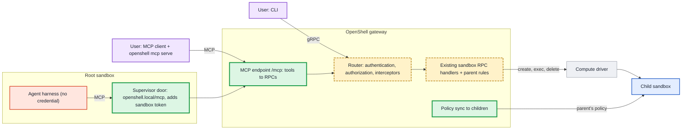

---
authors:
  - "@patkraw"
state: review
links:
  - https://github.com/NVIDIA/OpenShell/issues/4574
  - https://github.com/NVIDIA/OpenShell/pull/4721
---

# RFC 0021 - Sandboxed Subagents

## Summary

This RFC lets a sandbox create child sandboxes, so an agent can hand work to a
sub-agent or a tool that runs in its own isolated sandbox. A user creates a
child from the CLI with
`openshell sandbox create --name worker1 --parent <sandbox>`. An agent inside a
root sandbox creates one through a small set of MCP tools at
`http://openshell.local/mcp`. Users can use the same MCP tools from the host
through `openshell mcp serve`, a local bridge that reuses their CLI login.

The design is deliberately small. A sandbox gains a read-only `parent` field,
and a create request can name a parent. Only a sandbox without a parent can create children, so trees are
one level deep. A child always uses its parent's policy: the gateway copies the
parent's policy into the child at creation and keeps it in sync when the parent
changes. Agents create, run commands in, wait for and delete their children
through the existing sandbox RPCs, which the MCP tools call through the
gateway's normal authorization and interceptor path. The feature is
experimental and off unless the gateway operator enables it.

This version replaces the earlier draft of this RFC, which proposed grants,
deeper trees, agent and tool sandbox kinds, and a policy prover. The review
discussion narrowed the scope; the Decision record section lists each choice
and where it came from.

## Motivation

Agent harnesses split work across sub-agents: a lead agent plans the work and
hands parts of it to workers. Today those workers run inside the lead's
sandbox, as threads or processes next to it, so they share its files,
credentials and network access.

We want each sub-agent to run in its own sandbox. That needs three things
OpenShell does not have today:

- **A relationship between sandboxes.** A sandbox can record a parent. For now
  a parent's children cannot have children of their own, so trees are one
  level deep.
- **A way for an agent to create a child.** Only users can create sandboxes
  today. An agent inside a root sandbox gets a small set of MCP tools to create
  children, run work in them and collect the results.
- **The same workflow for users.**
  `openshell sandbox create --name worker1 --parent <name>` works like creating
  any other sandbox, with the same options. Users who work
  through an MCP client can do the same with the MCP tools.

Starting with one level keeps the design small, so we can learn how sandboxed
sub-agents are used before adding deeper trees or finer-grained permissions.

## Non-goals

- **Deeper trees.** A child cannot create children; deeper trees are future
  work.
- **Separate agent and tool sandbox kinds.** Every child is an ordinary
  sandbox; what runs in it does not change the rules.
- **A child policy different from its parent's.** Children cannot narrow or
  widen the parent's policy in this version; narrowing is planned for v1.
- **Choosing an image from inside a sandbox.** An agent's children copy its
  image and resources; choosing from approved templates is planned for v1.
- **Storing results in the gateway.** A child's output stays in the child until
  its parent reads it.
- **Messaging between agents.** How running agents talk to each other is a
  separate proposal.
- **Other control-plane tools on the MCP endpoint.** Each later set of tools
  gets its own proposal.

## Decision record

The review of the earlier draft on this pull request and in the design
document led to the following choices. "Proposed by" names where the idea came
from; all were accepted by the author.

| Topic | Decision | Proposed by |
|---|---|---|
| Depth | Only roots create children; one level | drew |
| Sandbox kinds | No agent and tool kinds | review thread |
| Parent link | Read-only `parent` field on the sandbox | drew |
| RPCs | Reuse existing sandbox RPCs; no child-sandbox API | drew, Piotr |
| MCP path | Tools call RPCs through the normal router, so interceptors run | author |
| Callers | Agents in root sandboxes and users on the host (`openshell mcp serve`) | author |
| Enabling | Gateway setting, off by default; no grants | Piotr |
| Limit | `max_concurrent_children` per parent, default 10; deletes free slots | author, team call |
| Policy | Child uses the parent's policy, copied and kept in sync | author |
| Child policy changes | Refused, including proposals; narrowing planned for v1 | drew (narrowing) |
| Image and resources | Users: all create options, a deliberate departure from drew's "inherited from the parent"; agents: copy the parent | Piotr (copy) |
| Providers | Subset of the parent's; removals reach children | author |
| Results | Idle children, `exec`, background jobs and `wait` | Piotr |
| Retries | Same name returns the existing child with `already_existed` | Piotr |
| User check | The root's user must still be a workspace member | Piotr |
| Deleting a parent | Refused unless `--with-children` | author |
| Protocol | 2025 MCP revisions, no sessions, calls under 45 s | Piotr |
| Credential | Existing sandbox session token, attached by the supervisor | Piotr |

## Proposal

### Overview

A sandbox can have a parent. A sandbox without a parent is a root; a sandbox
with one is a child. Only a root can be a parent, so trees are one level deep.
Children are ordinary sandboxes: the same lifecycle, the same commands and the
same policy enforcement. Three rules set them apart. A child always uses its
parent's policy, a child cannot create children, and a parent with children
cannot be deleted unless the caller asks to delete its children too.

Three kinds of caller create and manage children, and all of them end up in
the existing sandbox RPCs:

- **A user with the CLI** runs
  `openshell sandbox create --name worker1 --parent <name>` and the other
  sandbox commands as today.
- **A user with an MCP client** on the host runs `openshell mcp serve`, a local
  bridge that reuses the CLI login, and calls the MCP tools.
- **An agent inside a root sandbox** calls the MCP tools at
  `http://openshell.local/mcp`. Its supervisor attaches the sandbox's token, so
  the agent never holds a credential, and the gateway treats the sandbox as the
  caller.



The MCP endpoint adds no new authority. It turns each tool call into the
matching sandbox RPC and sends it through the same router as any gRPC call, so
authentication, authorization and operator interceptors apply to every
caller. A user can do through MCP exactly what the CLI allows. A sandbox can
act only on its own children.

The rest of this section covers parentage, policy, the MCP tools, running work
and collecting results, gateway configuration and limits, lifecycle, and
authorization.

### Parentage

A child records its parent in one gateway-owned, read-only field on the
sandbox, next to `created_from_workload_template`:

```proto
message Sandbox {
  // ... existing fields ...
  // Set by the gateway when the sandbox is created as a child. Absent on roots.
  // Never changes after creation.
  SandboxParent parent = 21;
  // Set by the gateway on every new sandbox: the user who created it.
  // Never changes after creation. Absent on sandboxes created before this field.
  string created_by = 22;
}

message SandboxParent {
  string name = 1;  // the parent's name, for display
  string id = 2;    // the parent's id; names can be reused after a delete
}

message CreateSandboxRequest {
  // ... existing fields ...
  // Name of the root sandbox to create this sandbox under.
  optional string parent = 10;
}
```

The gateway stores the parent's id so that deleting a parent and creating a
new sandbox with the same name never re-attaches the old children. Older
records have no `parent` field and are read as roots, so no migration is
needed. Field numbers are illustrative until implementation.

When a request names a parent, the gateway checks, in order:

1. Child sandboxes are enabled on this gateway.
2. The parent exists and is in the same workspace.
3. The parent has no parent of its own. Otherwise the request fails with
   "only one level of child sandboxes is supported".
4. The request carries no policy (see [Policy](#policy)).
5. Any providers named are attached to the parent (see [Providers](#providers)).
6. The parent has fewer children than `max_concurrent_children` (see
   [Gateway configuration and limits](#gateway-configuration-and-limits)).

**Who sets the parent.** For a user, `parent` is optional: without it the
request creates a root, as today. For a sandbox calling through MCP, the
gateway sets `parent` to the calling sandbox, taken from its token. A sandbox
cannot name a different parent and cannot create a root, so an agent cannot
escape the one-level limit by leaving `parent` out.

**From the CLI**, `--parent` works with every other `sandbox create` option:

```shell
openshell sandbox create --name lead --from codex-agent:local \
  --provider openai --provider anthropic --policy team.yaml
openshell sandbox create --name reviewer --parent lead \
  --from claude-agent:local --provider anthropic --cpu 2 --memory 4Gi
openshell sandbox create --name nested --parent reviewer
# error: only one level of child sandboxes is supported
```

`openshell sandbox list` shows each sandbox's parent, and
`openshell sandbox list --parent lead` lists one parent's children.

**Children created by agents and by users.** A child can be created by a user
(CLI, SDK or MCP) or by its parent sandbox (MCP). The two differ only in what
the creator may choose:

| | Created by the parent sandbox (MCP) | Created by a user (CLI, SDK or MCP) |
|---|---|---|
| Create inputs | `name` only | Every `sandbox create` option, except a policy |
| Image and resources | Copied from the parent | Chosen by the user; default as for any sandbox |
| Providers | All of the parent's | All of the parent's, or a subset |
| Main command | None; always idle | Optional; idle without one |
| Parent | Always the caller | Any root the user can access |
| Retry with an existing name | Returns the child with `already_existed: true` | "already exists" error |
| Creator check | The root's `created_by` user is rechecked | The user is checked as the caller |

After creation, both are the same kind of child: the same policy sync,
lifecycle, limits and parent link. The audit log records which path created
each child.

Agents get fewer choices because an agent can be steered by content it reads,
while a user is accountable for what they create. A free choice of image would
let an agent run any code from any registry with the parent's provider
credentials; free resources would let it exhaust the cluster, since the limit
counts children, not their size; free labels and environment could spoof what
operators and interceptors match on or override what the sandbox relies on;
and a main command would end the child before its results can be collected.
Templates over MCP (see [Future work](#future-work)) are the planned way to
give agents operator-approved choices.

### Policy

A child always runs under its parent's policy. It has no policy of its own to
set, edit or widen.

**At creation** the gateway copies the parent's current policy into the
child's policy history and records which parent version it came from, for
example "copied from `lead` version 7". A request that carries a policy for a
child is refused with "child sandboxes use their parent's policy; omit
--policy". This applies to the CLI, the SDKs and MCP alike. The CLI also
ignores the `OPENSHELL_SANDBOX_POLICY` environment variable when `--parent` is
set and prints a one-line note, so a policy left in the user's shell does not
cause a confusing error.

**When the parent's policy changes**, the gateway copies the new version into
each child and delivers it the same way it delivers any policy update. One
function does this: for each child, compare the parent version it was copied
from with the parent's latest version, and copy and deliver if the child is
behind. The write is conditional on the child's recorded parent version, so a
child only ever moves forward: a slow or repeated run can never replace a newer
copy with an older one, and running it twice changes nothing. The gateway runs
it after every change to a parent's policy, at gateway start, when a child's
supervisor connects, and periodically, so a copy that failed or was missed
during a crash or a disconnect is retried.

```text
lead:      v6 ──── v7 ──────────── v8
reviewer:  v1 (from lead v6) ─ v2 (from lead v7) ─ v3 (from lead v8)
```

Each child keeps its own history and its own load status, so a child that
fails to load a version never marks the parent's version as failed, and the
reverse. Delivery is asynchronous, as it is for every sandbox today: a child
applies a new version within seconds of the parent, and a disconnected child
catches up when it reconnects. A parent's policy follows the existing rules for
running sandboxes: Landlock and process rules cannot change after creation, and
filesystem rules can only gain paths, which take effect on the next start.
Because children only receive versions their parent accepted, the same limits
hold for children.

**Children cannot change their policy.** The gateway refuses policy updates
addressed to a child, from any client. At startup a supervisor normally adds
required filesystem paths to its policy and writes the result back to the
gateway. For a child the gateway reports the policy's source as `Parent`, and
the supervisor keeps those paths in memory without writing back, as it already
does when a global policy is active.

**Children cannot request more access.** A child's policy proposals through
`policy.local` are refused with "child sandboxes use their parent's policy;
ask the parent or a user". Denials are still logged on the child, so the lead
or a user can see what it needed. The lead can propose a change to its own
policy; once approved, it reaches every child. A global policy, when active,
applies to parents and children as it does to every sandbox today.

**Trade-off.** Because children share their parent's policy, the parent must
hold every permission any of its children needs, even ones the parent never
uses. Narrowing a child's policy at creation, planned for v1, lets a child
have less than its parent but does not remove the parent's access. A policy for
a whole tree or group of sandboxes, which could, is future work.

### Providers

A provider holds a credential, such as a model API key, that the supervisor
adds to a sandbox's outgoing requests, and attaching one also opens the network
to that provider's endpoints. Children can use only providers attached to
their parent.

- **From the CLI**, `--parent` without `--provider` attaches all of the
  parent's providers. Naming providers picks a subset. Naming a provider the
  parent does not have is refused.
- **Through MCP**, a child created by a sandbox gets all of the parent's
  providers; sandbox callers cannot name providers. A user calling through
  MCP can pick a subset, as with the CLI.

```shell
# lead has openai and anthropic
openshell sandbox create --name reviewer --parent lead --provider anthropic
openshell sandbox create --name helper --parent lead --provider github
# error: provider 'github' is not attached to parent 'lead'
```

When the parent's providers change:

- **The parent loses a provider:** its children lose it too. Provider changes
  are not policy versions, so the sync compares each child's providers with the
  parent's separately and detaches any the parent no longer has. Revoking a
  credential on the lead therefore reaches the whole tree.
- **The parent gains a provider:** existing children are unchanged. New
  children get it.
- **Attaching a provider to a child later** follows the same rule as at
  creation: only providers the parent has.

Because each child's providers add their own endpoints to its effective
policy, a parent and a child that use different providers can have different
effective network rules while sharing the same authored policy.

### MCP endpoint and tools

The gateway serves an MCP endpoint at `/mcp` on its existing port. It is one
MCP server with a fixed set of tools, not a proxy for other MCP servers. Each
tool call becomes the matching sandbox RPC and goes through the gateway's
normal router, so authentication, authorization and operator interceptors run
exactly as they do for gRPC. The router accepts a sandbox caller on these RPCs
only for requests that `/mcp` dispatches inside the gateway process; direct
gRPC calls from a sandbox stay refused (see
[Authorization and audit](#authorization-and-audit)).

**From inside a sandbox**, an agent calls `http://openshell.local/mcp`. The
sandbox's supervisor serves that address, the same way it serves
`policy.local`. It drops any credentials or identity headers the agent sent,
attaches the sandbox's existing session token and forwards the call to the
gateway. The agent never holds a token. Only roots can create children, but
every sandbox can reach the endpoint, so a child gets a clear refusal instead
of a connection error.

**From the host**, a user adds `openshell mcp serve` to their MCP client's
configuration. The client starts it as a local process, and it forwards tool
calls to `/mcp` using the CLI's existing login. This works with gateways that
use mTLS client certificates, which most MCP clients cannot present.

**Tools.** All tools are always listed; whether a call is allowed is decided
when it is made.

| Tool | What it does | RPC |
|---|---|---|
| `create_sandbox` | Create a sandbox and wait until it is ready, up to 45 s | `CreateSandbox` |
| `list` | List sandboxes and their state | `ListSandboxes` |
| `exec` | Run a command; with `background: true`, start a job and return its name | `ExecSandbox` |
| `wait` | Wait for a job, up to 45 s | `ExecSandbox` |
| `delete` | Delete a sandbox | `DeleteSandbox` |
| `logs` | Read a sandbox's logs, such as startup errors and policy denials | `GetSandboxLogs` |

What a caller can do depends on who it is:

- **A sandbox** acts only on its own children. `create_sandbox` takes only a
  `name`; the child copies the caller's image, resources and providers, and
  its parent is the caller. `list` shows only its children.
- **A user** acts on any sandbox the CLI would let them act on.
  `create_sandbox` accepts `name`, `parent`, `image`, `cpu`, `memory`,
  `providers`, `env`, `labels`, `command` and, for roots only, `policy` as YAML
  text. CLI options that act on the user's own machine stay CLI-only:
  uploading local files, opening an editor, forwarding ports and attaching a
  terminal. Files can be placed in a sandbox over MCP with `exec` and stdin,
  for example as a tar archive.

**Retries.** If a sandbox calls `create_sandbox` with the name of a child it
already has, the gateway returns that child with `already_existed: true`, its
creation time and its state, and does not count it again. This makes a retry
after a lost reply safe, and tells the model when a name was already in use.
For users the existing "already exists" error applies.

**Protocol.** The endpoint speaks the 2025 MCP revisions (2025-06-18 and
2025-11-25) that most harnesses use today, without MCP sessions, so any
gateway replica can answer any call. Replies are plain JSON. No call runs
longer than 45 seconds, below the 60-second timeout common in MCP clients; a
longer wait returns `timed_out` and the caller calls `wait` again. Streamed
progress and the 2026-07-28 revision are planned for v1.

### Running work and collecting results

A child that an agent creates through MCP always starts idle: its main process
is a shell that waits. All work runs through `exec`, so the child stays ready
and its files stay readable until it is deleted. A harness inside the child is
just a command, so a Codex lead can run Claude Code in a child as long as the
image contains it.

A user can give a child a main command, as with any sandbox; without one, the
child starts idle. When a main command ends, the sandbox completes and `exec`
and `wait` no longer work on it, as for any sandbox today, so a child whose
results are needed should start idle and run its work with `exec`.

**Short commands** run in the foreground. `exec` returns the exit code, stdout
and stderr. Output is capped at 64 KiB; when it is longer, the start and the
end are kept with a marker between them, because errors usually appear at the
end, and `truncated` is set. A foreground command is stopped when it reaches
its timeout, 45 seconds at most, and the reply says it timed out and that long
commands should run with `background: true`.

```text
exec {name: "box", command: ["cargo", "test"]}
→ exit 0 · stdout: "test result: ok. 214 passed"
```

**Long work**, such as a sub-agent, runs as a background job. `exec` with
`background: true` returns a job name at once, and `wait` returns the job's
result in the same shape as a foreground `exec`, or `timed_out` after 45
seconds so the caller can call it again. The caller can name the job. If it
retries a start after a lost reply with the same name, the reply says the job
is already running instead of starting it twice. Without a name, the gateway
picks one and retries are not protected.

```text
create_sandbox {name: "reviewer"}
exec {name: "reviewer", command: ["claude", "-p", "Review the diff"], background: true, job: "review"}
→ job: review
wait {name: "reviewer", job: "review"}
→ timed_out
wait {name: "reviewer", job: "review"}
→ done · exit 0 · stdout: the review
delete {name: "reviewer"}
```

The result is the harness's stdout. One-shot modes such as `pi -p`,
`codex exec` and `claude -p` print the final answer there, so the parent needs
no result file.

**How jobs work.** The caller passes the plain command. The gateway wraps it so
it runs detached in its own session (`setsid`), writes its process id, output
and exit code to `/tmp/openshell/jobs/<job>/` inside the child, and keeps
running after the `exec` that started it ends or is cancelled. The wrapper
creates the job's folder in one step that fails if the folder already exists,
which is what makes a named retry safe. `wait` checks for the exit file with
short `exec` calls. If there is no exit file and the process is no longer
running, for example because the child restarted, `wait` returns `lost`
instead of waiting forever.

The command is passed as separate arguments, never quoted into a shell string.
Job names may contain only letters, digits and dashes, so a name cannot point
outside the jobs folder. Output files can grow inside the child, but `wait`
returns at most 64 KiB of them. The child writes these files, so the parent
receives their contents as data from the child, not as facts the gateway has
checked. The gateway stores no output: results live in the child until it is
deleted, which is one reason deleting a parent with children needs an explicit
flag (see [Lifecycle](#lifecycle)).

This needs `sh` and `setsid` in the child's image and a writable `/tmp` under
the parent's policy. A native detach option on `ExecSandbox`, handled by the
sandbox runtime, can replace the wrapper later.

### Gateway configuration and limits

Child sandboxes are experimental and off by default. An operator enables them
in the gateway configuration:

```toml
[openshell.gateway]
experimental_enable_child_sandboxes = true
max_concurrent_children = 10
```

The gateway reads both settings at startup; changing them needs a restart.

**`experimental_enable_child_sandboxes`** (default `false`) controls only the
creation of new children, from the CLI and MCP alike. When it is off, a create
request with a parent is refused with "child sandboxes are disabled on this
gateway". Everything else keeps working for children that already exist:
policy sync, `list`, `exec`, `wait`, `logs` and `delete`. Turning the setting
off never deletes children, and policy changes keep reaching them, so a
revocation on a parent still applies.

**`max_concurrent_children`** (default `10`) limits how many children each
parent can have at once. The limit applies to each parent separately; it is not
a pool shared across the gateway, and the parent does not count itself. `0`
means no children even when the feature is on. The gateway refuses values above
1,000 at startup.

Every child that exists counts, whether it is starting, running, stopped or
failed, because a stopped child still holds a name and storage. Deleting a
child frees its slot. Creating a child checks the parent, counts its children
and inserts the child's record in one database transaction that locks the
parent's record. Deleting a parent takes the same lock. Two creates for the
same parent therefore cannot both take the last slot, and a create and a
delete of the same parent cannot both succeed, even across gateway replicas:
the database makes one wait for the other. The limit lives in the create path;
operators who need other quotas can add them with gateway interceptors.

### Lifecycle

Children follow the ordinary sandbox lifecycle. The parent relationship adds
three rules.

**Stopping a parent does not touch its children.** A stopped or crashed parent
keeps its record, and its children keep running under their last copy of its
policy. When the parent starts again it can collect their results. Stopping or
restarting a child works as for any sandbox; on reconnect the child receives
the parent's latest policy.

**Deleting a parent that has children is refused** unless the caller asks to
delete the children too, in the same way a workspace cannot be deleted while
it still holds sandboxes:

```shell
openshell sandbox delete lead
# error: sandbox 'lead' has 3 children; delete them first or use --with-children
openshell sandbox delete lead --with-children
```

With `--with-children`, or `with_children: true` on the MCP `delete` tool, the
gateway deletes the children first and the parent last. A child's job output
lives only inside the child, so this rule keeps a single command from
discarding results nobody has collected. A sandbox calling `delete` through MCP
can delete only its own children, which have no children of their own.

**A child whose parent is missing is stopped.** Because creating a child and
deleting its parent take the same lock, a child can lose its parent only
through a crash or a bug. If the gateway finds such a child, it stops it as
`openshell sandbox stop` would, which ends its processes and with them its use
of credentials and network access, and marks it failed. The record and files
stay, so a user can inspect the child, read its logs and delete it. Starting
it again is refused, because nothing would keep its policy in line with a
parent, and it never receives a default policy.

### Authorization and audit

**Authenticating `/mcp`.** Plain HTTP routes on the gateway are not
authenticated today; only the gRPC service is. The `/mcp` handler runs the
gateway's existing authenticator chain. A sandbox session token yields a
sandbox caller. An OIDC bearer token or an mTLS client certificate, which is
what `openshell mcp serve` sends, yields a user. Anonymous callers are refused.
The handler then dispatches the RPC to the gRPC router inside the gateway
process, with that caller and an in-memory marker saying the request came from
`/mcp`. The marker is a typed value in the request's extensions, not a header,
so nothing that arrives over the network can carry it. The caller's
authentication context is preserved, so interceptors see the real caller.

The router allows a sandbox caller with the marker on exactly five methods:
`CreateSandbox`, `ListSandboxes`, `ExecSandbox`, `DeleteSandbox` and
`GetSandboxLogs`. Every other method keeps its current rule. The parent,
workspace and child-only checks below run in the handlers, on the request as
it arrives after interceptors have run, so an interceptor that rewrites a
request cannot move a child to another parent or workspace.

**Sandbox callers.** A sandbox may call `CreateSandbox`, `ListSandboxes`,
`ExecSandbox`, `DeleteSandbox` and `GetSandboxLogs` only through `/mcp`, and
only on its own children:

- `CreateSandbox`: the caller must be a root. The gateway sets the parent to
  the caller, creates the child in the caller's workspace, and fills in the
  image, resources and providers from the caller. Any other fields in the
  request are refused.
- `ListSandboxes`: returns only the caller's children.
- `ExecSandbox`, `DeleteSandbox`, `GetSandboxLogs`: the target's parent must be
  the caller.

**User callers** keep exactly the permissions they have today, whether they use
the CLI, an SDK or MCP. Nothing in this RFC lets a user do more than before.

| Action | User (CLI, SDK or MCP) | Root sandbox (MCP) | Child sandbox (MCP) |
|---|---|---|---|
| Create a root | yes | no | no |
| Create a child | under any root they can access | under itself only | no |
| List, exec, wait, logs, delete | sandboxes they can access | its own children | nothing |
| Change a child's policy | no (change the parent's) | no | no |

**The user who started the root must still have access.** When a user creates
a sandbox, the gateway records that user in its read-only `created_by` field.
Every time a root creates a child through MCP, the gateway checks that this
user is still a member of the workspace with at least the user role. If not,
the create is refused with "the user who started this sandbox no longer has
access". Existing children keep running and can still be listed, waited on and
deleted. An agent therefore cannot create children after its user loses access
to the workspace.

The check fails closed. A root created before `created_by` existed, or by an
identity that has no workspace membership to recheck, such as an operator's
client certificate, cannot create children through MCP; the error says so.
Users can still create children under such a root from the CLI, where the
user is the caller and is checked directly.

**Credentials.** The supervisor attaches the sandbox's existing session token
to MCP calls. The agent never receives it, and it is not a new credential. A
token that can be used only for `/mcp` is planned for v1.

**Audit.** Every MCP tool call, refusal and `exec` command is logged through the
existing OCSF events, with the calling sandbox, the user it acts for, the
parent, the decision and the reason. Refusals at the supervisor door are logged
as HTTP denials, like other egress denials. An operator can answer "which
sandbox created this one, for which user, and what did it run" from the logs
they already collect.

### Compatibility

The change is additive. With `experimental_enable_child_sandboxes` off, which
is the default, the gateway behaves as today, except that `/mcp` answers user
callers. Sandboxes created without `--parent` are unchanged. The new `parent`
fields are optional, and records written before this change read as roots, so
existing gRPC clients and stored sandboxes need no migration. Regenerated SDKs
expose the new fields.

A supervisor older than this change does not serve `openshell.local`, so
agents in sandboxes started from an older supervisor image cannot reach the MCP
tools until the image is updated. Host users can use `/mcp` as soon as the
gateway supports it. A child started under a supervisor that does not know the
`Parent` policy source would try to write its startup policy back; the gateway
refuses that write, so the supervisor version must be at least the gateway
version for children.

## Implementation plan

Each phase is a separate pull request with its own tests. Child creation stays
behind `experimental_enable_child_sandboxes` throughout, so a partly finished
feature is never reachable on a default gateway.

1. **Configuration.** Add `experimental_enable_child_sandboxes` and
   `max_concurrent_children` to the gateway configuration, with defaults,
   range checks and documentation in the gateway configuration reference.
2. **Parentage from the CLI.** Add `CreateSandboxRequest.parent`, the read-only
   `Sandbox.parent` and `Sandbox.created_by` fields, `--parent` on `sandbox create`, `--parent` on
   `sandbox list`, and `--with-children` on `sandbox delete`. The create path
   checks the feature, the parent, the depth, the absence of a policy, the
   provider subset and the per-parent limit. A new child starts with a copy of
   the parent's current policy. Regenerate the SDKs.
3. **Policy and provider sync.** Add the sync that copies a parent's policy and
   provider removals into its children, run after parent changes, at gateway
   start and when a child connects. Refuse policy writes and proposals for
   children, and report the `Parent` policy source to their supervisors.
4. **MCP for sandboxes.** Add the `openshell.local` door to the supervisor and
   the `/mcp` endpoint to the gateway. Tools call the existing RPCs through the
   router; sandbox callers act only on their own children, and the root's user
   is rechecked on every create.
5. **Results.** Foreground `exec` with the 64 KiB cap, background jobs and
   `wait`. Before building, confirm the job checks listed in
   [Open questions](#open-questions) on Docker and Kubernetes.
6. **MCP for users.** Accept user callers on `/mcp` and add
   `openshell mcp serve`.
7. **Documentation and end-to-end tests.** Publish user documentation for the
   CLI, the MCP tools and the gateway settings, and add end-to-end tests that
   create, use and delete children from the CLI and from an agent in a sandbox.

The proof of concept on the
[`gateway-mcp-poc`](https://github.com/patkraw/OpenShell/tree/gateway-mcp-poc)
branch implements the door, the `/mcp` endpoint and child creation for the
earlier draft of this RFC. Its MCP protocol handling and supervisor door can be
reused; its grants, lineage store and result files are not part of this design.

## Risks

- **Parents hold their children's permissions.** A child can use only what its
  parent has, so a lead that delegates email to a child must itself be allowed
  to send email. Users should give leads only the access their workers need.
  Narrowing in v1 lets a child have less than its parent, but the parent keeps
  its access; only a policy for a whole group of sandboxes, which is future
  work, would remove it.
- **Policy updates reach children a few seconds after the parent.** Delivery is
  asynchronous, as it is for every sandbox, and a disconnected child catches up
  only when it reconnects. During that window a child can still use access the
  parent has just lost.
- **Background jobs depend on the sandbox runtime.** Jobs assume that `setsid`
  is allowed by the sandbox's system-call filter, that a job survives a
  cancelled `exec`, and that `/tmp` is writable. If any of these fails on a
  driver, background jobs fail there until a native detach option exists.
- **The MCP door uses the sandbox's session token.** That token can do more
  than call `/mcp`. The agent never sees it, but the agent must also be unable
  to read the token file inside the sandbox. A token limited to `/mcp` is
  planned for v1.
- **Agents start sandboxes on their own.** Within the limit, a prompt-injected
  agent can start children and run commands in them. Children cannot exceed
  the parent's policy, the limit caps how many run at once, and every call is
  audited.

## Future work

- **Templates over MCP.** A `list_templates` tool and a `template` argument on
  `create_sandbox`, built on the existing `ListSandboxTemplates` RPC and
  `CreateSandboxRequest.workload_template`, so agents can start children with
  a different image. Only templates an administrator labels as usable by agents
  are listed or accepted, a template's environment variables are never
  returned to the agent, and templates with driver configuration are refused.
  Templates hold an image, environment and resources but no policy, so a child
  created from one still uses its parent's policy.
- **Narrowing a child's policy.** A child created with a stricter policy than
  its parent, checked to fit inside the parent's.
- **Child policy proposals.** A child's proposal routed to its parent's inbox,
  approved only by a person, never automatically.
- **Deeper trees and groups.** More than one level of children, or a group of
  sandboxes with its own limits and policy, for teams of agents that are not a
  simple tree.
- **Communication between agents.** Creating children always forms a tree, but
  agents may need to talk in other patterns, including cycles. How running
  agents discover and message each other is a separate proposal.
- **Progress and newer MCP revisions.** Streamed progress during long calls and
  the 2026-07-28 MCP revision.
- **A token for `/mcp` only**, and a native detach option on `ExecSandbox` to
  replace the job wrapper.
- **A CLI over the door**, for harnesses that use skills and shell commands
  instead of MCP.
- **Harness integration.** Configuration that turns off a harness's built-in
  sub-agent tool, so its sub-agents run in OpenShell sandboxes instead.

## Alternatives

### A child points at its parent's policy

Instead of copying, a child would have no policy history and the gateway would
read the parent's policy whenever it builds the child's configuration.

This was rejected because the gateway delivers, records and reports policy per
sandbox. A shared policy record would make a child's load status overwrite the
parent's, would need every policy change to find and notify children anyway,
and would let a supervisor's startup write-back create a child policy. Copying
keeps per-sandbox delivery, history and load status as they are. The new work
is the sync function and the `Parent` policy source that stops a child's
startup write-back.

### A one-time copy at creation

The child would get the parent's policy at creation and be managed separately
afterwards, with its own proposals going to a user.

This was rejected because revoking access on the parent would not reach its
children, and a child could become wider than its parent.

### A lifetime budget

The root would carry a budget of children ever created, never refunded, so a
tree could not create and delete children forever.

This was not chosen because a long-running lead that cleans up after itself
would still run out. The per-parent concurrent limit caps resources in use; a
lifetime budget can be added later if runaway loops appear in practice.

### Any sandbox in a tree may create children

Children could create children as long as the root's budget allows.

This was not chosen for this version, to keep one simple rule and learn how
one level is used first.

### MCP calls the handlers directly

The `/mcp` endpoint would build requests and call the sandbox handlers without
going through the gRPC router.

This was rejected because operator interceptors would never see sandboxes
created through MCP. Users can choose any create option over MCP, and
operators may restrict even an image an agent copies from its parent, so
skipping the interceptors would bypass operator rules such as allowed images.

### Sandboxes call the gRPC API directly

`CreateSandbox` and the other RPCs would accept sandbox callers over gRPC.

This was rejected because it would expose the whole public create surface to
sandboxes, including every option added in future. The MCP path accepts a
narrow request and fills in the rest from the parent.

### MCP server in the supervisor

Each supervisor would serve the MCP tools itself, like `policy.local`.

This was rejected because host users have no supervisor and would need a
second path, the MCP layer would need upgrading in every running sandbox when
MCP changes, and the checks would still have to live in the gateway.

### Agent holds its own gateway credential

The agent would call the gateway directly with a token in its environment.

This was rejected because a prompt-injected agent could copy the token and use
it from anywhere. The supervisor door keeps credentials out of the agent's
reach.

### Skills and a CLI instead of MCP

Harnesses would create children by running a command-line tool described in a
skill.

MCP was chosen first because most harnesses already speak it and need only a
configuration entry. A CLI over the same door is future work.

### Grants

The earlier draft of this RFC gave each tree a grant with depth, breadth,
total, expiry and program limits, and checked each child's policy with the
policy prover. Reviewers found it more than a first version needs. Its pieces
remain available as future extensions.

## Prior art

- **Harness sub-agent limits.** Claude Code, Qwen Code, Gemini CLI and Pi cap
  sub-agent depth or concurrency inside the harness. This RFC moves the limit
  outside the agent's reach.
- **AWS instance metadata and the SPIFFE workload API.** A workload gets its
  identity from a trusted local component and never stores a long-lived
  secret. The supervisor door follows this pattern, as OpenShell's provider
  credential injection already does.
- **OpenShell RFC 0010 (gateway interceptors)** and **RFC 0011 (workspaces).**
  MCP calls run through interceptors, and workspace membership remains the
  access model; the root's user check builds on it.
- **The earlier draft of this RFC** and its proof of concept on the
  `gateway-mcp-poc` branch, which tested the door, the MCP endpoint and
  sub-agents in Pi, Codex, OpenCode, Qwen Code and other harnesses.

## Open questions

- **Background jobs.** Before building them, confirm on Docker and Kubernetes
  that a background job keeps running after its `exec` ends and after it is
  cancelled, that the system-call filter allows `setsid`, that target images
  include `sh` and `setsid`, that `/tmp` is writable under typical policies,
  and that a child created without a command stays ready.
- **The session token file.** Confirm that the agent process cannot read the
  sandbox's session token file.
- **Automation identities.** Roots created by identities without workspace
  membership cannot create children through MCP in this version. Whether some
  automation identities, such as CI service accounts, should be rechecked
  another way is open.
- **gRPC from inside sandboxes.** The door carries MCP only. Whether SDK code
  inside a sandbox should later reach the same RPCs, for example over gRPC-Web
  or Connect, is open.

## Appendix: End-to-end walkthrough

1. **The operator enables the feature.**

   ```toml
   [openshell.gateway]
   experimental_enable_child_sandboxes = true
   max_concurrent_children = 10
   ```

2. **A user starts a lead.**

   ```shell
   openshell sandbox create --name lead --from pi-agent:local \
     --provider nvidia --policy team.yaml -- pi
   ```

3. **The agent creates a worker.** Pi calls `create_sandbox {name: "worker"}` at
   `http://openshell.local/mcp`. The supervisor attaches `lead`'s token. The
   gateway checks that children are enabled, that `lead` is a root under its
   limit, and that the user who created `lead` is still a member of the
   workspace. It creates `worker` with `lead`'s image, resources and providers
   and a copy of `lead`'s policy, and returns once `worker` is ready.

4. **The agent hands it a task.**
   `exec {name: "worker", command: ["pi", "-p", "Write the tests"], background: true}`
   returns job `j1`. The agent calls `wait {name: "worker", job: "j1"}` until it
   returns the exit code and the worker's answer on stdout.

5. **The user changes the lead's policy.** `openshell policy set lead ...`
   creates `lead` version 8. The gateway copies it into `worker` and delivers
   it; `worker` applies it within seconds.

6. **The agent cleans up.** `delete {name: "worker"}` frees the slot. Later the
   user runs `openshell sandbox delete lead`, which succeeds because `lead` has
   no children left.
