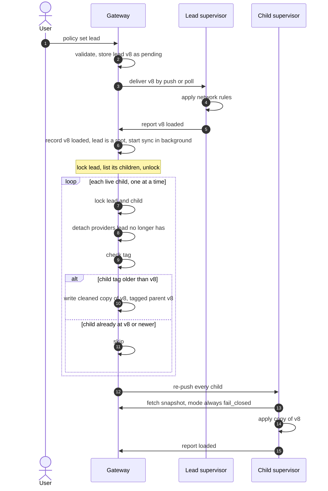
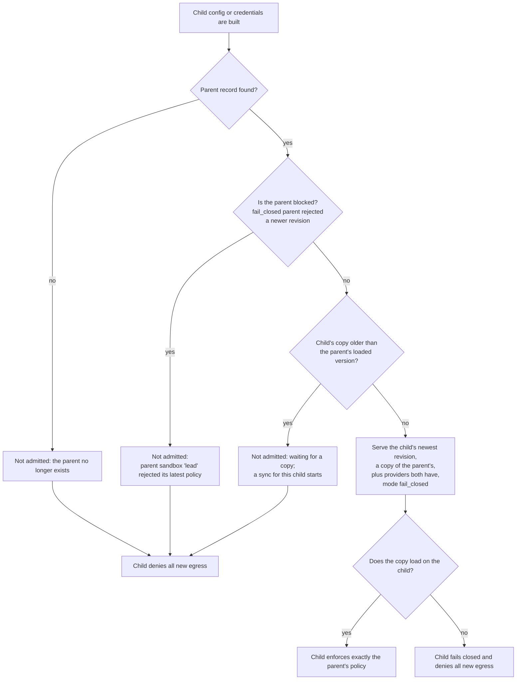
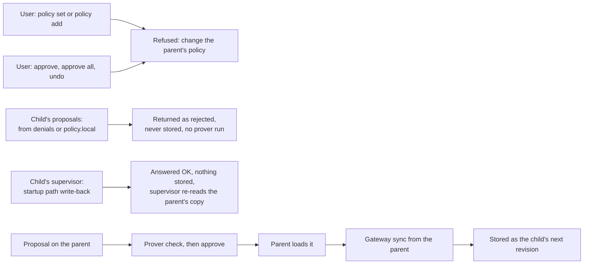
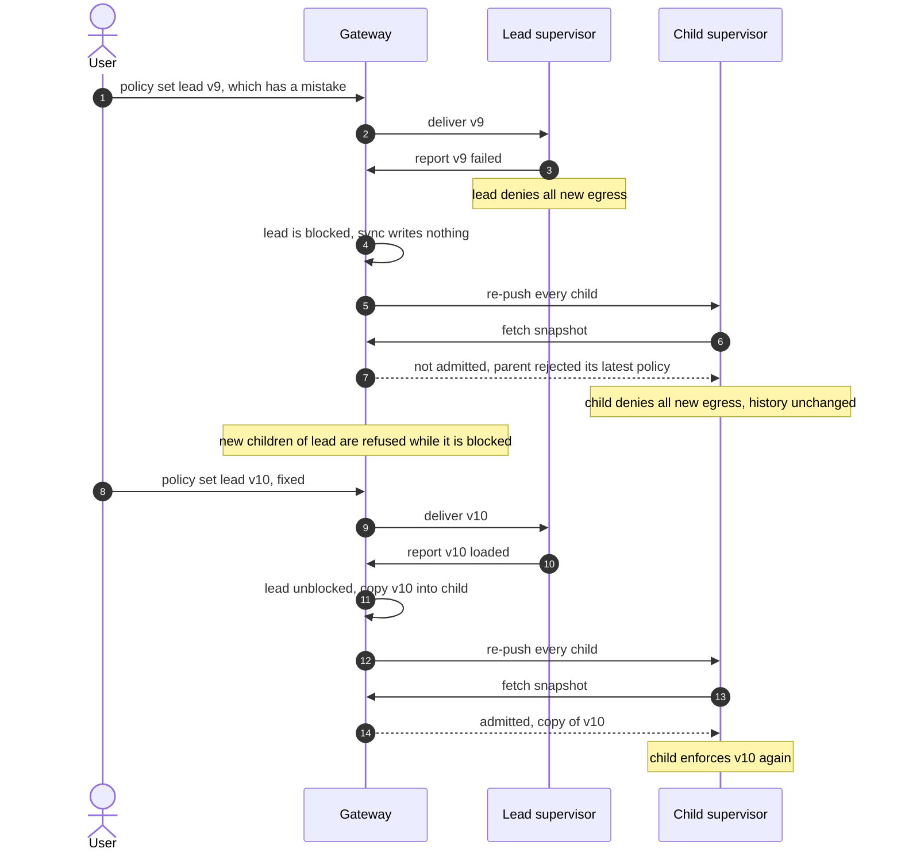
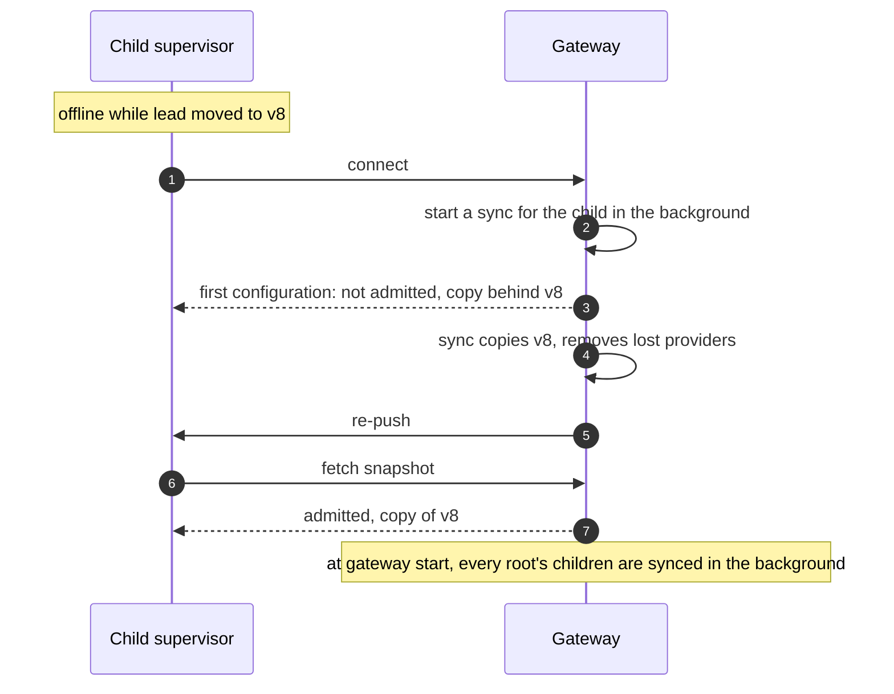
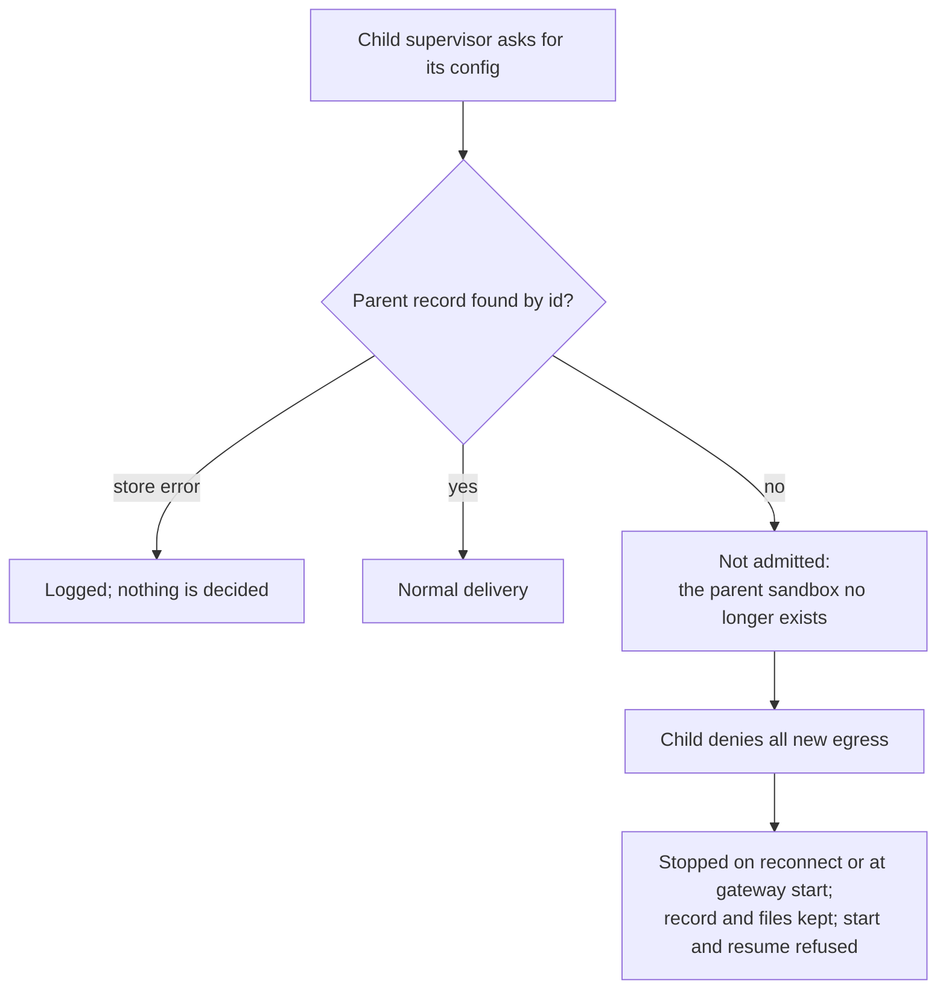

# Appendix: Policy Sync Between Parents and Children

> This is an appendix to the [RFC](../README.md). Please familiarize yourself with the RFC before reading this.

This appendix shows how a parent's policy reaches its children and what happens in each edge case, as built on the `feat/child-sandboxes/patkraw` branch. In short:

- A child's supervisor still writes its startup policy back. The gateway answers OK and stores nothing.
- Children always fail closed, whatever failure mode the gateway uses.
- Every configuration and credential build for a child checks the parent's live record. The child is refused while the parent is missing or blocked, or while its copy is behind the parent's loaded version, and it is served only providers the parent still has.
- A refusal for a copy that is behind starts a sync for that child. Rebuilds happen at least every 30 s, so a failed sync is retried that often.
- A provider the parent loses is withheld at the child's next build, and the sync removes it from the child's record.
- A child whose parent record is gone is stopped.

## What OpenShell already had

Most of the machinery is the gateway's existing per-sandbox policy handling; the feature adds one sync function and a few refusals on top of it.

- **Per-sandbox policy history** with versions, hashes and a load status per version, reported by each supervisor.
- **Delivery by push and poll**, so a sandbox picks up a new version within seconds or when it reconnects.
- **Failure modes** (`fail_closed`, `retain_last_valid`) for a supervisor that cannot load a version.
- **Mutation locks** per sandbox, which the child create, the sync and parent deletes share.
- **Provider attach and detach** with an attachment epoch, so a supervisor drops a detached credential.

## Normal case: the parent's policy changes



## What the gateway serves a child



## Who can change a child's policy



## A `fail_closed` parent rejects a policy, then is fixed



## A child catches up



## A child's parent is gone



A root created later under the same name is not the parent, because the parent is looked up by id.

## A child is created while a sync runs

```mermaid
sequenceDiagram
    autonumber
    participant Create as Child create
    participant Sync as Sync for lead v8
    participant Lock as Lead's lock
    Create->>Lock: take lead and new child
    Create->>Create: read lead's enforced policy, save child
    Create->>Lock: release
    Sync->>Lock: take lead
    Sync->>Sync: read lead v8, list children, new child included
    Sync->>Lock: release
    Note over Create,Sync: The lock serializes the two. A create either finishes before<br/>the list and gets synced, or starts after v8 is recorded and copies v8 itself.
```

## Other edge cases

| Situation | What happens | Why |
|---|---|---|
| Child created while the parent has no loaded revision | Refused | A child copies only a policy the parent enforces |
| Which parent revision is "enforced" | The one at the parent's `current_policy_version`, the last version it reported loaded, read by version | A newer revision marks it superseded before loading, and a failed re-apply marks it failed, so "the newest revision with status loaded" can be missing or older |
| A "failed" report for the parent's current version | `fail_closed`: parent and children blocked. `retain_last_valid`: children keep that version, and new children copy it | The parent still enforces that version under `retain_last_valid`; an older one could allow more |
| Two syncs finish out of order, v8 then v7 | v7 is skipped | The child's tag already says v8; a sync only moves a child forward |
| Sync runs twice for v8 | The second run writes nothing | The tag check makes it safe to repeat |
| One child's lock times out during a sync | Its siblings are still synced; the error is logged and reported at the end | One stuck child must not hold a revocation back from the others |
| The child's newest revision has no parent tag | It counts as behind and gets re-copied | Nothing but the sync may decide a child's policy |
| The parent's copy binds a provider the child lacks | Child is not admitted and fails closed | Children never keep access the parent lost |
| Gateway set to `retain_last_valid` | The parent keeps that mode; children always use `fail_closed` | A child that kept its old copy could keep revoked access |
| Parent uses `retain_last_valid` and has a newer pending or failed revision | Children copy the parent's enforced revision | Children get what the parent enforces |
| Child's image needs a system path its parent's image lacks | The path is not added; something in the child may get "permission denied" | Child = parent exactly; the gateway log shows the dropped write |
| Parent is unblocked but the child's copy is already current | The re-push of every child admits it again | This is why re-push runs on every sync, not only when it writes |
| Provider attach on a child | Allowed only if the parent has the provider, checked under the parent's lock | A child's providers are a subset of its parent's |
| Global policy active, parent has no policy history | Child create is refused | There is no parent revision to copy |
| Parent is deleted while it has live children | Refused: "has N child sandboxes; delete them first" | No orphaned children |
| A child is offline during a parent change | Refused on reconnect until the copy lands, then admitted | Delivery checks the parent, not the sync |
| The parent's loaded policy cannot be copied | Child refused with that reason; logged once per parent version | A copy that can never succeed must say why |

## Still open

- **Up to one rebuild of extra access.** A child keeps its old copy until its next rebuild, about 30 s, if the sync after a parent change fails. Notifying children when the parent loads would close this.
- **Stopping an orphan by name.** The stop re-reads the child by name and checks its id, but a short window remains before the stop; closing it needs a stop by id in the compute layer.
- **Failures of a loaded version cannot be told apart.** A "failed" report for the version a parent last loaded may be a re-apply that failed or a late result from a replaced polling session; both are recorded as failed. Under `fail_closed` the children are then blocked with the parent until it loads again.
