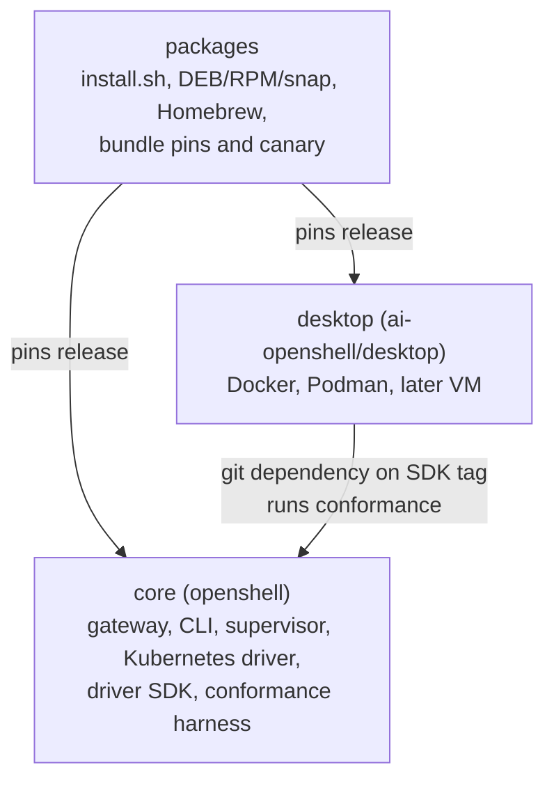
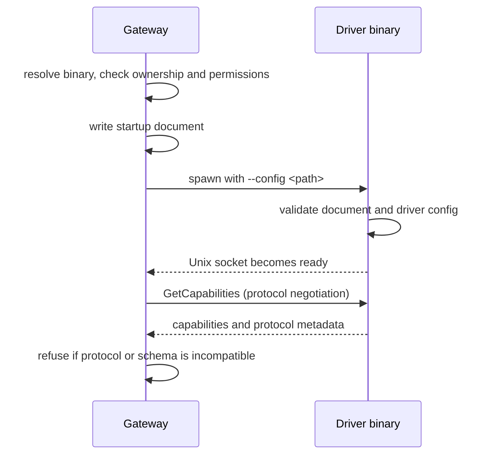

---
authors:
  - "@elezar"
state: draft
links:
  - https://github.com/NVIDIA/OpenShell/issues/5200
  - https://github.com/NVIDIA/OpenShell/issues/4425
  - https://github.com/NVIDIA/OpenShell/pull/4426
  - https://github.com/NVIDIA/OpenShell/pull/5202
---

# RFC 0022 - Moving the Desktop Drivers to a Separate Repository

<!--
See rfc/README.md for the full RFC process and state definitions. Do not
create an RFC until a GitHub issue exists and maintainers have assigned the
RFC number from that issue.
-->

## Summary

Move the desktop compute drivers (Docker, Podman, and later the microVM driver)
to the `ai-openshell/desktop` repository, so `desktop` maintainers can own,
test, and release them independently of core. The gateway compiles Docker and
Podman into its own binary today, so the move first requires running them as
separate driver processes launched by the gateway.

The RFC has two parts. Part A is the prerequisite: it turns Docker and Podman
into standalone driver processes that the gateway launches, with a small driver
SDK for the code they share with core. Part B moves the drivers to `desktop` and
defines how core, `desktop`, and `packages` release together. Part A is useful
even if Part B never happens.

## Motivation

[RFC 0019](https://github.com/NVIDIA/OpenShell/pull/4426) proposes splitting
OpenShell into a smaller core and focused repositories so new maintainers can
own them. It lists a `desktop` repository for macOS isolation, Podman, Docker,
and possibly microVM support, and leaves the placement of microVM support,
cross-repository compatibility, and the timing of the desktop migration open.
This RFC answers the technical half of those questions.

The desktop drivers cannot move today because core is compiled against them, so
`desktop` maintainers cannot own, test, or release them independently:

- `openshell-gateway` links `openshell-driver-docker` and
  `openshell-driver-podman` as optional crates, enabled by the default
  `in-tree-compute-drivers` feature. It registers them through
  `ComputeDriverFactory` (the in-process registration trait) and calls
  driver-specific items such as `is_available` and the in-process tracing hooks.
- `openshell-supervisor-network` depends on `openshell-driver-vm` for an
  allocation-tracking test helper, and `openshell-driver-vm` depends on
  `openshell-driver-podman` for socket detection.
- The drivers import a large amount of shared code from `openshell-core`
  (sandbox environment names, ids, resource admission, extension protocol, JWT
  helpers) and from `openshell-sandbox-backend`.
- Docker and Podman build and test machinery, e2e scripts, and packaging are
  interleaved with core's CI and release workflows.

The gateway already supports two other ways to reach a driver. The VM driver is
a gateway-managed subprocess reached over a Unix socket
(`crates/openshell-gateway/src/vm.rs`, `ManagedDriverProcess`), and operators
can point the gateway at an operator-managed external driver (see the driver
extension docs). So the contract for out-of-process drivers exists. What is
missing is a generic way to launch and configure them, and a clean split of the
shared code.

## Non-goals

- The macOS App Sandbox driver. It does not exist in this repository today and
  is built later against the contract defined here.
- A fake or reference compute driver for core's tests, and the future
  Linux-process driver (a follow-up that would give core a fast,
  non-Kubernetes e2e path).
- The Windows MXC driver, which stays on the `windows` branch.
- Restarting a crashed driver without restarting the gateway.
- Publishing crates to crates.io, including the Rust client SDK.
- The other repositories proposed in RFC 0019 (language SDKs, providers,
  `console`), and the internal layout of the `packages` repository.
- Changes to the semantics of the `ComputeDriver` lifecycle RPCs. The only proto
  addition is two capability fields.

## Proposal

### Overview

Compute drivers run as separate processes. The gateway discovers a driver
binary, writes a startup document (a versioned config file passed to the driver
with `--config <path>`), launches the process, and talks to it over the existing
`ComputeDriver` gRPC contract on a Unix socket. Drivers get the code they share
with core from a small driver SDK. Once this works for Docker and Podman inside
this repository, moving them is a directory move. Core and `desktop` then ship
together as a bundle: one core release paired with one `desktop` release.

Four rules shape the design:

1. Core never depends on `desktop` at build, test, or release time.
2. `desktop` depends only on a published core contract: the compute-driver proto
   and the driver SDK.
3. `packages` assembles pinned core and `desktop` releases and owns the
   compatibility matrix.
4. Conformance (the driver-agnostic test suite in `openshell-conformance`) is
   owned by core and run by `desktop`.

### Part A: Prerequisite, external compute drivers

#### A1. Delivery model

The gateway can link a driver in (Docker and Podman today), launch it as a
managed subprocess (the VM driver today), or connect to an operator-managed
external driver. This RFC makes the managed subprocess the default for Docker and
Podman, using a generic launcher that replaces the VM-specific one, and keeps the
operator-managed model as the escape hatch. Linked factories remain for drivers
that core itself keeps, such as Kubernetes. New first-party desktop drivers do
not use them, because that would make the Rust factory trait a public API.

#### A2. Launcher

The launcher takes a driver name and gateway settings and returns a connected
`ComputeDriver` channel. It owns discovery, launch, readiness, and shutdown.

Discovery resolves a driver name in order: an explicit path in gateway
configuration, then a driver directory beside the gateway binary.
Because the gateway executes the result, it refuses a binary or directory that
is not owned by the gateway's effective user or root, or is group- or
world-writable, using the same style of checks `vm.rs` applies to its socket
directory.

Shutdown reuses `ManagedDriverProcess`: SIGTERM, a bounded wait, then kill, plus
socket cleanup. If a driver exits unexpectedly the gateway fails fast and
exits, leaving restart to the init system. Restart-and-reconnect is a later
extension.

#### A3. Startup document

The gateway no longer builds one command-line flag per setting. It hands the
driver one versioned document, written with mode 0600 into a private directory
so secrets never appear in the process list. The document has two parts:

- **Gateway context**, with a fixed schema defined in the driver SDK and a
  schema version: settings such as the bind address, log level, TLS CA,
  telemetry endpoints, upstream proxy, and the network trust bundle.
- **Driver config**, the `driver_config` table from gateway configuration
  (RFC 0006), opaque to the gateway. The driver deserializes and validates it,
  so the gateway no longer links `DockerComputeConfig` or `PodmanComputeConfig`.

The VM flags built today by the `append_*_args` functions in `vm.rs` become
fields in this document. Which settings are gateway context and which are driver
config is settled during the classification in the implementation plan.

#### A4. Probe and preflight

The driver binary exposes `probe` and `preflight` subcommands that take the same
document and print a bounded JSON result.

- `probe` reports whether the driver is usable on this host and why not. It
  replaces the in-process `is_available` functions.
- `preflight` validates driver config and checks host tools without starting
  runtime state. It replaces `validate_config` and `preflight_host_tools`, and
  keeps their rules: bounded time and output, cleanup on cancellation, and
  operator-readable results including executable paths.

#### A5. Contract and compatibility

The runtime contract stays the `ComputeDriver` service in
`proto/compute_driver.proto`. It already carries protocol negotiation
(`PeerMetadata` in `GetCapabilities`), the resource admission policy match, and
the lifecycle, authentication, readiness, resource, and rootfs capabilities.
Two capability fields are added for hooks that exist only as Rust factory
methods today: whether the driver propagates the gateway's network supervisor
trust bundle, and whether the configured driver uses shared supervision
(RFC 0018). Trace context continues to propagate over gRPC.

Two versions matter at runtime: the startup-document schema version and the
extension protocol version. If either is not accepted, the gateway refuses to
use the driver and reports both versions and what to update. Crate versions
affect builds only, so a driver is compatible with a gateway if it speaks a
protocol version the gateway accepts, regardless of release numbers. The
document schema joins the proto in breaking-change detection, as RFC 0014
requires for stable interfaces.

#### A6. Driver SDK

Drivers need shared code with the supervisor and gateway, such as the sandbox
environment names, the supervisor CA path, ids, and the UID range. If these are
copied, drift shows up as runtime failures without compile errors. A proto-only
contract is therefore not enough.

Core carves out a small `openshell-driver-sdk` crate. The relevant modules move
out of `openshell-core` into it, and `openshell-core` re-exports them for
compatibility, so every shared constant and type has one definition. The wide
`openshell-core` and `openshell-sandbox-backend` crates stay private. Early
sizing from the drivers' imports suggests about 23 `openshell-core` modules
(mostly `sandbox_env`), a small slice of `openshell-sandbox-backend`, the
`openshell-isolation-interface` contract types, and tracing helpers. The
classification below confirms it.

Code is classified at the item level, not the module level, into three
categories:

- **SDK**: used by a crate that stays in core (including the Kubernetes driver
  and the supervisor) as well as by desktop drivers.
- **desktop**: used only by the desktop drivers. It moves with them, into a
  shared container-runtime crate inside `desktop`.
- **core-only**: not used by desktop drivers and not part of the SDK.

Many modules are shared by the Kubernetes driver and the desktop drivers, so the
driver-only code has to be separated within them.

#### A7. Driver selection

Core keeps an ordered table of built-in driver names (Kubernetes, Podman, Docker,
VM, in that order today) with their attributes: auto-detect priority, telemetry
category, and the other per-driver flags the registry carries today, such as
local-singleplayer. When no driver is configured, the gateway runs each built-in
driver's `probe` in order and picks the first available one. A driver name not
in the table can still be used by explicit configuration. Core names drivers as
data and has no code dependency on them. Adding a new auto-detected driver needs
a change to the table.

#### A8. Core after Part A

Core's gateway and tests no longer depend on the desktop drivers. The VM driver
crate stays in this workspace until phase 8, and its e2e runs as an external
target. Core's own tests that construct real desktop drivers use lightweight
in-test doubles, and core's e2e runs on Kubernetes. Once the VM driver moves,
Kubernetes is core's only e2e driver until a Linux-process driver exists. The
conformance harness stays in core and is the interface `desktop` uses to test its
drivers.

### Part B: Moving the desktop drivers

#### B1. Scope

The `ai-openshell/desktop` repository (`desktop` in RFC 0019) receives
`openshell-driver-docker` and `openshell-driver-podman`, the shared
container-runtime crate, their tests and e2e, and their documentation, with git
history preserved where practical. The VM driver and the microVM runtime (libkrun
and kernel build, runtime packaging) move later, once the contract is proven.

Before each move, `desktop` has named maintainers and owns its CI, release
automation, contribution guidance, and a documented compatibility statement
with core, as RFC 0019 requires.

#### B2. Dependencies

`desktop` consumes the SDK as a git dependency pinned to a core release tag,
with the exact commit recorded in its `Cargo.lock`. Its `deny.toml` allows the
core repository as a git source. Core's `deny.toml` is unchanged, because core
never depends on `desktop`. Tracking core's `dev` release for early warning is
a scheduled `desktop` CI job that overrides the SDK to a newer commit.

This is the simplest option while no other crate needs publishing. If crates are
later published to crates.io for their own reasons, the SDK can follow with a
change to dependency lines only. The SDK therefore keeps its dependencies inside
the workspace or on crates.io, and keeps its public API narrow and covered by
semver checks.

The SDK version equals the core release version (lockstep), following the
compatibility rules of RFC 0014: stable API is backward compatible across patch
releases and may break only in a minor release with notice, and the latest and
N-1 lines are supported.

#### B3. Conformance and testing

Core publishes the conformance harness with the SDK. `desktop` runs it against
its drivers on every change, against core's latest stable and N-1 releases, and
on a schedule against core's `dev`. A core change that breaks a driver therefore
shows up in `desktop` CI within a day. Docker, Podman, and VM e2e scripts and
the nix test guest and tmachine pieces they use move to `desktop` with the
drivers.

#### B4. Releases and breakage ownership

`packages` publishes a single bundle version, and all install paths
(`install.sh`, Homebrew, DEB, RPM, snap) install the bundle.

- **Contents:** one core release and one `desktop` release. The bundle reuses
  core's version number and lists the pinned `desktop` version in its manifest.
- **Cadence:** core releases on its existing Tuesday train. `desktop` releases on
  demand, and `packages` takes the latest qualified `desktop` for each bundle.
- **Gate:** a bundle is published only when the install canary passes on the
  supported matrix. The canary is today's `release-canary.yml`, which
  smoke-tests `install.sh` on macOS, Ubuntu, and Fedora and the Helm chart on
  kind. `packages` owns the canary and the compatibility matrix.

A broken pairing blocks only the bundle. Users keep the last good bundle, and
neither core nor `desktop` waits for the other. Breakage is owned as follows:

- A core change that breaks the stable contract without a version change is a
  core bug that breaking-change detection should have caught. `desktop` files an
  issue against core.
- A `desktop` failure against a new core release caused by a documented contract
  change is fixed by `desktop` maintainers.

## Implementation plan

Part A happens in this repository, without any repository moves. Each phase is
independently shippable.

- **Phase 1: Classify.** Resolve every item the Docker, Podman, and VM drivers
  use from `openshell-core`, `openshell-sandbox-backend`,
  `openshell-isolation-interface`, `openshell-otel`, `openshell-policy`, and
  `openshell-crypto`, including crate root re-exports, into SDK, desktop, or
  core-only. Review the table.
- **Phase 2: Isolate and carve.** Move desktop-category code into a shared
  container-runtime crate in this repository, then move the SDK-category items
  into `openshell-driver-sdk` with `openshell-core` re-exporting them.
- **Phase 3: Contract and launcher.** Add the two capability fields, the startup
  document (with its schema in breaking-change detection), the generic launcher,
  and `probe` and `preflight`. Migrate the VM driver to the generic launcher
  first. Exit when VM passes its existing e2e with no VM-specific gateway code.
- **Phase 4: Externalize.** Build Docker and Podman as standalone binaries on the
  new contract and make them the default, keeping the linked-factory feature for
  one release as a fallback inside this repository. Run the existing Docker and
  Podman e2e suites on the external path and record create and streaming latency
  against the linked path. Users see no change apart from the process boundary:
  the same driver names, auto-detect order, and config tables work, with driver
  config validated by the driver. Kubernetes-only operators are unaffected.
- **Phase 5: Cut the ties.** Remove the linked-factory features, move the
  allocation tracking helper out of `openshell-driver-vm`, and move socket
  detection out of `openshell-driver-podman`. Core's gateway and tests no longer
  depend on the desktop drivers.

Part B starts once Part A is complete and RFC 0019's repository layout is
accepted.

- **Phase 6: Stand up `desktop`.** CI against a pinned core tag, the git SDK
  dependency, the `deny.toml` allowance, conformance in CI, and named
  maintainers. A minimal driver passes conformance before anything moves.
- **Phase 7: Move Docker and Podman** with the shared crate, history, CI, and
  documentation. `packages` publishes its first bundle from a pinned core and
  `desktop` release.
- **Phase 8: Move the VM driver and the microVM runtime.**

Contributor skills, `AGENTS.md`, `CONTRIBUTING.md`, and the published docs
(including `docs/extensibility/drivers.mdx` and the gateway configuration page)
are updated with each phase that changes them, not with this RFC.

## Risks

- **Process boundary.** Sandbox create, exec attach, and watch and log streams
  now cross a process boundary for Docker and Podman. Latency is measured and
  recorded, but a regression does not block the change. A crashed driver now
  stops the gateway, because supervision is fail-fast.
- **Public contract surface.** The SDK, the startup document, and the proto
  become interfaces that another repository builds against. Changes need the
  breaking-change discipline of RFC 0014, and the item-level classification is a
  real refactor of core with import path churn across several crates. `desktop`
  also depends on core by git tag, which needs a `deny.toml` exception there and
  is less ergonomic than a registry. The `Cargo.lock` commit pin keeps builds
  reproducible.
- **Cross-repository coordination.** More repositories mean more CI and release
  coordination, and an integration can fall behind core. The bundle, the
  scheduled `dev` conformance job, and the refusal-on-mismatch rule contain the
  impact, but this only works if `desktop` attracts maintainers.
- **Default install depends on packaging.** A laptop install gets Docker or
  Podman support only through the `packages` bundle. A core-only install has no
  desktop driver unless one is configured explicitly, and a missing driver binary
  must produce a clear error instead of an opaque startup failure.
- **Executing binaries.** The gateway executes discovered driver binaries.
  Ownership and permission checks reduce the risk of an attacker-planted binary,
  but a stronger option such as digest pinning in the bundle may be needed.

## Alternatives

### Keep one repository and delegate ownership

Use CODEOWNERS and focused CI so `desktop` maintainers own the drivers inside
this repository. This is the least work and avoids the contract design.
It leaves everyone sharing one repository and release machinery, which is the
problem RFC 0019 sets out to solve, so it is not chosen. Part A is still
valuable under this alternative because it removes the compile-time dependency
on drivers.

### A gateway binary built by `desktop`

`desktop` links core's server crates as libraries, registers the Docker and
Podman factories, and ships its own gateway binary. It needs no new launcher
or contract. It makes the Rust factory trait and registry a public API,
produces two gateway binaries to package and qualify, and makes laptop users
wait for a `desktop` rebuild after every core release. Having core's gateway
depend on `desktop` crates instead is not workable, because it creates a
dependency cycle and two copies of `openshell-core`. This option is not chosen.

### Proto-only contract

Drivers in other repositories regenerate bindings from the proto and re-derive
the shared constants and types. It keeps core's Rust crates private. The drivers
share a few dozen items with the supervisor and gateway, and drift in them fails
at runtime without a compile error, so it is not chosen.

### Separate user-visible versions

Users install core and `desktop` independently and see two version numbers. It
is simpler for `packages`, but moves the compatibility matrix onto the user and
makes support harder. It is not chosen.

## Prior art

- **RFC 0012 (isolation backend)** separates compute orchestration, supervision,
  and isolation behind contracts. Those boundaries are why a driver can run as
  a separate process today.
- **RFC 0006 (driver config passthrough)** keeps driver-specific configuration
  out of the gateway's schema. The opaque `driver_config` in the startup document
  continues it.
- **RFC 0014 (release stability)** defines stable and experimental interfaces,
  N-1 support, and the qualification pipeline that the bundle flow reuses.
- **RFC 0019 (repository migration)** defines the repositories this RFC fills in
  for `desktop`.
- **Terraform providers and Kubernetes CSI drivers** run as subprocesses over
  gRPC, with a protocol-version handshake or a probe call. An explicit handshake
  lets plugins release independently of the host.

## Open questions

- Who are the named maintainers of `desktop`? RFC 0019 requires them before
  each move.
- Does fail-fast supervision match what the VM driver does on driver exit today?
- Is an ownership and permission check on discovered binaries enough, or should
  the bundle pin driver digests? Is a system driver directory also searched?
- How are hotfixes numbered when only the pinned `desktop` version changes in a
  bundle?
- How do telemetry categories apply to externally launched drivers? Today the
  registry assigns an anonymous category per first-party driver.
- When RFC 0019 is accepted, does its `desktop` section reference this RFC for
  the technical design? The authors of RFC 0019 should decide how to cross-link.
