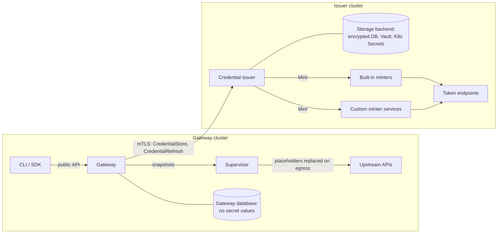

---
authors:
  - "@mrunalp"
state: draft
links:
  - https://github.com/NVIDIA/OpenShell/issues/4358
  - https://github.com/NVIDIA/OpenShell/pull/5139
---

# RFC 0023 - Credential Issuer Service

## Summary

This RFC proposes splitting OpenShell credential management into two roles. A
**credential issuer** stores secrets and keeps refreshable tokens fresh. The
**gateway** continues to own provider semantics, workspace authorization, and
credential delivery to sandbox supervisors. The issuer exposes two separate
gRPC contracts to the gateway: `CredentialStore` for storing and resolving
secrets, and `CredentialRefresh` for managing refresh grants. A third contract,
`TokenMinter`, lets operators add custom refresh implementations without
changing OpenShell.

The issuer is a library crate that the gateway links by default, so a single
gateway process works as it does today. The same crate also builds a standalone
service binary that may run on another cluster. In remote mode, the gateway
connects to the issuer over mutually authenticated TLS. In both modes, the
issuer owns the only store of secret values, including gateway-internal
secrets such as SSH host keys. Supervisors are unchanged: they still obtain
credentials only from the gateway.

## Motivation

OpenShell credential handling has three responsibilities that share one process
and one database today:

1. **Storage and fetch.** The `CredentialDriver` contract in
   [`proto/credential_driver.proto`](../../proto/credential_driver.proto)
   stores, deletes, and resolves provider secrets in the encrypted gateway
   database, Kubernetes Secrets, or Vault.
2. **Refresh.** The refresh worker in
   [`crates/openshell-server/src/provider_refresh.rs`](../../crates/openshell-server/src/provider_refresh.rs)
   runs on every gateway replica. It mints OAuth, Google service account, and
   AWS STS credentials, then replaces credential handles on the gateway's
   provider records.
3. **Delivery.** The gateway resolves values when it builds a provider
   environment snapshot and delivers the snapshot to supervisors, which replace
   workload placeholders on egress.

Operators want to run storage and refresh separately from delivery. A central
security team may own the secret backend and the token issuer for several
OpenShell gateways, often in a dedicated cluster with its own egress to identity
providers. The current design makes that impossible:

- **Credential drivers are local.** A driver is either in-tree or a separate
  process on a Unix domain socket. There is no network transport, and the
  socket has no caller authentication beyond file mode `0600`.
- **Refresh is part of the gateway.** Refresh depends on gateway persistence,
  Postgres advisory locks, provider-record compare-and-swap writes, workspace
  mutation guards, attached-sandbox validation, the provider profile catalog,
  and mutation replay. None of it can run elsewhere.
- **Refresh strategies are a closed set.** `ProviderCredentialRefreshStrategy`
  is a proto enum. Minting is a `match` over that enum, and
  `is_gateway_mintable_strategy` in `openshell-providers` must be kept in sync
  with it by hand. The only escape hatch is the `EXTERNAL` strategy, where an
  outside updater writes new values through `UpdateProvider`. That moves
  scheduling, locking, retry, and staged writes into every custom integration.

The storage contract already exists, and delivery already resolves values in a
single step (`build_provider_environment_snapshot_from_inputs`). The work that
needs design review is the boundary between gateway provider records and
issuer-owned credential state, the refresh and plugin contracts, change
propagation, and cross-cluster authentication. The change touches public
configuration, internal driver contracts, and the security boundary, so it
needs an RFC rather than a series of local pull requests.

If the design stays unchanged, a remote secret store or custom token issuer
must be built outside OpenShell and pushed in through `UpdateProvider`. That
loses OpenShell's refresh locking, recovery, and revocation semantics.

## Non-goals

- Changing how supervisors receive credentials or how workloads see
  placeholders. The supervisor protocol is unchanged.
- Moving dynamic token grants (`ExchangeProviderSubjectToken` and supervisor
  `client_credentials` grants) to the issuer. They run at request time on behalf
  of a sandbox identity and remain delivery concerns.
- Letting supervisors call the issuer directly.
- Moving gateway bootstrap material into the issuer. The gateway's issuer
  client identity, JWT signing key, and TLS server certificates remain local
  files, as they are today.
- Dynamic leases with renewal and revocation, such as Vault database secrets
  engines. The contracts leave room for them, but this RFC does not define them.
- Running interactive OAuth login flows, such as signing in to a model
  provider, from OpenShell. `CreateGrant` accepts the refresh material those
  flows produce, so a login extension can build on this RFC later.
- Migrating stored credentials between storage backends.
- Changing public provider or refresh RPCs. `ConfigureProviderRefresh`,
  `RotateProviderCredential`, and related RPCs keep their current shape.

## Proposal

### Responsibilities

| Concern | Owner |
|---|---|
| Provider records, profiles, workspace authorization, attachment rules | Gateway |
| Resolving refresh defaults from profiles (token URL, scopes, outputs) | Gateway |
| Snapshot builds, placeholder identity, supervisor delivery | Gateway |
| Dynamic token grants for sandboxes | Gateway and supervisor |
| Non-secret state: sandboxes, provider records, credential references and versions | Gateway database |
| Bootstrap material: issuer client identity, JWT signing key, TLS server certificates | Gateway, local files |
| All secret values: provider credentials, refresh material, SSH host keys, shared supervisor launch material | Issuer |
| Secret storage backends (encrypted database, Kubernetes Secrets, Vault) | Issuer |
| Refresh scheduling, locking, retries, uncertain-mint recovery | Issuer |
| Minting tokens for a strategy | Issuer, through a built-in or custom minter |



The gateway always opens the connection. Only the issuer needs to accept
inbound traffic, and secret values move only in response to a gateway request.

### One secret store

The issuer owns the only store of secret values in both deployment modes. This
matches the current behavior when an external credential driver is configured:
SSH host keys and shared supervisor launch material already go to the same
driver as provider credentials. The gateway database keeps only non-secret
state. In remote mode, the gateway no longer needs a key-encryption key.
Legacy provider records that hold inline credential values migrate into the
issuer.

Gateway-internal secrets get a real owner kind instead of the synthetic
provider identities they use today (`sandbox-ssh-<id>` in `ssh_identity.rs` and
`sandbox-instance-<id>` in `supervisor_pool.rs`). Owners are always scoped by
workspace, so the issuer applies the same gateway binding and workspace scoping
to every secret.

### Credential references and versions

Today, a refresh writes new credential handles into the gateway's `Provider`
record with a compare-and-swap, under the workspace mutation guard and after
re-validating attached sandboxes. A remote issuer cannot do that without
reaching back into the gateway database on every refresh.

This RFC changes what the gateway stores. A provider credential key points to a
**credential reference** that the issuer owns. A reference has a stable
identity and a monotonically increasing **version**. Storing a new value or
completing a refresh advances the version inside the issuer. The gateway
provider record changes only when an operator changes the provider: creating a
credential, reconfiguring refresh, or deleting it.

The reference identity keeps the revocation semantics that identity-bearing
handles provide today. Reconfiguring a refresh grant creates a new grant and a
new reference, so placeholders and in-flight requests bound to the old
authorization epoch stop resolving. Versions change within an epoch. Values do
not need new placeholders.

The provider environment revision that supervisors compare must include the
resolved version of each reference. Today the revision hashes provider
`resource_version`, credential keys, expiration times, and refresh-state
metadata. It does not hash values or handles, so a value that changes inside
the issuer would never reach a sandbox. Including the version fixes that
without hashing secret material.

### CredentialStore contract

`CredentialStore` evolves the current `CredentialDriver` contract. It keeps
batch resolution and capability negotiation, and adds versions, cache hints,
and an optional change stream. Existing drivers implement it behind the issuer.

```protobuf
package openshell.credentials.store.v1;

service CredentialStore {
  rpc GetCapabilities(GetCapabilitiesRequest) returns (GetCapabilitiesResponse);
  // Create a reference, or write a new version of an existing reference.
  rpc PutSecret(PutSecretRequest) returns (PutSecretResponse);
  rpc DeleteSecret(DeleteSecretRequest) returns (DeleteSecretResponse);
  rpc ResolveSecrets(ResolveSecretsRequest) returns (ResolveSecretsResponse);
  // Stream version changes for references owned by the caller. Never carries values.
  rpc WatchSecrets(WatchSecretsRequest) returns (stream WatchSecretsResponse);
}

message SecretOwner {
  string workspace = 1;
  oneof kind {
    ProviderSecretOwner provider = 2;
    // Sandbox SSH host identity.
    SandboxSecretOwner sandbox = 3;
    // Shared supervisor instance launch material.
    SupervisorInstanceSecretOwner supervisor_instance = 4;
  }
  // Logical key within the owner, such as a credential key.
  string key = 5;
}

message ProviderSecretOwner {
  string provider_id = 1;
  // Audit-only display name. Never used for authorization.
  string provider = 2;
}

message PutSecretRequest {
  SecretOwner owner = 1;
  // Empty creates a new reference.
  string reference = 2;
  // Secret value. Implementations must never log this field.
  string value = 3;
  google.protobuf.Timestamp expiration_time = 4;
  // Version the caller last observed. Rejects stale writes when set.
  optional uint64 expected_version = 5;
  // Caller-chosen key that makes retries idempotent.
  string idempotency_key = 6;
}

message PutSecretResponse {
  string reference = 1;
  uint64 version = 2;
}

message ResolveSecretsRequest {
  repeated ResolveSecretRequest secrets = 1;
  // Why the gateway needs the values: sandbox delivery, operator export, or
  // refresh. Implementations may use it for authorization and audit.
  ResolvePurpose purpose = 2;
}

message ResolveSecretRequest {
  string request_id = 1;
  SecretOwner owner = 2;
  string reference = 3;
}

message ResolvedSecret {
  string request_id = 1;
  string value = 2;
  uint64 version = 3;
  // Absence means the credential does not expire.
  google.protobuf.Timestamp expiration_time = 4;
  // How long the caller may serve this value from cache. Independent of
  // expiration: a non-expiring API key can still rotate.
  google.protobuf.Duration cache_ttl = 5;
}

message WatchSecretsResponse {
  string reference = 1;
  uint64 version = 2;
}
```

The issuer namespaces every reference by the authenticated gateway identity.
`ResolveSecrets` rejects a reference created by another gateway even when the
caller supplies a matching owner.

Read-only resolution of secrets that OpenShell does not own, such as an
existing Vault path or a 1Password field, fits this contract as a separate
capability with its own reference format. It needs its own design review,
listed under Open questions.

### CredentialRefresh contract

`CredentialRefresh` manages **refresh grants**. A grant binds a strategy, its
configuration, and its secret material to a fixed set of output references. The
gateway resolves profile defaults before it calls `CreateGrant`, so the issuer
never reads provider profiles.

```protobuf
package openshell.credentials.refresh.v1;

service CredentialRefresh {
  rpc ListStrategies(ListStrategiesRequest) returns (ListStrategiesResponse);
  rpc CreateGrant(CreateGrantRequest) returns (CreateGrantResponse);
  rpc GetGrant(GetGrantRequest) returns (GetGrantResponse);
  rpc DeleteGrant(DeleteGrantRequest) returns (DeleteGrantResponse);
  // Mint now, skipping backoff. Used by RotateProviderCredential.
  rpc RotateGrant(RotateGrantRequest) returns (RotateGrantResponse);
  // Return current outputs, minting first if fewer than min_remaining remain.
  // Used by operator credential export.
  rpc EnsureFresh(EnsureFreshRequest) returns (EnsureFreshResponse);
  rpc WatchGrants(WatchGrantsRequest) returns (stream WatchGrantsResponse);
}

message CreateGrantRequest {
  openshell.credentials.store.v1.SecretOwner owner = 1;
  // Built-in strategy name, such as "oauth2_refresh_token", or a custom name
  // registered by a minter, such as "custom:acme-sts".
  string strategy = 2;
  // Non-secret configuration: token URL, scopes, role ARN, audience.
  map<string, string> config = 3;
  // Secret material such as refresh tokens and client secrets.
  map<string, string> secret_material = 4;
  // Output ids the strategy produces, mapped to credential keys.
  map<string, string> outputs = 5;
  google.protobuf.Duration refresh_before = 6;
  google.protobuf.Duration max_lifetime = 7;
  // Makes gateway mutation replay safe across retries.
  string idempotency_key = 8;
}

message CreateGrantResponse {
  string grant = 1;
  // Output id to CredentialStore reference.
  map<string, string> output_references = 2;
}

message GrantStatus {
  string grant = 1;
  // pending, refreshing, refreshed, failed, parked
  string state = 2;
  google.protobuf.Timestamp expiration_time = 3;
  google.protobuf.Timestamp next_refresh_time = 4;
  string failure_code = 5;
  string recovery_action = 6;
}
```

Outputs are read through `CredentialStore.ResolveSecrets`, so the gateway has
one read path. Outputs are declared when the grant is created, so the gateway
checks credential-key collisions with attached sandboxes once, at configure
time, instead of on every refresh.

The issuer owns everything `provider_refresh.rs` does today after the profile
lookup: the durable refresh state, scheduling from `expiration_time -
refresh_before`, per-grant locking, bounded concurrency, retry and
configuration-error backoff, staged writes of rotated refresh material, and
parking a grant whose last mint ended with an unknown outcome.

### TokenMinter plugin contract

A minter turns grant configuration and secret material into outputs. Minters
hold no state. The issuer calls them under its own lock and handles
persistence, retries, and staged writes.

```protobuf
package openshell.credentials.minter.v1;

service TokenMinter {
  rpc Describe(DescribeRequest) returns (DescribeResponse);
  rpc Mint(MintRequest) returns (MintResponse);
}

message StrategyDescriptor {
  // Must start with "custom:" for minters outside OpenShell.
  string name = 1;
  repeated MaterialDescriptor config = 2;
  repeated MaterialDescriptor secret_material = 3;
  // Output ids this strategy always produces, such as "access_token".
  repeated string outputs = 4;
}

message MintRequest {
  string strategy = 1;
  map<string, string> config = 2;
  map<string, string> secret_material = 3;
  // Stable per grant and attempt, so a minter can make upstream calls idempotent.
  string attempt_id = 4;
}

message MintResponse {
  map<string, string> outputs = 1;
  google.protobuf.Timestamp expiration_time = 2;
  // Replacement secret material, such as a rotated refresh token.
  map<string, string> rotated_secret_material = 3;
}
```

Minters return gRPC status codes with a structured reason that distinguishes
retryable failures, configuration errors that need operator action, and
uncertain outcomes where the upstream may have issued a credential.

The four strategies OpenShell mints today become in-process minters behind the
same Rust trait: `oauth2_refresh_token`, `oauth2_client_credentials`,
`google_service_account_jwt`, and `aws_sts_assume_role`. A custom minter runs as
a service reachable from the issuer, registered in issuer configuration:

```toml
[openshell.credential_issuer.minters.acme-sts]
endpoint = "https://acme-sts-minter.security.svc:8443"
tls_ca_cert_path = "/etc/openshell/minters/ca.pem"
```

Provider profiles name strategies by string. The proto enum stays for
compatibility, and a new `strategy_name` field carries custom names. The
gateway asks the issuer which strategies exist through `ListStrategies` when it
validates a profile or a `ConfigureProviderRefresh` request.

### Change propagation and caching

Values are pulled and changes are pushed:

1. The gateway opens `WatchSecrets` and `WatchGrants` streams after it connects
   to the issuer. Each event carries a reference or grant and a new version,
   never a value.
2. On an event, the gateway finds affected providers and calls the existing
   `config_delivery::publish_provider`. Push-mode sessions rebuild their
   snapshot. Poll-mode supervisors see a new revision on their next poll.
3. Snapshot builds call `ResolveSecrets` as they do today.

The gateway keeps an in-memory cache of resolved values keyed by reference and
version. It serves a cached value until the version changes, `cache_ttl`
elapses, or `expiration_time` passes, whichever comes first. Poll mode has no
gateway-side cache today, and the issuer adds a network round trip to every
build, so the cache is required for remote mode. The cache also covers shared
supervisor launch material, which the supervisor pool loads on every
reconcile pass. If a watch stream breaks, the
gateway reconnects with the last version it saw and treats unknown state as a
change.

`ExchangeProviderSubjectToken` resolves the stored subject token before it
checks its intermediate-token cache. That order must be reversed so a cache hit
on the request path never waits on the issuer.

### Transport and authentication

The gateway authenticates to a remote issuer with **mutual TLS**. mTLS binds
the caller's identity to the connection, rotates without a token issuance
path, and needs no signing-key distribution across clusters. The issuer
authenticates the gateway; the gateway pins the issuer with a private CA and
verifies its DNS name.

`openshell-extension-core` gains a client identity next to the existing
`ExtensionServerTrust`:

- **Certificate files.** A PEM certificate and key that the gateway reloads
  when the files change. This works with cert-manager and any private CA.
- **SPIFFE X.509-SVIDs.** The gateway reads its SVID from the SPIFFE Workload
  API. Cross-cluster trust uses SPIFFE trust-domain federation. OpenShell
  already uses SPIRE JWT-SVIDs for dynamic token grants, and the transport code
  anticipates X.509-SVIDs.

TLS configuration goes through `openshell-crypto`, as with other
security-sensitive operations.

Authentication alone does not stop one gateway from reading another
gateway's secrets. The issuer enforces two rules:

- **References are bound to the creating gateway.** The issuer records the
  authenticated gateway identity on every reference and grant and rejects
  access from any other identity.
- **Gateway identities are scoped.** Issuer configuration maps each gateway
  identity to the workspaces it may store and resolve. A request outside that
  scope fails with `PERMISSION_DENIED`.

The embedded issuer uses in-process calls and needs no transport
authentication. Custom minters use the same transport options, with the issuer
as the client.

### Crate layout and deployment modes

The issuer is one library crate, `openshell-credential-issuer`. It contains the
`CredentialStore` and `CredentialRefresh` service handlers, the refresh engine
and scheduler, the minter registry with the built-in minters, the storage
drivers, and the issuer's persistence for secrets and refresh state. A thin
binary wraps the library with gRPC servers, mTLS, configuration loading, and
gateway identity scoping. This follows the pattern of
`openshell-driver-vault`, which provides a library linked in-tree and a
`main.rs` that runs it as a separate process. Whether the binary lives in the
same crate or a separate crate that keeps server-only dependencies out of the
gateway build is an implementation choice.

The gateway depends on one Rust trait with two implementations: the in-process
library and a gRPC client. No other gateway code knows which mode is active,
as today with the `CredentialDriver` trait and `RemoteCredentialDriver`. The
in-process implementation calls the same service handlers as the binary, with
a fixed local gateway identity, so validation, ownership checks, and versioning
cannot diverge between modes.

| | Embedded (default) | Remote |
|---|---|---|
| Calls | In-process | gRPC over mTLS |
| Refresh worker | Runs in each gateway replica, as today | Runs in the issuer |
| Change notifications | In-process channel | `WatchSecrets` and `WatchGrants` streams |
| Secret storage | Issuer-owned tables in the gateway database, or Vault or Kubernetes Secrets | Issuer database, or Vault or Kubernetes Secrets |

In both modes, only issuer code reads or writes secret data. The gateway
reaches it only through the trait.

The **embedded** mode keeps today's behavior for local and single-cluster
deployments and needs no new configuration.

The **remote** mode points the gateway at an issuer endpoint:

```toml
[openshell.gateway.credential_issuer]
mode = "remote"
endpoint = "https://credential-issuer.security.example.com:8443"
tls_ca_cert_path = "/etc/openshell/issuer/ca.pem"
tls_client_cert_path = "/etc/openshell/issuer/tls.crt"
tls_client_key_path = "/etc/openshell/issuer/tls.key"
```

The issuer binary owns its own database and configures storage backends with
the same `[openshell.credential_drivers.<name>]` tables the gateway uses today.
Multi-replica issuers require Postgres, because the refresh lock relies on
Postgres advisory locks.

The refresh engine depends on `persistence::Store` in `openshell-server` for
compare-and-swap writes and advisory locks. The issuer crate cannot depend on
`openshell-server`, because the gateway depends on the issuer crate. Either a
shared persistence crate moves out of `openshell-server`, or the issuer gets
its own smaller storage layer. This choice is listed under Open questions.

### Compatibility

Public provider and refresh RPCs keep their request and response shapes. The
gateway forwards refresh operations to the issuer and maps grant status onto
`GetProviderRefreshStatus`. Existing provider records that hold driver handles
migrate to references on first gateway start in embedded mode; the reference is
the existing handle, and its version starts at 1. Moving an existing deployment
from embedded to remote mode requires migrating stored secrets and refresh
state into the issuer, which this RFC leaves to a dedicated tool.

## Implementation plan

The work proceeds in phases. Phases 1 and 2 change only internal boundaries and
ship with embedded mode, so they are useful even if remote mode is delayed.

1. **Persistence and owner kinds.** Decide how the issuer crate gets
   persistence and extract it from `openshell-server`. Replace the synthetic
   provider identities for SSH host keys and launch material with owner kinds.
   Route the roughly 35 non-test storage call sites in `grpc/provider.rs`,
   `provider_refresh.rs`, `grpc/provider_credentials.rs`, `ssh_identity.rs`,
   and `supervisor_pool.rs` through the issuer trait.
2. **References, versions, and the refresh engine.** Introduce credential
   references with versions, include versions in the provider environment
   revision, and migrate existing handles. Move the refresh engine into an
   `openshell-credential-issuer` library crate behind three traits: a minter, a
   refresh-state store, and a sink notified when a new version commits.
   Replace the strategy `match` with a registry and add `strategy_name`.
3. **Contracts and remote transport.** Add the `CredentialStore`,
   `CredentialRefresh`, and `TokenMinter` protos. Add mTLS client identity to
   `openshell-extension-core`, a remote provider credential source in the
   gateway, the version-keyed cache, and watch-driven publishing. Reorder the
   subject-token cache check.
4. **Issuer service.** Ship the `openshell-credential-issuer` binary, container
   image, and Helm chart option, with identity scoping, audit, and metrics.
5. **Documentation and validation.** Update
   `docs/how-it-works/gateways/configuration.mdx`, `docs/extensibility/`, the
   provider refresh docs, and the `debug-openshell-cluster` skill. Add e2e
   coverage for an issuer in a separate cluster, issuer outage behavior, watch
   reconnection, a custom minter, and cross-gateway access denial.

## Risks

- **Availability coupling.** In remote mode, an unreachable issuer blocks more
  than credential delivery. Sandbox create and start need the SSH host key,
  shared supervisor reconciliation needs launch material, and a sandbox cannot
  receive a new credential. Today a failed resolution sends an empty snapshot
  marked `CredentialInstallFailed`. Deployments with an external Vault driver
  already depend on Vault for the same operations. The version-keyed cache
  limits the impact to values that are new, expire, or change during the
  outage. Whether the gateway may serve a cached value past `cache_ttl` during
  an outage is an open question.
- **Persistence extraction.** The refresh engine relies on gateway persistence
  for compare-and-swap writes and advisory locks. Extracting a shared
  persistence crate touches much of `openshell-server`, and a separate issuer
  storage layer duplicates locking logic that has subtle recovery semantics.
  Either path is a large part of the implementation cost.
- **Migration complexity.** Replacing handle swaps with versioned references
  changes durable provider and refresh state. A bug can strand credentials or
  break revocation. Mitigation: migrate in embedded mode first, keep handle
  identity as the reference identity, and test authorization-epoch revocation
  explicitly.
- **Confused deputy at the issuer.** A shared issuer holds secrets for several
  gateways. A compromised gateway can read everything in its scope.
  Mitigation: per-gateway reference binding and workspace scoping. Remaining
  risk: scope configuration errors grant broad access.
- **Custom minter trust.** A custom minter receives refresh tokens and client
  secrets. Mitigation: minters are operator-registered, authenticated with TLS,
  and limited to the strategies they declare. A minter compromise still exposes
  the material for those strategies.
- **Latency on new paths.** Snapshot builds and subject-token exchange gain a
  network round trip on a cache miss. Mitigation: caching, batch resolution,
  and reordering the subject-token lookup. Builds already allow 20 seconds for
  cold Vault logins.
- **Operational surface.** A second service adds a database, certificates,
  monitoring, and upgrade ordering between gateway and issuer. Embedded mode
  keeps this optional.

## Alternatives

### Add a network transport to the existing credential driver

Adding TCP and TLS to `CredentialDriver` would let storage run remotely with
little change. Refresh would stay in the gateway, along with its dependency on
the gateway database and the closed strategy set. It solves half the problem
and does not enable custom refresh. It is a reasonable first step and is
covered by phase 3 of this proposal.

### Have the issuer push values to the gateway

The issuer could push new values to the gateway as they are minted. The
gateway would then need a durable copy of every secret, the issuer would need
inbound access to every gateway, and values would move without a gateway
request. Pushing version notifications and pulling values keeps a single
direction of trust and keeps secrets out of the gateway database.

### Keep gateway-internal secrets in a local store

The gateway could keep SSH host keys and shared supervisor launch material in
its own encrypted store and send only provider credentials to the issuer.
Sandbox launch and supervisor reconciliation would then keep working during an
issuer outage. The cost is two secret stores with separate key management,
backup, and audit, and the gateway would still hold secrets at rest. A single
issuer-owned store with a gateway-side cache keeps one security boundary and
matches how external credential drivers behave today.

### Let supervisors fetch from the issuer

Supervisors could resolve credentials from the issuer directly. That would move
workspace authorization, attachment rules, and placeholder identity out of the
gateway, and require every sandbox network to reach the issuer cluster. The
gateway would no longer be the single authorization boundary for credentials.

### Authenticate with gateway-signed JWTs instead of mTLS

The gateway already mints short-lived JWTs for middleware and interceptors over
server-authenticated TLS. Reusing that pattern needs no client certificates, and
claims can carry per-call context. A stolen token can be replayed until it
expires, and the issuer must fetch or pin the gateway signing keys across
clusters. This RFC prefers mTLS for gateway authentication and leaves per-call
JWT claims as an optional addition.

### Keep the EXTERNAL strategy as the extension point

Custom refresh could stay outside OpenShell, with each integration writing
values through `UpdateProvider`. Every integration would have to reimplement
scheduling, locking, retries, staged writes, and uncertain-mint recovery, and
would need admin credentials for the gateway API. A stateless minter contract
keeps those guarantees in one place.

## Prior art

- **[RFC 0001](../0001-core-architecture/README.md)** defines credential
  drivers as separate processes behind a gRPC contract and keeps caching,
  rotation, and name mapping in the gateway. This RFC keeps name mapping and
  delivery in the gateway and moves rotation behind a contract.
- **[RFC 0009](../0009-supervisor-middleware/README.md) and
  [RFC 0010](../0010-gateway-interceptors/README.md)** established the
  extension transport, protocol negotiation through `PeerMetadata`, and
  gateway-minted extension tokens. This RFC reuses that transport and adds
  client identity.
- **cert-manager external issuers** let operators add certificate issuers as
  separate controllers while cert-manager keeps scheduling, renewal timing, and
  storage. The `TokenMinter` contract applies the same split to tokens.
- **HashiCorp Vault secrets engines and leases** separate secret storage from
  credential generation and attach lifetime to issued credentials. The version
  and `cache_ttl` fields follow the lesson that freshness and expiration are
  different properties.
- **SPIFFE federation** lets workloads in separate trust domains authenticate
  each other with short-lived X.509-SVIDs. It is the intended cross-cluster
  identity source for remote mode.

## Open questions

- Should the issuer crate share a persistence crate extracted from
  `openshell-server`, or own a separate storage layer? This changes the
  implementation size more than any other decision in this RFC.
- Should the issuer binary live in the library crate or in a separate crate?
- May the gateway serve a cached value past `cache_ttl`, up to its
  `expiration_time`, when the issuer is unreachable? This trades availability
  for prompt rotation.
- Should `CreateGrant` accept secret material by value through the gateway, or
  should operators be able to write material directly to the issuer so it
  never transits the gateway?
- Should read-only external references, such as existing Vault paths or
  1Password fields, be part of `CredentialStore` v1 or a separate resolver
  contract?
- Does remote mode need per-call JWT claims, such as purpose and sandbox ID,
  for issuer-side authorization in v1?
- How should operators migrate an existing embedded deployment to a remote
  issuer, and is downtime acceptable during migration?
- Should one issuer support several storage backends at once, selected per
  workspace or per grant? Today the gateway allows at most one enabled
  credential driver.
- Should refresh-related OCSF events be emitted by the issuer, the gateway, or
  both? Refresh emits no OCSF events today.
- Should a custom minter also be able to run the initial OAuth login flow and
  create its own grant, as
  [#4358](https://github.com/NVIDIA/OpenShell/issues/4358) explores, or should
  login flows use a separate extension contract?
