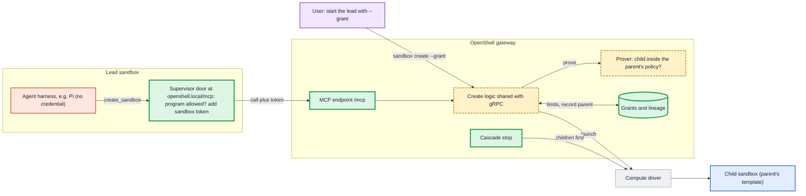
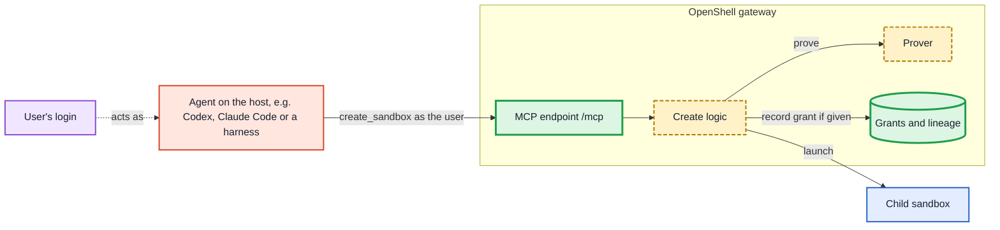

---
authors:
  - "@patkraw"
state: draft
links:
  - (originating GitHub issue, to be opened; maintainers assign the RFC number)
---

# RFC NNNN - Gateway MCP for Creating Sandboxes

## Summary

This RFC proposes letting agents create sandboxes through an MCP endpoint
hosted in the OpenShell gateway. An agent running in a sandbox can create
sub-agents (`kind: agent`) and tool sandboxes (`kind: tool`). Every request is
identified by OpenShell, proved against a ceiling with the policy prover,
limited by a grant that the user sets once when starting the tree's first
sandbox, and recorded in a lineage so that stopping a parent stops its children
first.

The contract is a gRPC API for child sandboxes, exposed through the SDKs, the
CLI and an MCP endpoint, so a harness can integrate at whichever level suits it.
Agents inside a sandbox reach the gateway through a door in their own
supervisor at `http://openshell.local`. The supervisor checks the calling
program against a network rule that the gateway writes from the grant, attaches
a token bound to the sandbox, and forwards the call; the agent never holds a
credential. Agents and tools running on the host call the same endpoint with the
user's login and create sandboxes as the user would with the CLI. In every case
the gateway makes every decision, and a sandbox without a grant cannot create
sandboxes at all.

## Motivation

Agent harnesses increasingly split work across sub-agents. A lead agent plans
the work and delegates parts of it; workers implement, test and review.
Running each agent in its own sandbox lets each one have only the access its
part of the task needs, and keeps one compromised agent from reading another's
files or credentials. OpenShell is well placed to provide that isolation, but
today a sandbox cannot create another sandbox, and nothing in OpenShell bounds
what a delegated agent receives.

- **Only users can create sandboxes.** `CreateSandbox` is declared with
  `auth_mode: "bearer"` in `proto/openshell.proto`, and the gateway router
  refuses it for sandbox principals because it is not in the
  `is_sandbox_callable` allowlist (`crates/openshell-server/src/multiplex.rs`).

- **Harnesses work around this with host services.** Prototypes for Pi and
  OpenWorker run a service on the host that holds a user credential and creates
  sandboxes when an agent asks. Each such service is harness-specific, keeps its
  security checks outside OpenShell, and becomes a second source of truth for
  who may create what. Operators have to trust and audit each one separately.

- **Nothing bounds a new sandbox's policy.** At create time the gateway runs
  validation and safety checks, but nothing proves that a delegated sandbox
  gets no more than its creator was allowed. `openshell-prover` already
  implements `check_within_boundary`, whose documentation describes exactly
  this use ("a policy a parent agent writes for a subagent"), but its only
  caller is the standalone CLI.

- **There is no lineage.** OpenShell records no parent, creator or tree for a
  sandbox. A crashed lead leaves its workers running, and there is no limit on
  how many sandboxes one delegated task can create.

- **Sandboxes from sandboxes is a general need.** Sub-agents are one use.
  Reinforcement learning environments such as Hugging Face's OpenEnv and
  NVIDIA NeMo Gym run an agent in one environment and start isolated
  environments for it to act in, evaluate or score; an agent on a developer's
  machine asks for a sandbox to try something safely. Each of these needs a
  sandbox to start other sandboxes, within limits, without holding a user
  credential.

- **Harness limits are suggestions.** Claude Code, Qwen Code, Gemini CLI and Pi
  each cap sub-agent depth or concurrency, but those limits are enforced by the
  harness, which runs inside the sandbox next to the agent. An agent that has
  been manipulated through a prompt injection can call the creation path
  directly and bypass them.

Leaving the design unchanged means every harness that wants sandboxed
sub-agents builds and operates its own credential-holding service, with its own
checks and its own failure modes, and OpenShell cannot answer "who created this
sandbox, for whom, and was it allowed".

## Non-goals

- **Agent-to-agent messaging and shared task boards.** How agents in a tree
  talk to each other is a separate proposal.
- **Per-tool permissions for other MCP servers**, such as "GitHub MCP, read
  tools only". Children get other MCP servers only whole, as REST rules (see
  [Other MCP servers](#other-mcp-servers)).
- **Per-tool-call approval inside a harness.** Harnesses keep their own
  approval prompts; this RFC covers the sandbox boundary, not the harness's
  decisions within it.
- **In-process sub-agents and writable folders shared between sandboxes.**
  Children receive read-only copies of inputs and return results through
  files.
- **Shared or highly available supervisors** (RFC 0018). This design keeps
  identity per sandbox so that it remains valid when one supervisor process
  serves several sandboxes.
- **Interactive approval for requests outside a grant.** v1 refuses them;
  interactive approval is future work.

## Proposal

### Overview

The gateway gains a child-sandbox API and an MCP endpoint, `/mcp`, served on
the existing gateway port. The MCP endpoint is a thin adapter over the API, and
both use the same create logic as the gRPC `CreateSandbox` handler, so every
caller gets identical validation and security checks (see
[Interfaces](#interfaces-api-sdk-cli-and-mcp)). Four new pieces sit behind
them: grants, lineage, the boundary proof, and lifecycle management for trees.
Two kinds of caller reach the gateway.

**Harness inside a sandbox.** This is the main case. The user starts a lead
sandbox with a grant. The lead's harness connects to `http://openshell.local/mcp`,
which the lead's supervisor serves. The supervisor checks the calling program,
attaches the sandbox's token and forwards the call. The gateway authenticates
the sandbox, checks the grant, proves the child's policy, records lineage and
launches the child through the compute driver.



**Agent or tool on the host.** An agent on the user's machine, such as Codex,
Claude Code or a host harness, calls the same endpoint with the user's login
(OIDC bearer or mTLS client certificate). There is no supervisor and no door.
The caller is the user, so it creates top-level sandboxes exactly as the user
could with the CLI, subject to the same workspace roles; no grant is needed. If
it gives a new sandbox a grant, that sandbox can create children as described
below. The host agent itself is not contained by OpenShell, only the sandboxes
it creates are.



The endpoint lives in the gateway rather than in each supervisor for three
reasons. Host agents have no supervisor, so a supervisor-hosted server would
need a second path for them. Keeping the decision in one component means there
is one implementation of the security checks and no second copy to drift. And
MCP revisions change quickly; a gateway-hosted server is upgraded once, while a
supervisor-hosted one would need every running sandbox's supervisor to keep up.
MCP's sessionless revision also fits gateway high availability, since any
replica can serve any request. The split follows the zero-trust pattern of
deciding centrally and enforcing at the workload: the gateway decides, the
supervisor enforces reachability next to the sandbox.

### Interfaces: API, SDK, CLI and MCP

The contract is a gRPC service. The SDKs, the CLI and the MCP endpoint are
surfaces over it, and each MCP tool maps to one RPC. A harness that wants deep
integration calls the SDK from its own code and decides itself when to create a
child; a harness or agent that already speaks MCP needs only a configuration
entry. Nothing about the security model depends on which surface is used.

```proto
service SandboxChildren {
  rpc CreateChildSandbox(CreateChildSandboxRequest) returns (CreateChildSandboxResponse) {
    option (authorization) = { auth_mode: "dual" workspace_role: "user" scope: "sandbox:write" };
  }
  rpc WaitChildSandbox(WaitChildSandboxRequest) returns (WaitChildSandboxResponse) {
    option (authorization) = { auth_mode: "dual" workspace_role: "user" scope: "sandbox:read" };
  }
  rpc StopChildSandbox(StopChildSandboxRequest) returns (StopChildSandboxResponse) {
    option (authorization) = { auth_mode: "dual" workspace_role: "user" scope: "sandbox:write" };
  }
  rpc ListChildSandboxes(ListChildSandboxesRequest) returns (ListChildSandboxesResponse) {
    option (authorization) = { auth_mode: "dual" workspace_role: "user" scope: "sandbox:read" };
  }
  rpc GetSandboxLimits(GetSandboxLimitsRequest) returns (GetSandboxLimitsResponse) {
    option (authorization) = { auth_mode: "dual" workspace_role: "user" scope: "sandbox:read" };
  }
}
```

`auth_mode: "dual"` admits both user and sandbox principals. For sandbox
principals each handler applies a child-scope guard, in the style of
`ensure_sandbox_principal_scope`: a sandbox may create children only under its
grant and act only on its own descendants. `exec` and `get_file` use the
existing `ExecSandbox` RPC with the same guard.

| Surface | Used by | How it reaches the gateway |
|---------|---------|----------------------------|
| gRPC / SDK (Rust, Python, TypeScript, Go) | Harnesses integrating in code; services such as RL environment runners | From the host: the user's login. From a sandbox: through the door, once it carries gRPC (open decision). |
| CLI | Users and scripts | The user's login |
| MCP `/mcp` | Any MCP-capable agent or harness | From a sandbox: through the door. From the host: the user's login. |

The door is the only way code inside a sandbox reaches the gateway, so what it
forwards decides which surfaces work from inside. MCP is plain HTTP/1.1 and is
forwarded. The gRPC service runs on HTTP/2, and how the door carries it is an
open decision (see [Open questions](#open-questions)); until then, code inside a
sandbox uses MCP and the gRPC service is used from the host.

### Grants

A grant is a budget for one tree of sandboxes, set by the user. It answers
three questions: may this tree create sandboxes at all, how large may it grow,
and what is the most any sandbox in it may be given.

**Creation.** A grant is created when the user starts the tree's first sandbox,
called the holder. There is no grant file; the grant is part of the create
request:

```shell
openshell sandbox create \
  --from pi-agent:local \
  --provider pi-nvidia \
  --policy lead.yaml \
  --grant max_depth=1,max_breadth=2,max_total=3,expires=4h,program=/usr/local/bin/node \
  -- pi
```

The CLI parses `--grant` into a `SandboxGrantSpec` on `CreateSandboxRequest`.
Only a user principal may set it; the gateway rejects the field from any other
principal. The holder's policy is the ceiling for its children.

```proto
message SandboxGrantSpec {
  // Levels below the holder. 1 means the holder's children cannot create.
  uint32 max_depth = 1;
  // Children per parent.
  uint32 max_breadth = 2;
  // Sandboxes in the whole tree, including the holder.
  uint32 max_total = 3;
  // Grant lifetime.
  google.protobuf.Duration expires_after = 4;
  // Absolute path of the executable allowed to use the door,
  // for example /usr/local/bin/node for a Node-based harness.
  string program = 5;
  // NARROW (default): agents write their children's network rules within their
  // own policy. INHERIT: every child receives its parent's policy unchanged.
  ChildPolicyMode child_policy = 6;
}

message CreateSandboxRequest {
  // ... existing fields ...
  SandboxGrantSpec grant = 20;
}
```

**One grant per tree.** Children and grandchildren draw from the same grant.
When a child creates its own child, the gateway charges the shared counters and
checks the child's depth against the same `max_depth`. A child's slice is never
more than its parent has left, so the user confirms the tree's limits once and
sees no further prompts however deep the tree goes. The alternative, a new grant
per level, would put a prompt in front of the user every time a worker
delegated.

**No grant, no children.** A sandbox started without a grant cannot create
sandboxes. `create_sandbox` is absent from its tool list, and a call is refused
with `NOT_ALLOWED`. The safe default is that a sandbox never gains the ability
to create sandboxes unless the user said so.

**Set up front.** In v1 the grant is the only approval. A request inside it
proceeds without prompting anyone; a request outside it is refused with
`LIMIT_REACHED` and the agent adapts. This matches how OpenShell is used today,
from the CLI, and needs no new approval interface. Interactive approval for
requests outside the grant is future work.

**Only the user changes a grant.** The user can widen, shrink or revoke a grant
while the tree runs. Changes apply to new creates only: an existing child keeps
its policy and its door rule. No sandbox can change a grant, including through
the gateway MCP, and every change is audited. If an agent could widen its own
grant, the grant would mean nothing.

```proto
rpc ListSandboxGrants(ListSandboxGrantsRequest) returns (ListSandboxGrantsResponse) {
  option (authorization) = { auth_mode: "bearer" workspace_role: "user" scope: "sandbox:read" };
}
rpc UpdateSandboxGrant(UpdateSandboxGrantRequest) returns (SandboxGrantResponse) {
  option (authorization) = { auth_mode: "bearer" workspace_role: "user" scope: "sandbox:write" };
}
rpc RevokeSandboxGrant(RevokeSandboxGrantRequest) returns (RevokeSandboxGrantResponse) {
  option (authorization) = { auth_mode: "bearer" workspace_role: "user" scope: "sandbox:write" };
}
```

`UpdateSandboxGrant` and `RevokeSandboxGrant` additionally require the caller
to be the grant's user or a Workspace Admin of the grant's workspace.

**The harness declares, OpenShell enforces.** A harness may send its own limits
with a create request, for example "a lead has at most two workers". The
effective limit for each dimension is the lowest of the harness's value, the
grant's and the operator's cap from gateway configuration. A limit set by the
harness is thereby enforced outside the harness's reach.

**Storage.** Grants are stored in the existing objects table as a new object
type, `sandbox_grant`, scoped to the holder's workspace. The counters (`total`
and per-parent children) live in the grant record and are updated with
`WriteCondition::MatchResourceVersion`, so two concurrent creates cannot both
take the last slot. A create reserves its slot before calling the compute
driver and releases it if the driver fails.

### Lineage

Each sandbox created under a grant has a `Lineage` record:

```proto
message SandboxLineage {
  string sandbox_id = 1;
  // Parent sandbox id, empty for the holder.
  string parent_sandbox_id = 2;
  // The user the tree acts for.
  string root_subject = 3;
  string workspace = 4;
  SandboxKind kind = 5;          // AGENT or TOOL
  SandboxLifetime lifetime = 6;  // UNTIL_STOPPED or UNTIL_EXIT
  uint32 depth = 7;              // 0 for the holder
  string grant_id = 8;
  google.protobuf.Duration idle_timeout = 9;  // tool sandboxes
}
```

The record is stored as the object type `sandbox_lineage`, keyed by sandbox id,
with an index on `parent_sandbox_id` for cascade stop. A child's workspace is
always its parent's.

Lineage is deliberately a separate record rather than an owner field on the
sandbox. RFC 0011 gives sandboxes no owner: access comes from workspace
membership, and any user in a workspace can act on its sandboxes. Lineage does
not change that model. It is used only for decisions about trees (cascade stop,
"a sandbox acts only on its own descendants") and for audit attribution.

### Ceiling and policy proof

**A child's ceiling is its parent's policy.** When a sandbox creates a child,
the gateway proves the child's policy against the parent's current policy,
without the door rule and provider layers. The lead's children are bounded by
the lead's policy, its grandchildren by its children's policies, and so on, so
each level can only narrow: `child ≤ parent ≤ global maximum`, the model in
#2025. A single tree-wide ceiling, the lead's policy, would let a child that was
given only GitHub read access create a grandchild with everything the lead has.

Because the ceiling is the parent's policy at the moment of the create, a
parent whose policy has grown through an approved proposal can pass that access
on, and one whose policy has shrunk cannot. Children already running when a
parent's policy shrinks keep their policy; revalidating them is #3808.

**What the agent writes.** The agent supplies only the child's
`network_policies`. The gateway builds the child's full policy from the
ceiling's filesystem, process and Landlock sections plus those network rules.
This keeps the agent from requesting filesystem or process changes it has no
reason to make, and keeps the proof focused on network access, where delegated
tasks differ.

**The proof.** The gateway serializes the ceiling and the candidate with
`openshell_policy::serialize_sandbox_policy`, parses both with
`openshell_prover::containment::parse_policy_str`, and calls
`check_within_boundary` on a blocking thread with a 10 second timeout. Only
`Within` lets creation continue:

| Prover result | Error returned to the agent |
|---------------|-----------------------------|
| `Within` | none; creation continues |
| `Exceeds` | `EXCEEDS_CEILING`, with the prover's counterexample, so the agent can narrow its request and retry |
| `Unsupported` | `UNSUPPORTED_RULES`, naming the rule the prover cannot model |
| `Inconclusive` | `PROVER_INCONCLUSIVE` |

Returning the counterexample matters: it tells the agent which request
(`POST api.github.com/repos/...`) is outside the ceiling, which is usually
enough for it to correct its policy without involving the user.

**Later policy writes.** The same check runs on every later write to the policy
of a sandbox that has a lineage, whatever the source: `UpdateConfig`, policy
sync from the supervisor, or an approved proposal. A sandbox in a tree can
never be widened past its ceiling after it starts.

**Global policy as a maximum.** A gateway-global policy is meant to state what
no sandbox on the gateway may exceed. Today it does that by replacing every
sandbox's policy, which also removes every narrower one, so trees of sandboxes
with least privilege cannot exist under it. This RFC adds a second mode in which
the global policy is the gateway's outermost ceiling:

```toml
[openshell.gateway]
# "replace" (current behavior) or "maximum"
global_policy_mode = "maximum"
```

In `maximum` mode each sandbox keeps its own policy, provider layers stay
active, and the gateway proves that every policy fits inside the global one: a
grant holder's policy when it is created, every child policy, and every later
policy write. A policy that does not fit is refused with
`EXCEEDS_GLOBAL_POLICY` and the prover's counterexample. Children are then
proved against both their ceiling and the global policy.

In `replace` mode a child created with a narrow policy would silently receive
the global one instead, so `create_sandbox` with a policy is refused with
`GLOBAL_POLICY_ACTIVE`, and the agent learns that delegation is unavailable
rather than receiving a child with unexpected access.

**Whether a parent may set its child's policy.** A grant states whether agents
in the tree may write their children's network rules (`child_policy: narrow`,
the default) or whether every child receives its parent's policy unchanged
(`child_policy: inherit`). In `inherit` mode a `create_sandbox` request that
includes a policy is refused. Either way a child never receives more than the
ceiling and the global maximum allow.

**Layers the gateway adds.** The door rule and provider layers are added after
the proof. Both come from trusted sources, the grant and admin-imported provider
profiles, not from the agent. Provider attachments are checked separately: a
child may only receive providers attached to its parent.

#### Other MCP servers

The prover models a request as program, host, port, HTTP method and path. That
is enough for network and REST rules. MCP rules match fields inside the JSON-RPC
body, the `method` and the tool name in `params.name`, and the model has no
body fields. The prover therefore returns `Unsupported` for any endpoint with
`protocol: mcp`, including one that allows every tool ("only L4 TCP and REST are
modeled", `crates/openshell-prover/src/containment.rs`). This is unbuilt work
rather than a fundamental limit; tool names are strings like paths.

Until the prover models MCP rules, a child gets another MCP server whole or not
at all, written as a REST rule on the server's `/mcp` path:

```yaml
network_policies:
  github_mcp:
    name: github_mcp
    endpoints:
      - host: api.githubcopilot.com
        port: 443
        protocol: rest
        enforcement: enforce
        rules:
          - allow: { method: POST, path: /mcp }
    binaries:
      - path: /usr/local/bin/node
```

We checked the three ways of writing this with `openshell-prover` against a
ceiling that allows `POST` and `GET` on `/mcp`. The REST rule above is
`within`. A rule naming only the host and port `exceeds` the ceiling, because it
allows requests to any path. An endpoint with `protocol: mcp` and
`allow_all_known_mcp_methods: true` is `unsupported`. The cost of the REST form
is that there are no per-tool limits, so a child with GitHub's MCP server can
call every tool on it, and the supervisor applies no MCP-specific checks such as
protocol version and tool-name syntax.

### The supervisor door

The door is served by the supervisor at `openshell.local`, port 80, path `/mcp`.
It reuses the mechanism that serves the `policy.local` API today
(`crates/openshell-supervisor-network/src/policy_local.rs`):

- **Name resolution.** The supervisor's synthetic DNS answers `openshell.local`
  with the same local address as `policy.local` (`198.18.0.1`), so clients that
  connect directly, such as Node's `fetch`, reach the transparent path.
  Clients that honor the proxy environment reach the explicit forward-proxy
  path. Both paths dispatch on the `Host` header.

- **Program check.** The door checks the calling program against the sandbox's
  network policy for `openshell.local:80`, using the binary identity the
  isolation backend supplies for the connection (RFC 0012), through the same
  OPA evaluation the proxy uses for egress (`authorize_supplied_identity`). The
  workload cannot forge this identity. `policy.local` today skips this check;
  the door must not.

- **Forwarding.** The door reads the request body (the same 64 KiB limit as
  `policy.local`), forwards it to the gateway's `/mcp` with a token bound to
  this sandbox, and returns the gateway's response unchanged.

**The door rule.** The network rule that makes the program check pass is
written by the gateway, never by the agent:

```yaml
network_policies:
  openshell_gateway_mcp:
    name: openshell_gateway_mcp
    endpoints:
      - host: openshell.local
        port: 80
    binaries:
      - path: /usr/local/bin/node   # the grant's program
```

The gateway adds it to a sandbox's base policy at creation when the sandbox is
an agent with depth left: the holder when `max_depth > 0`, and an agent child
when its depth is below `max_depth`. A child policy that already contains the
key is refused. Because the rule is part of the base policy at creation, it is
present from the supervisor's first configuration fetch; the 10 second policy
poll (`OPENSHELL_POLICY_POLL_INTERVAL_SECS`) does not delay it. The door rule is
a plain network rule, so the prover can check it.

**Program, not script.** The door rule names an executable. Pi is a Node
program, so its rule names `/usr/local/bin/node`, and any Node process in the
sandbox can use the door, including one the agent starts from its shell. `curl`,
`bash` and other programs cannot. Provider credentials scoped to `node` have the
same property today. The gateway's checks still apply to every call, so a
script using the door gets exactly what the harness would get.

**Token.** The supervisor obtains a short-lived token for the audience
`urn:openshell:gateway-mcp` through `RefreshSandboxToken`, extending the
existing extension-credential path, which today mints only for supervisor
middleware services and is rate limited per sandbox. The token is bound to the
sandbox id and lives at most one hour (`MAX_EXTENSION_TOKEN_TTL`). The gateway
accepts it only on `/mcp`. Using a dedicated audience instead of the
supervisor's main session token limits what a leaked token can do.

### Three walls

A sandbox with no depth left meets three independent checks if it tries to
create a child:

| Wall | Where | What happens |
|------|-------|--------------|
| The tool is hidden | Gateway | `tools/list` is answered per caller; without a grant or with no depth left there is no `create_sandbox`. Models do not see, and so do not waste turns on, tools they cannot use. |
| No route | Supervisor | No door rule, so the door refuses every program before anything reaches the gateway. |
| Refused | Gateway | Any create from such a caller fails with `LIMIT_REACHED(depth)` and is audited. |

The door enforces who can reach the gateway MCP; the gateway enforces what they
may do. The gateway remains the final authority: the first two walls are early
refusals that also protect against a bug in the third.

### MCP tools

`tools/list` is answered by the gateway, because the list depends on state only
the gateway has: whether the caller has a grant, how much depth and breadth it
has left, and whether the user changed the grant a moment ago. The supervisor
only learns policy changes on its 10 second poll and never sees the counters.
MCP clients call `tools/list` once per connection, so this costs one request per
session. A client's cached list can go out of date during a session, for example
still showing `create_sandbox` after the budget is used; the gateway refuses
such calls, and pushing list-changed notifications is future work.

| Tool | Listed for | Input | Output | Errors |
|------|------------|-------|--------|--------|
| `create_sandbox` | users; sandboxes with a grant and depth left | `kind`, `lifetime`, `command`, `task`, `policy`, `providers`, `inputs`, `request_id`, `limits`, `idle_timeout_s`, `grant` (users only) | `handle` | `NOT_ALLOWED`, `LIMIT_REACHED(depth\|breadth\|total)`, `EXCEEDS_CEILING`, `UNSUPPORTED_RULES`, `GLOBAL_POLICY_ACTIVE` |
| `wait` | sandboxes | `handle`, `timeout_s` | `phase`, `exit_code` | `NOT_YOUR_CHILD` |
| `exec` | sandboxes | `handle`, `command`, `timeout_s` | `stdout`, `stderr`, `exit_code` | `NOT_YOUR_CHILD`, `WRONG_KIND` |
| `get_file` | sandboxes | `handle`, `path` | `content` | `NOT_YOUR_CHILD` |
| `stop_sandbox` | sandboxes | `handle` | `stopped` | `NOT_YOUR_CHILD` |
| `list_children` | sandboxes | none | children with kind, lifetime, depth | none |
| `get_limits` | sandboxes | none | depth, children and total used and allowed | none |

A sandbox acts only on its own descendants; `handle` is the child's sandbox name
within the caller's workspace. A user caller creates top-level sandboxes with
the same rules as `openshell sandbox create`, may attach a grant to them, and
acts on any sandbox its workspace role allows. `inputs` lists paths in the parent that are
copied read-only into the child at start. `exec` and `get_file` run through the
existing `ExecSandbox` path, acting for the tree's root user.

These are the only tools a harness reaches through the gateway. A harness's
built-in tools (shell, file editing) run inside the sandbox, constrained by its
policy, and other MCP servers are reached directly through the supervisor's
normal proxy. A harness merges all of them into one list for its model.

### Agent and tool sandboxes

A child is created with a fixed kind. The kind decides how its parent uses it
and whether it can delegate further.

| | `kind: agent` | `kind: tool` |
|---|---|---|
| Runs | A harness doing its own task | No agent; only commands its parent sends |
| Parent uses it with | `wait`, `get_file` | `exec`, `get_file` |
| `exec` | Refused with `WRONG_KIND` | Allowed; every command is logged |
| Can create children | If depth is left; it gets the door rule | Never; it never gets the door rule |
| Command | Required | Optional; it stays up until stopped |
| Lifetime | Until stopped; never outlives its parent | Until stopped, or stopped after an idle timeout (default 10 minutes without `exec` or `get_file`) |

Agent sandboxes run their own task, so their parent observes them rather than
driving them, and `exec` on an agent is refused to keep a parent from steering
a child's work behind its harness. Tool sandboxes are the opposite: a disposable
environment for running builds, tests or untrusted code on the parent's behalf.
Every command run through `exec` is recorded with the parent, the child and the
command line.

### Lifecycle

**Default lifetime.** Agent children default to `until_stopped`, because
delegated agents usually work for a long time; one-shot children pass
`until_exit`.

**A child never outlives its parent.** When a parent ends, whether stopped,
deleted, crashed or reaped, the gateway stops its children first, deepest first.
For each child it first bumps the authentication epoch, so the child's next
call to the gateway fails, then stops it through the compute driver, then
deletes it. Results the parent has not read are lost; a parent whose work is
done waits for its children with `wait`. An orphan reaper removes children
whose parent no longer exists, for example after a gateway crash.

**A parent with running children is never idle.** Otherwise its idle timer
could stop the whole tree while the parent waits for a worker. The maximum
lifetime still applies, so no tree runs forever.

**Children's policy changes go to the user.** A running child can propose new
rules through `policy.local`, as any sandbox can. The gateway first checks that
the proposal fits the child's ceiling and rejects it without asking if it does
not. Otherwise the user approves as today, with `openshell rule approve`, the
TUI or auto-approval. This is the only point at which the user may be prompted
during a run.

### Images and resources

A child is created from its parent's sandbox template: the same image, CPU and
memory, with no GPU. If the parent was created from an admin workload template,
the child is created from that same template. `create_sandbox` takes no image
or template. The image that works for the parent already contains the harness
and the tools its children need (Pi, for example, needs Node, `ripgrep` and `fd`
preinstalled because it otherwise downloads them at runtime, which a sandbox
blocks). No GPU is given to children because GPUs are scarce and three
children each taking one could block other work; `max_total` caps the tree's
other resources.

### Retries

Agents retry. If the reply to `create_sandbox` is lost, the agent sends the
request again, and without deduplication the tree would get two children and
spend its budget twice. Sandbox callers therefore send a `request_id`; the
gateway stores the first result per grant and returns it for any repeat, which
is counted once. Today `request_id` deduplication through `mutation_replay` is
available to user principals only.

### Authorization enforcement

**Authenticating `/mcp`.** Plain HTTP routes on the gateway are not
authenticated today; only the gRPC service is wrapped by `AuthGrpcRouter`. The
`/mcp` handler runs the same authenticator chain (`build_authenticator_chain`):
a gateway-MCP extension token yields `Principal::Sandbox` for that sandbox; an
OIDC bearer or an mTLS client certificate yields `Principal::User`. Anonymous
callers are refused. The `x-openshell-auth-source` marker is stripped as on the
gRPC path.

**Pinning the workspace.** `authorize_workspace` currently accepts any
workspace for a sandbox principal. The MCP handler never takes a workspace from
the caller: a child is always created in its parent's workspace.

**Acting principal.** The child is created on behalf of the tree's root user,
so provider resolution and workspace checks behave as if the user created it,
while lineage records which sandbox asked.

| Action | User | Holder or agent child with depth left | Agent child with no depth left | Tool child |
|--------|------|------|------|------|
| Start a sandbox with `--grant` | yes | no | no | no |
| List grants | own workspace | no | no | no |
| Update or revoke a grant | own grants; Workspace Admin for the workspace | no | no | no |
| Reach the door | not applicable | named program only | no route | no route |
| `create_sandbox` | top-level sandboxes, as with the CLI | within limits | hidden and refused | hidden and refused |
| `wait`, `get_file`, `stop_sandbox`, `exec` | not applicable | own descendants | own descendants | own descendants |

### Gateway configuration

The MCP endpoint is on by default. It is a route on the existing gateway port
rather than a separate process, so it costs nothing until it is called, and it
lets any agent that can reach the gateway start sandboxes, whether or not
sub-agents are involved. Turning it on does not let any sandbox create
children: that still requires a grant on the sandbox. Operators who do not want
it turn it off in configuration or from the CLI:

```shell
openshell gateway mcp status
openshell gateway mcp disable
openshell gateway mcp enable
```

```toml
[openshell.gateway.sandbox_mcp]
enabled = true                # default
# Operator caps; the effective limit is the lowest of these, the grant and the harness.
max_depth = 3
max_breadth = 8
max_total = 20
# Default idle timeout for tool sandboxes.
tool_idle_timeout = "10m"
```

When disabled, `/mcp` is not routed and the supervisor door answers 404 for
MCP requests; the gRPC child-sandbox API, the SDKs and the CLI keep working.

### CLI surface

```shell
# Start a tree that may create children
openshell sandbox create --policy lead.yaml \
  --grant max_depth=1,max_breadth=2,max_total=3,expires=4h,program=/usr/local/bin/node \
  -- pi

# Inspect and change grants
openshell grant list
openshell grant update <grant-id> --max-breadth 3 --max-total 4
openshell grant revoke <grant-id>

# See a tree
openshell sandbox list --tree
```

A harness needs one setting: the gateway MCP server's address. For Pi, which
has built-in MCP support since 0.99, that is `~/.pi/agent/mcp.json`:

```json
{ "mcpServers": { "openshell": { "url": "http://openshell.local/mcp" } } }
```

### Audit

Every create, refusal, grant change, `exec` command and cascade stop is emitted
through the existing OCSF infrastructure with the caller, the parent sandbox,
the root user and the grant. Tool calls on `/mcp` use the `ApiActivity` class
proposed in RFC 0011, with the decision and its reason code (`EXCEEDS_CEILING`,
`LIMIT_REACHED`, and so on). Door refusals are emitted by the supervisor as
`HttpActivity` denials, like other egress denials. An operator can therefore
answer "which sandbox created this one, for whom, under which grant, and what
did it run" from the same log stream they already ship to their SIEM.

### Compatibility

The change is additive. Sandboxes created without `--grant` behave exactly as
today, and the default `global_policy_mode` remains `replace`. Existing gRPC clients are unaffected; the new `grant` field is optional.
Supervisors without the door ignore `openshell.local`, so a newer gateway with
an older supervisor image simply cannot serve in-sandbox callers until the image
is updated. Host agents can use the endpoint as soon as the gateway supports it.

## Implementation plan

The work is phased so that each phase is usable and testable on its own:

- **Phase 1: The child-sandbox API, grants, lineage and the boundary proof.**
  Add the `SandboxChildren` gRPC service and its SDK functions, the
  `sandbox_grant` and `sandbox_lineage` object types, atomic counter
  reservation, `SandboxGrantSpec` on `CreateSandboxRequest`, the grant RPCs and
  CLI, and the prover call at create time and on every later policy write to a
  sandbox with a lineage. Validate with the existing Pi and OpenWorker
  prototypes by replacing their host creation services with these RPCs.
- **Phase 2: Gateway MCP endpoint and supervisor door.** Add `/mcp` over the
  same API, with authentication and per-caller `tools/list`, and the
  `openshell gateway mcp` commands. Add the door at `openshell.local` for both
  MCP and the gRPC service, the door rule written from the grant, and the
  `urn:openshell:gateway-mcp` token. Ship host callers first, then in-sandbox
  callers.
- **Phase 3: Tool sandboxes.** `kind: tool`, `exec` with command audit, and the
  idle timeout.
- **Phase 4: Global policy as a maximum.** Add `global_policy_mode` and the
  proof of every grant holder's policy, child policy and policy write against
  the global policy in `maximum` mode.
- **Phase 5: Lifecycle.** Cascade stop on every way a parent ends, the orphan
  reaper, and idle and maximum lifetime for agent children with the "a parent
  with running children is not idle" rule.
- **Phase 6: Documentation.** A tutorial in which a Pi lead creates a Pi worker,
  reference pages for grants and the MCP tools, and a configuration entry for
  `[openshell.gateway.sandbox_mcp]`.

Validation runs at each phase: unit tests for grant parsing, limits and the
door-rule decision; gateway tests for refusals; and an end-to-end scenario with
the Docker driver that exercises every refusal listed in this RFC.

A proof of concept of phases 1 to 3 exists on the branch `gateway-mcp-poc`
(`crates/openshell-server/src/mcp.rs`,
`crates/openshell-supervisor-network/src/gateway_mcp_door.rs`,
`examples/gateway-mcp-poc/`). Against a development gateway with the Docker
driver, its check script passes 29 of 31 checks, covering grants, the door,
refusals, retries, tool sandboxes and cascade stop; the two failures are the
script running out of grant budget. The proof of concept keeps grants and
lineage in memory and forwards the supervisor's main session token instead of a
dedicated token.

## Risks

- **New gateway endpoint.** `/mcp` adds attack surface on the gateway port, and
  gateway HTTP routes have no authentication today. The handler must run the
  authenticator chain itself and be rate limited per sandbox. A mistake here
  would let an unauthenticated caller create sandboxes, so this code needs
  focused review and tests for every principal type.

- **Trusted, unproved layers.** The door rule and provider layers are added
  after the proof. A bug in the code that writes them could widen a child
  without the prover noticing. The code is small and table-driven, and tests
  cover each kind and depth combination, but it is trusted rather than proved.

- **Program-level door.** The door rule matches an executable, not a script. In
  a harness built on Node or Python, any script run by the same interpreter can
  use the door. Such a script still receives only what the gateway would give
  the harness, but operators should not read the door rule as "only the
  harness".

- **Results channel.** A child's standard output does not reach the sandbox
  logs, and `get_file` needs the child to be running. A child that exits before
  its parent reads its result loses that result. Harnesses must keep agent
  children running until their result is read, or results need a channel that
  survives exit.

- **Spawn storms.** A misbehaving lead can create children up to its grant
  quickly. Atomic counters, `max_total`, operator caps, retry deduplication and
  the token rate limit bound the damage.

- **Host mode is weaker.** An agent on the host is not contained, only its children
  are. This is a property of host mode and must be documented, not hidden.

## Future work

### Returning results to the parent

`get_file` lets a parent read a running child's files, but a child's standard
output does not reach the logs and a child that exits loses its files. A native
channel would let a child publish a result that the gateway keeps until the
parent reads it, so `wait` can return the result itself.

### Agent-to-agent communication through the gateway

Teams and swarms of agents need to find each other and exchange messages and
context, and in a swarm there may be no parent at all. Routing that traffic
through the gateway gives one place to check that two sandboxes may talk, to
offer discovery of other agents in a tree or workspace, and to monitor what
passes between them. The lineage and identity introduced here are the basis
for that work, which needs its own proposal.

### Interactive approval

A request outside the grant could wait for the user instead of being refused.
`create_sandbox` would return a `pending_id`, the harness would call `wait`, and
the user would approve where they are: in the TUI, in a harness's approval
interface (OpenWorker shows one for teams), or through a harness extension's
confirmation dialog, which Pi forwards over its RPC mode. Open points are where
pending requests are shown, timeouts, and whether to use a pending identifier
with `wait` or MCP's long-running task support.

### Per-tool rules for other MCP servers

If `openshell-prover` models MCP rules, children could receive per-tool access
such as "GitHub MCP, read tools only", proved like any other rule. Until then,
admin-imported provider profiles can carry MCP tool rules as trusted bundles;
they are attached by name and not proved.

### Templates for children

A grant could list workload templates a child may use, so that a Pi lead can
create a Claude Code child in a different image.

### Resource budgets

A per-tree CPU, memory and GPU budget in the grant (`max_cpu`, `max_gpu`) for
trees that need GPUs.

### Tool-list change notifications

The gateway could notify connected clients when a caller's tool list changes,
for example after its budget is used, so that cached lists stay accurate.

## Alternatives

### MCP server in the supervisor

Each supervisor would serve the MCP tools itself, like `policy.local`, and call
a new sandbox-only gRPC method on the gateway.

This was rejected because host harnesses have no supervisor and would need a
second path, the MCP layer would ship in every supervisor and need upgrading in
every running sandbox when MCP changes, and the security checks would still have
to live in the gateway. Its one benefit, no new gateway endpoint, is smaller
than the cost of two implementations.

### Agent holds its own gateway credential

The agent would call the gateway directly with a token in its environment.

This was rejected because it breaks the rule that an agent inside a sandbox
holds nothing worth stealing. A prompt-injected agent could exfiltrate the token
and create sandboxes from anywhere.

### Host creation service

A service on the host holding the user's credential creates sandboxes on
agents' behalf. This is how current prototypes work, and it needs no change to
OpenShell.

This was rejected as the long-term design because the checks live outside
OpenShell, each harness needs its own service, and there are two sources of
truth for who may create what. It remains useful for prototyping.

### Policy rules decide who may call which gateway tool

Each sandbox's policy would carry MCP tool rules for the gateway MCP, for
example "only the lead may call `create_*`".

This was rejected because the prover cannot check MCP rules, a policy rule
cannot count ("at most three children"), and the decision would be split
between policy and grant. The grant decides; the door rule controls only
reachability.

### SDK or CLI only, without MCP

Harnesses would create children by calling the SDK from their own code, or by
running the CLI.

These are not alternatives to the proposal but parts of it: the gRPC API is the
contract, and the SDK and CLI are surfaces over it. MCP is added as one more
surface because most harnesses and coding agents already speak it, so they can
create sandboxes with a configuration entry and no code change. Offering only
the SDK would make every harness change its code before it could use the
feature.

### Global policy as a fixed policy

Children would all run under the gateway-global policy as it works today, which
replaces each sandbox's policy.

This was rejected because no child could then have less access than another,
and least privilege per child is the point of the proposal. The global policy
is instead offered as a maximum that every sandbox must fit inside.

## Prior art

- **Anthropic Managed Agents and OpenAI Codex.** Both separate the
  environment's network boundary from tool-call permission: Managed Agents has
  environment networking and a tool permission policy, Codex has `--sandbox`
  and `--ask-for-approval`. The lesson is to keep the wall and the gate apart.
  This RFC covers the wall; harnesses keep the gate.

- **Harness depth limits.** Claude Code limits sub-agent nesting and
  concurrency, Qwen Code and Gemini CLI cap depth, and Pi's sub-agent example
  caps parallel tasks. All of these are enforced inside the harness. The lesson
  is that the limits are useful but need enforcement outside the agent's reach.

- **Azure dynamic sessions, E2B and Modal.** These provide one sandbox per
  session, reused by identifier, with idle and maximum lifetimes. Tool
  sandboxes follow the same model.

- **AWS instance metadata and the SPIFFE workload API.** A workload obtains its
  identity from a trusted local component and never stores a long-lived secret.
  The supervisor door follows this pattern, as OpenShell's provider credential
  injection already does.

- **OpenShell RFC 0011.** Workspace membership is the access model and
  sandboxes have no owner. This RFC keeps lineage as a separate record so the
  two models compose.

## Open questions

- Is a dedicated gateway-MCP token audience required for v1, or is the
  supervisor's session token acceptable initially?
- Is the separate `sandbox_lineage` record acceptable alongside RFC 0011's
  model, or should lineage live elsewhere?
- Will `openshell-prover` model MCP and GraphQL rules, and on what timeline?
  The answer decides whether per-tool rules for other MCP servers become
  possible.
- Should a parent be able to read the result of a child that has exited, for
  example through a result file the gateway keeps until the parent reads it?
- When interactive approval is added, where should pending requests appear?
- Should `global_policy_mode = "maximum"` become the default, and how do
  operators who run shared gateways use the global policy today?
- Is the MCP endpoint's cost when idle small enough to keep it on by default on
  every gateway?
- **Decision to make: how the door carries gRPC.** The door forwards MCP, which
  is plain HTTP/1.1: one request, one response, read and forwarded with the
  sandbox's token. gRPC uses HTTP/2, with many calls multiplexed on one
  connection and streaming responses. Options:
  - **A. MCP only inside sandboxes.** No change; agents use MCP, and the SDKs
    are used from the host. Cost: SDK code inside a sandbox cannot call the
    child-sandbox API.
  - **B. Forward gRPC over HTTP/2.** The door becomes an HTTP/2 proxy that adds
    the sandbox's token to every call and relays streams. Cost: the largest
    change to the supervisor.
  - **C. gRPC over HTTP/1.1 (gRPC-Web or Connect).** The gateway also accepts
    the HTTP/1.1 encoding, and the door forwards it the way it forwards MCP.
    Cost: a second encoding on the gateway and SDK clients configured for it.

  Leaning: A for v1, then C. Agents mostly use MCP, and C reuses the existing
  door.

## Appendix: End-to-End Walkthrough

This walkthrough follows a user reviewing a pull request with a Pi lead and one
Pi worker, showing the check at each step.

**1. The user starts the lead with a grant.**

```text
CreateSandbox { name: "lead", policy: lead.yaml, providers: [pi-nvidia],
                grant: { max_depth: 1, max_breadth: 2, max_total: 3,
                         expires_after: 4h, program: "/usr/local/bin/node" } }
→ principal = User → may set a grant → pass
→ lead.yaml is the ceiling for the lead's children
→ max_depth > 0 → add door rule (openshell.local:80, /usr/local/bin/node)
→ persist SandboxGrant { total: 1 }, SandboxLineage { lead, depth: 0 }
```

**2. The lead lists its tools.**

```text
node → openshell.local/mcp   tools/list
→ supervisor: binary /usr/local/bin/node allowed by door rule → pass
→ forward with gateway-mcp token → Principal::Sandbox(lead)
→ grant present, depth 0 < 1, budget left → include create_sandbox
```

**3. The lead creates a worker.**

```text
create_sandbox { kind: agent, policy: {board rule}, providers: [pi-nvidia],
                 command: [pi-run, -p, "..."], request_id: r1 }
→ request_id r1 not seen
→ no global policy → pass
→ depth 0 < 1, breadth 0 < 2, total 1 < 3 → pass
→ providers ⊆ lead's providers → pass
→ prover: check_within_boundary(lead's policy, child) → Within
→ reserve counters (total 2, lead's children 1)
→ child depth 1 = max_depth → no door rule
→ create from lead's template, no GPU, acting for the root user
→ persist SandboxLineage { worker, parent: lead, depth: 1 }
```

**4. The lead retries after a lost reply.**

```text
create_sandbox { ..., request_id: r1 }
→ r1 seen → same handle, total stays 2
```

**5. The worker tries to create a child.**

```text
node (worker) → openshell.local/mcp
→ supervisor: no door rule → 403 door_denied, HttpActivity denial emitted
(were the call to reach the gateway)
→ depth 1 = max_depth → LIMIT_REACHED(depth), ApiActivity emitted
```

**6. The lead asks for more than it has.**

```text
create_sandbox { policy: {POST api.github.com/repos/**} }
→ prover: Exceeds, counterexample POST /repos/... → EXCEEDS_CEILING
```

**7. The user widens the grant.**

```text
UpdateSandboxGrant { grant_id, max_breadth: 3, max_total: 4 }
→ principal = User, grant owner → pass
→ applies to new creates only; worker unchanged; audited
```

**8. The lead collects the result and stops the worker.**

```text
wait { handle: worker } → READY
get_file { handle: worker, path: /tmp/result.txt } → content
stop_sandbox { handle: worker }
→ worker's descendants (none) stopped first, then worker; identity revoked first
```

**9. The user deletes the lead.**

```text
DeleteSandbox { name: "lead" }
→ cascade: children deepest first (bump auth epoch, stop, delete), then lead
→ grant closed, lineage removed, audited
```
