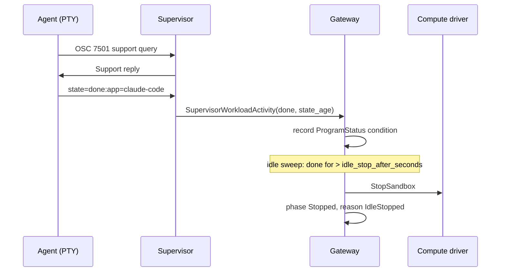

---
authors:
  - "@mrunalp"
state: draft
links:
  - https://github.com/ai-openshell/openshell/issues/5852
---

# RFC NNNN - Stop Idle Agent Sandboxes

<!--
See rfc/README.md for the full RFC process and state definitions. NNNN is a
placeholder until maintainers assign the number from the originating issue.
-->

## Summary

The supervisor reads the program status that coding agents already write to
their terminal with OSC 7501, the Program Status Protocol. It reports a
sandbox-wide activity summary to the gateway, which can then stop a sandbox
whose agent has been waiting on the user for longer than a configured timeout.
A later `openshell sandbox connect` starts the sandbox again before connecting.

Phase 1 uses the existing stop and start lifecycle. Filesystem state survives,
and the agent resumes its conversation from disk. Phase 2 reuses the same
activity signal to drive the existing `SuspendSandbox` and `ResumeSandbox`
contracts once a backend implements memory checkpoints.

## Motivation

Agent sandboxes spend most of their life waiting. A coding agent finishes a
turn, reports its result, and then sits at a prompt until a person comes back,
often hours later or never. The sandbox keeps its CPU and memory reservations
and its node or VM the whole time. Operators clean up by hand or not at all.

OpenShell cannot tell an idle agent from a busy one today. The only activity
signal is the network connection summary the supervisor sends for telemetry.
An agent waiting on a person and a long build that makes no connections look
the same from outside. Screen scraping, such as matching a spinner in the
window title, is fragile and differs for every agent.

OSC 7501 ([spec](https://www.superlogical.com/rex/docs/build/program-status),
[announcement](https://mitchellh.com/writing/program-status-osc7501)) gives
programs a standard way to declare `idle`, `working`, `done`, `blocked`, or
`error` on their own terminal. Claude Code (from v2.1.295) and Codex (0.170.0
verified) report it natively. The workload PTY already passes through the supervisor, so OpenShell
can read these reports without agent-specific integrations or new workload
dependencies.

The lifecycle side is partly built. `StopSandbox`, `StartSandbox`,
`SuspendSandbox`, and `ResumeSandbox` exist in the public and driver APIs, but
nothing stops a sandbox on its own and no driver implements suspend.

## Non-goals

- Memory checkpoints. Phase 1 stops compute and loses process memory. CRIU or
  VM snapshots are phase 2 and follow the suspend contract, not this RFC.
- Detecting idleness for programs that do not report OSC 7501. A sandbox with
  no reports is never stopped automatically.
- Waking on inbound service traffic. Only an explicit connect or start wakes a
  sandbox in phase 1.
- Interpreting the free-text `msg` and `title` fields. They are validated and
  then dropped, never stored or logged.
- Agent-specific resume logic. OpenShell restarts the canonical command; the
  agent's own `--continue` or `resume` flags restore its conversation.

## Proposal

### Observe program status in the supervisor

The supervisor scans PTY output for OSC 7501 in two places:

- the canonical process reader (`openshell-supervisor-process/src/main_session.rs`)
- the SSH exec loop for PTY sessions (`ssh.rs`)

Both run on plaintext before output reaches any client, and the canonical
reader runs whether or not a client is attached.

The scanner keeps the per-terminal records the protocol defines:

- record ids and hierarchy;
- `clear` semantics;
- drop `working` and `blocked` records on process exit or OSC 133 `A`;
- the 256-record cap;
- the 4096-byte sequence limit.

Report bytes pass through unchanged, so a supporting client terminal still
shows status.

The supervisor answers the support query (`OSC 7501 ; ?`) itself by writing
the reply to the program's input, and strips the query from forwarded output.
The reply is the full form, `OSC 7501 ; ? : states=... : kinds=... ST`. A
program that probes with terminal echo on reads its own echo, and a reply
identical to the query would be answered again without end.

Answering the probe is required, not an optimization. A prototype run against
Claude Code 2.1.327 showed:

- It probes at startup, followed by a DA1 (`CSI c`) query.
- It reports only if the OSC 7501 reply arrives before the DA1 reply. That
  follows the spec's detection rule.
- The supervisor's reply reaches the program before any client terminal's.
- Stripping the query keeps a supporting client terminal from answering a
  second time into the program's input.

The supervisor keeps the result as a sandbox-wide summary: the most active
state across terminals (working, then blocked, error, done, idle), plus its
`kind` and `app`. It also tracks when that state began and when any client
last wrote to a workload terminal.

Observed behavior through the supervisor's scanner:

| Event | Claude Code 2.1.327 | Codex 0.170.0 |
|-------|---------------------|---------------|
| Support query | Sent at startup | Never sent |
| Startup | `idle` | `idle` |
| Prompt submitted | `working` | `working` |
| Turn finished | `done` | `done` |
| Folder trust or approval prompt | `blocked:kind=permission` | `blocked:kind=permission` |
| Approval denied or interrupted | `clear` | `working`, then `idle` |
| Exit | `clear` | `clear` |

Neither agent returns to `idle` after a finished turn, so the policy treats
`done` as waiting on the user. Codex reports without querying first, so the
scanner keeps records for every terminal whether or not its program asked.

### Report activity to the gateway

A new `ConnectSupervisor` payload carries the summary:

```proto
message SupervisorMessage {
  oneof payload {
    // ... existing variants 1-6 ...
    SupervisorWorkloadActivity workload_activity = 7;
  }
}

message SupervisorWorkloadActivity {
  WorkloadProgramState state = 1;          // UNSPECIFIED: no program reports
  WorkloadBlockedKind blocked_kind = 2;
  string app = 3;                          // OSC 7501 app grammar
  google.protobuf.Duration state_age = 4;  // time in `state`
  google.protobuf.Duration input_age = 5;  // since last client input, if any
  uint32 reporting_terminals = 6;
}
```

Ages are relative so supervisor and gateway clocks need not agree. The
supervisor sends the summary when each gateway session starts, on every change,
and when client input advances by a minute. Idle timeouts are minutes long, so
coarser input data costs nothing in accuracy.

The gateway records the latest report as a `ProgramStatus` condition in the
existing `SandboxStatus.conditions` list. This keeps the public `Sandbox`
messages unchanged: SDK users who build exhaustive `SandboxStatus` literals
still compile, as the `sandbox_status_compatibility` fixture requires.

| Field | Value |
|-------|-------|
| `reason` | `Idle`, `Working`, `Done`, `Blocked`, or `Error` |
| `message` | For example `claude-code is blocked on permission` |
| `transition_time` | The later of the state change and the latest client input, in gateway time |

The gateway writes the condition only when its reason or message changes, or
when input moves its time forward by a minute or more. That bounds
resource-version churn for the reconcile sweep. Writes are fenced to the running
main-process instance. Driver snapshots keep the condition, and every lifecycle
phase change removes it. `openshell sandbox get` and `WatchSandbox` show it
like any other condition.

### Stop idle sandboxes

A sandbox is idle when all of these hold:

- its phase is `Ready`;
- `workload_activity.state` is `idle`, `done`, `blocked`, or `error`, and no
  terminal is `working`;
- the later of the condition's time and `main_process_started_time` is older
  than the sandbox's idle timeout.

The timeout is a new runtime setting, `idle_stop_after_seconds`, set with
`openshell settings set` at gateway or sandbox scope. As with every runtime
setting, gateway scope wins over sandbox scope. It can be changed on a running
sandbox. Unset, zero, or negative disables idle stop, and values above 30 days
are capped. No new `SandboxSpec` field or gateway TOML key is needed.

The idle sweep runs in the restart loop every 30 seconds, so it inherits that
loop's reconciler-lease ownership in single- and multi-replica gateways. It
reads settings only for sandboxes that are already waiting. Each due sandbox
goes through the existing stop path on its own task, with an idle cause. The
stop re-checks idleness under the lifecycle lock, so input that arrives after
the sweep read keeps the sandbox running.

The idle request writes the internal annotation `internal.openshell.ai/idle-stop`
with the reason `IdleStopping`. The annotation survives gateway recovery and
driver snapshots that rewrite conditions. The Ready condition then settles as
`IdleStopped` instead of `Stopped`, so users and the CLI can tell an idle stop
from an explicit one. The next lifecycle transition removes the annotation. The
gateway logs each idle stop with the sandbox, the program, and how long it
waited.



### Wake on connect

When the target is `Stopped` with reason `IdleStopped`,
`openshell sandbox connect` calls `StartSandbox`, waits for `Ready`, then
connects as usual, printing a one-line notice. An explicitly stopped sandbox
keeps today's behavior and returns an error.

Exec and SSH proxy paths keep their current errors in phase 1, so scripts do
not start sandboxes implicitly.

### Security and trust

The workload controls the signal:

- Falsely reporting `working` only keeps its own sandbox running, which it can
  already do by staying busy.
- Falsely reporting `idle` stops its own sandbox.
- Neither crosses a trust boundary.

A stray report, such as a program printing a log file that contains OSC 7501
bytes, can make a sandbox look idle. The input-age condition limits the damage
to sandboxes no one is typing into.

The supervisor writes only the fixed reply bytes to program input, never
report content. `msg` and `title` are validated per the spec, then discarded.

## Implementation plan

1. **Supervisor observation.** Add the OSC 7501 scanner, records, probe reply,
   and summary in `openshell-supervisor-process`. Wire them into the canonical
   reader and SSH PTY sessions, with unit tests for parsing, chunk splits,
   limits, and record semantics. A prototype harness has run Claude Code
   2.1.327 and Codex 0.170.0 through the scanner on a host PTY.
2. **Reporting.** Add `SupervisorWorkloadActivity` and the supervisor reporter
   task. Add the gateway handler and the throttled `ProgramStatus` condition,
   and preserve the condition across driver snapshots.
3. **Policy.** Register the `idle_stop_after_seconds` setting. Add the idle
   sweep and the `IdleStopped` reason, and document them on the sandbox
   lifecycle page.
4. **Wake on connect.** Auto-start `IdleStopped` sandboxes in
   `openshell sandbox connect`.
5. **Validation.** Add the `idle_stop` conformance test, which runs a
   scripted OSC 7501 agent through idle → `IdleStopped` → start → reporting
   again on every driver. Check Claude Code and Codex manually inside Docker
   and Kubernetes sandboxes, with provider credentials.
6. **Phase 2 (separate change).** Choose `suspend` instead of `stop` when the
   driver advertises `openshell.compute.suspend-resume`, and implement Podman
   checkpoint and restore behind that capability.

Idle stop is off by default, so existing users see no change until an operator
sets a gateway value or a user opts in per sandbox.

## Risks

- **Lost in-flight work.** A `blocked` agent loses the pending turn when
  stopped. The timeout applies to all waiting states in phase 1. If users find
  that too aggressive, a separate blocked timeout is an open question.
- **Agent coverage and drift.** Only agents that implement OSC 7501 benefit,
  and their reporting can change between releases, as Claude Code's
  probe-before-report rule shows. Unreported sandboxes are never stopped, so
  drift fails safe.
- **Multiplexers.** An agent inside tmux in the sandbox probes tmux, not the
  supervisor's PTY, and tmux does not forward the reports. Those sandboxes look
  unreported and stay running.
- **Conversation resume depends on storage.** The agent's transcript must live
  on storage that survives stop: the Docker writable layer or workspace volume,
  the Kubernetes PVC, the VM overlay. Agents restarted with their plain command
  start a fresh conversation unless the user runs their resume flag.
- **Store churn.** Activity writes bump the resource version that the
  reconcile sweep compares. The one-minute input threshold and
  transition-only state writes limit this. An active agent still writes twice
  per turn (`working`, then `done`).

## Alternatives

### Screen or title scraping

Inbox tools such as Herdr detect Claude Code state by matching the Braille
spinner in the window title. That needs a parser per agent and breaks on UI
changes. OSC 7501 is a declared contract with a published grammar.

### Network or input inactivity only

Stopping after no egress and no keystrokes needs no agent cooperation. But it
cannot tell a quiet long-running build from a waiting agent, and it would stop
sandboxes mid-task. It remains useful as an extra condition and may become an
opt-in policy for non-reporting workloads later.

### Agent hooks or SDK callbacks

Claude Code hooks and similar mechanisms can call out when a turn ends, but
each agent needs its own configuration inside the sandbox image, and the hook
runs as workload code with network access. The terminal channel needs nothing
from the image.

### Do nothing

Operators keep deleting or stopping sandboxes by hand, and idle sandboxes keep
holding capacity.

## Prior art

- [Program Status Protocol (OSC 7501)](https://www.superlogical.com/rex/docs/build/program-status):
  record lifetime and the detection rule shape the scanner directly. The spec
  also says the program owns its state, which is why OpenShell treats reports
  as untrusted input.
- [Paneflow](https://paneflow.dev/blog/agent-status-osc-7501) answers the probe
  on behalf of its sessions and treats an agent's declaration as more reliable
  than heuristics. That is the same position the supervisor takes.
- Kubernetes scale-to-zero (KEDA, Knative) separates the activity signal from
  the lifecycle action and wakes on demand. The idle sweep and wake on connect
  follow that split.
- [RFC 0018](../0018-multi-sandbox-ha-supervisors/README.md) leaves room for
  backend-initiated suspend and wake (#4352). This RFC supplies the signal that
  decides when.

## Open questions

- Should `blocked` get its own, longer timeout, or never stop? It loses the
  pending turn in phase 1 but not in phase 2.
- Should an attached client with no input block idle stop? Phase 1 does not
  wait for clients to detach.
- Should a sandbox whose terminals all reported `clear` (agent exited, shell
  idle at a prompt) count as idle? Phase 1 treats it as unreported.
- Should the wake path also run the agent's resume command, for example via a
  `SandboxSpec` resume command, or is restarting the canonical command enough?
- Should exec and SSH proxy also wake an `IdleStopped` sandbox, behind a flag?
- Should idle stop ship behind an `unstable-idle-stop` compile flag until it is
  accepted, as RFC 0014 asks of unreleased features? No crate defines such a
  flag yet; phase 1 is off unless the setting is set.
- Is gateway-over-sandbox precedence right for this setting? It lets operators
  enforce a fleet timeout but stops users from choosing a longer one.
