---
authors:
  - "@mrunalp"
state: draft
links:
  - https://github.com/NVIDIA/OpenShell/issues/5563
  - https://github.com/NVIDIA/OpenShell/issues/5663
  - https://github.com/NVIDIA/OpenShell/issues/896
  - https://github.com/NVIDIA/OpenShell/pull/5139
---

# RFC NNNN - Workspace Secrets

<!--
RFC number pending maintainer assignment on #5563. Rename the folder and
title once it is assigned.
-->

## Summary

This RFC adds **workspace secrets**: named, workspace-scoped secret values that
OpenShell stores but never injects into sandboxes. A provider's refresh
configuration can name a workspace secret in place of an inline material value.
When the gateway mints or refreshes a credential, it reads the secret's current
value. Rotating that one secret updates every provider that references it.

Each secret declares, when it is created, the only token endpoints it may be
sent to. That set never changes, so no one can redirect a secret to a server
they control by authoring a profile. Values are write-only through the ordinary
API. A separate `RevealSecret` RPC, off by default, returns the plaintext value
to an operator or to an OIDC client that holds a dedicated scope. Every reveal
is audited. Control-plane services such as OCC use it for the OAuth
authorization-code exchange that happens before any provider exists. Sandbox
delivery and `GetProviderCredentials` never return workspace secrets.

## Motivation

A confidential OAuth client has one client secret shared by every user who
connects through it. OpenShell today stores refresh material per provider: each
user's provider holds its own copy of `client_secret` next to its refresh token
([#5563](https://github.com/NVIDIA/OpenShell/issues/5563)). Rotating the client
secret means updating every provider. That is not just tedious, it is not
possible without reauthorizing every user:
`ConfigureProviderRefresh` replaces the whole material set and schedules every
existing secret handle for deletion
(`crates/openshell-server/src/grpc/provider.rs`). To change `client_secret` the
caller must resend `refresh_token`. With rotating refresh tokens the gateway has
replaced that token since it was configured, and it never returns it.

OCE's OAuth connection flow exercises exactly this. An administrator registers
the confidential client once. Each user then completes consent, and OCC
exchanges the authorization code using the client secret. The resulting tokens
become that user's OpenShell provider. OCE's conformance test expects refreshes
after a client-secret rotation to use the new secret. OCC also needs the secret
*before* any provider exists, which today forces OCE to keep its own copy
outside OpenShell.

Related work makes this more pressing.
[#5663](https://github.com/NVIDIA/OpenShell/issues/5663) adds
`client_secret_basic` and resource indicators to refresh, so OpenShell can own
refresh for more OAuth servers. [RFC 0023](https://github.com/NVIDIA/OpenShell/pull/5139)
moves all secret values behind the credential issuer, and the owner kinds it
introduces give this feature a natural home.

This needs an RFC because it adds a new public resource type and a new
plaintext export path with its own authorization rule. It also lets one
caller's configuration send a value that caller never supplied to an upstream
endpoint. That is a confused-deputy risk OpenShell does not have today. Finally,
it changes refresh state in a way that must survive mixed-version gateways.

## Non-goals

- Injecting workspace secrets into sandboxes or using them as provider
  credentials. They are minting material only. Shared static credentials
  already fit a single static `Provider` in the workspace.
- Sharing one secret across workspaces. #5563 defers installation-wide
  secrets. They can later follow `ProviderProfile`'s pattern, where an omitted
  workspace selector means platform scope.
- Performing the OAuth authorization-code exchange inside OpenShell. OCC keeps
  that exchange; see Alternatives.
- Typed OAuth client registrations. A workspace secret is an opaque value; the
  token endpoint authentication method and resource indicator stay in the
  provider profile (#5663).
- Read-only references to external secret managers, such as an existing Vault
  path. RFC 0023 tracks that separately.
- Overlapping old and new secret values during rotation. The authorization
  server's own rotation support covers that.

## Proposal

### Threat model

Workspace secrets protect a value that the caller who binds it may not know.
Today, everyone who configures refresh supplies their own inline material, so
sending that material to a token endpoint reveals nothing new. With shared
secrets, a workspace admin could import a workspace profile whose `token_url`
points at a server they control, bind a workspace secret, and rotate the
credential. The gateway would then POST the plaintext secret to that server.

The design keeps two guarantees:

1. Plaintext leaves OpenShell only through `RevealSecret`, or in a mint request
   to an endpoint the secret's creator approved when they supplied the value.
2. Holding `openshell:all`, `provider:write`, `secret:write`, or workspace admin
   alone does not reveal a secret's value.

A caller who can write a secret can replace its value, which breaks dependent
providers but discloses nothing. A caller who controls an approved token
endpoint already receives the secret in ordinary operation.

### Workspace secret resource

A `Secret` is a workspace-scoped resource with standard `ObjectMeta`: name,
gateway-generated ID, labels, `resource_version`, and immutable workspace. It
holds one value and an immutable list of allowed endpoints.

```protobuf
message Secret {
  openshell.datamodel.v1.ObjectMeta metadata = 1;
  string description = 2;
  // Token endpoints this value may be sent to. Fixed at creation.
  repeated string allowed_endpoints = 3;
  // Last time the value was written. The value itself is never returned.
  google.protobuf.Timestamp value_update_time = 4;
}

message CreateSecretRequest {
  openshell.datamodel.v1.WorkspaceSelector workspace_scope = 1;
  string name = 2;
  string description = 3;
  // Required and non-empty.
  string value = 4 [(openshell.options.v1.secret) = true];
  // Required and non-empty. Absolute https URLs, compared exactly after
  // normalization (lowercase scheme and host, default port removed).
  repeated string allowed_endpoints = 5;
  map<string, string> labels = 6;
  string request_id = 7;
}

message UpdateSecretRequest {
  openshell.datamodel.v1.WorkspaceSelector workspace_scope = 1;
  string name = 2;
  // Absent leaves the value unchanged. Present must be non-empty.
  optional string value = 3 [(openshell.options.v1.secret) = true];
  optional string description = 4;
  // Absent leaves labels unchanged. Present replaces the full set.
  optional SecretLabels labels = 5;
  // Rejects stale writes when set.
  optional uint64 expected_resource_version = 6;
  string request_id = 7;
}

message SecretLabels {
  map<string, string> labels = 1;
}

message GetSecretRequest {
  openshell.datamodel.v1.WorkspaceSelector workspace_scope = 1;
  string name = 2;
}

message ListSecretsRequest {
  // Only a named workspace selection is accepted.
  openshell.datamodel.v1.WorkspaceSelector workspace_scope = 1;
  int32 page_size = 2;
  string page_token = 3;
  string label_selector = 4;
}

message DeleteSecretRequest {
  openshell.datamodel.v1.WorkspaceSelector workspace_scope = 1;
  string name = 2;
  bool allow_missing = 3;
  string request_id = 4;
}

message DeleteSecretResponse {
  DeletionOutcome outcome = 1;
}

message RevealSecretRequest {
  openshell.datamodel.v1.WorkspaceSelector workspace_scope = 1;
  string name = 2;
}

message RevealSecretResponse {
  string value = 1 [(openshell.options.v1.secret) = true];
  google.protobuf.Timestamp value_update_time = 2;
}
```

Paging and label-selector semantics match `ListProvidersRequest`, except that
`all_workspaces` is rejected. Get and List return metadata only. Values are
bounded by the existing provider map value limit. `allowed_endpoints` cannot be
updated. Moving a client to a new token endpoint means creating a new secret,
and only someone who knows the value can do that.

The gateway persists a private `StoredWorkspaceSecret` record holding the
current `CredentialHandle` and pending handle deletions. Neither appears on the
public `Secret`. Values are stored through the `CredentialIssuer` trait with a
new owner kind, `WorkspaceSecret { id }`. Its legacy driver scope is
`workspace-secret-<id>`, following the pattern phase 1 of RFC 0023 used for SSH
host keys and launch material.

`UpdateSecret` stages a new handle and swaps it in with a compare-and-swap. It
records the superseded handle as a pending deletion and then deletes it. A
failed swap deletes the staged handle. `DeleteSecret` tombstones the record by
setting its deletion time, deletes the current and pending handles, then
removes the row. The periodic refresh worker tick also sweeps workspace-secret
tombstones and pending deletions, paging through every record so healthy
secrets cannot starve later cleanup. A backend failure is therefore retried
rather than leaking a handle. The next `UpdateSecret` or `DeleteSecret` also
retries them.

The CLI adds `openshell secret create|update|get|list|delete`. Values come from
`--value-env VAR` or `--value-file PATH`, never from a command-line argument.
`--allowed-endpoint URL` is repeatable on `create`. The CLI has no reveal
command.

### Referencing secrets from refresh configuration

`ConfigureProviderRefreshRequest` gains a map from material key to secret name:

```protobuf
message ConfigureProviderRefreshRequest {
  // ...existing fields...
  // Material supplied by a workspace secret in the same workspace. Each key is a
  // secret material key; each value names a Secret.
  map<string, string> material_secrets = 9;
}

message ProviderCredentialRefreshStatus {
  // ...existing fields...
  // Material key to referenced secret name.
  map<string, string> material_secrets = 14;
}
```

```shell
openshell provider refresh configure alice-mcp \
  --credential-key MCP_ACCESS_TOKEN \
  --strategy oauth2-refresh-token \
  --material client_id="$CLIENT_ID" \
  --secret-material-env refresh_token=REFRESH_TOKEN \
  --material-secret client_secret=acme-oauth-client
```

Validation rules:

- A `material_secrets` key must be secret material: a strategy secret key, such
  as `client_secret` or `aws_secret_access_key`, or a key the profile declares
  `secret: true`. Configuration-time keys such as `token_url`, `scope`,
  `refresh_before_seconds`, and `sts_endpoint_url` are rejected rather than
  silently ignored.
- Keys the minter writes back are provider-owned and cannot be referenced. For
  `oauth2_refresh_token` that is `refresh_token`. After a rotating exchange the
  engine stores the replacement token under that key on the provider. A shared
  binding would leave each provider holding both a handle and a binding, and the
  other providers would keep reading a spent token. The motivating flow shares
  `client_secret`, and each provider keeps rotating its own refresh token.
- A key may appear in `material` or `material_secrets`, not both.
- Every `material_secrets` key must also be listed in the existing
  `secret_material_keys` field, and the request is rejected otherwise. The CLI
  adds them automatically. This makes the request wire-safe against older
  replicas. An older replica ignores field 9 but already rejects a
  `secret_material_keys` entry with no inline value, with `INVALID_ARGUMENT` and
  before any state change. A new replica accepts an entry backed by either
  `material` or `material_secrets`.
- Required-material checks, the AWS source-key pairing rule, and #5663's "Basic
  requires `client_secret`" rule all count a referenced key as present.
- The secret must exist in the provider's workspace. The effective token
  endpoint must be in its `allowed_endpoints`. That endpoint is the one the
  minter will call: a `token_url`, an Entra URL derived from `tenant_id`, or
  the Google default.
- References are limited to the OAuth2 and Google service account strategies.
  `aws_sts_assume_role` is rejected until its STS client enforces the same
  endpoint and redirect rules.

The gateway binds each key to the secret's immutable ID and records its
immutable name next to it, so status reads need no secret lookup. Public callers
use names, and stored state uses IDs, following
[proto/README.md](../../proto/README.md). Configuring a reference needs no scope
beyond what `ConfigureProviderRefresh` already requires. The endpoint
constraint, not a second scope, is what prevents disclosure.

### Minting with the current value

Before each mint, the refresh engine resolves inline secret handles as it does
today. It then asks a resolver port for each referenced secret's *value*. The
gateway implements that port: it reads the secret record and resolves its
current handle through the issuer. If the backend reports the handle missing and
the record's handle has changed in the meantime, the port re-reads the record
and retries once. A mint that races `UpdateSecret` therefore uses the new value
instead of failing.

Immediately before sending the request, the minter checks the effective endpoint
against every referenced secret's `allowed_endpoints`. This mint-time check is
the authoritative one; the configure-time check only reports errors early. A
mismatch fails with `fix_configuration` and failure code
`secret_endpoint_not_allowed`, and the request is never sent.

The check must hold for the whole HTTP exchange, not just the first URL. The
OAuth minter's HTTP client follows redirects by default, and a 307 or 308
redirect resends the request body to the new location. Mints that carry a
workspace secret therefore disable automatic redirects. Any redirect response
fails the mint with `fix_configuration` and failure code
`secret_endpoint_redirected`, and the client never contacts the redirect target.

```mermaid
sequenceDiagram
    participant Admin as Admin / OCE
    participant GW as Gateway
    participant ISS as Credential issuer (embedded)
    participant AS as OAuth server
    Admin->>GW: UpdateSecret(acme-oauth-client, new value)
    GW->>ISS: store new handle, CAS swap, delete old
    Note over GW,ISS: no snapshot publish: secret is never injected
    ISS->>GW: resolve referenced secret value (resolver port)
    GW-->>ISS: current value, retrying once on a concurrent swap
    ISS->>ISS: check effective endpoint against allowed_endpoints
    ISS->>AS: refresh_token grant with current client secret
    AS-->>ISS: access token
```



A rotation takes effect at each provider's next mint. Rotation does not trigger
a mint: existing access tokens stay valid, and a mint for every dependent
provider at once would add load at the authorization server. Callers who want to
confirm a new value can force `RotateProviderCredential` on one provider.
Workspace secrets are never delivered to supervisors, so rotation does not
publish provider snapshots or change provider environment revisions.

Failure classification:

| Condition | Recovery action | Failure code |
|---|---|---|
| Backend resolve fails after the retry | `retry` (short backoff) | `referenced_secret_unavailable` |
| Secret record missing or tombstoned | `fix_configuration` | `referenced_secret_missing` |
| Effective endpoint not allowed | `fix_configuration` | `secret_endpoint_not_allowed` |
| Token endpoint responds with a redirect | `fix_configuration` | `secret_endpoint_redirected` |
| Authorization server rejects the client | existing OAuth classification | existing codes |

### Authorization and export boundary

| RPC | Auth | Role | Scope | Audited |
|---|---|---|---|---|
| `CreateSecret`, `UpdateSecret`, `DeleteSecret` | bearer | workspace admin | `secret:write` | yes, naming the secret |
| `GetSecret`, `ListSecrets` | bearer | workspace user | `secret:read` | no |
| `RevealSecret` | bearer, plus the handler check below | workspace admin | `secret:reveal` | yes, every call |

`RevealSecret` fails closed in its handler, whatever the gateway's
authentication mode:

- It is disabled unless gateway configuration sets `enable_secret_reveal =
  true`. Deployments without OCC never expose it.
- `Principal::Operator` (operator mTLS) is accepted. `bearer` methods already
  admit operators with platform-admin rights, and the audit path already
  records operator principals. Non-OIDC OCC deployments use this path.
- `Principal::User` is accepted only when OIDC is configured with scope
  enforcement enabled, the token carries the literal `secret:reveal` scope, and
  the caller is a workspace admin. `openshell:all` does not satisfy the check.
  Unscoped OIDC gateways, user mTLS certificates, and local unauthenticated
  development modes are rejected. Without this check, middleware skips scope
  enforcement when `scopes_claim` is empty, and an empty `admin_role` grants
  platform admin.
- Every other principal is rejected.

The handler needs the gateway's scope-enforcement setting, which lives in the
authorization router today, so `ServerState` must expose it. The audit catalog
test currently requires the catalog to equal the set of `:write`-scoped RPCs. It
must allow this one audited read.

Workspace secrets stay out of every runtime export path by construction, the
same way refresh material does today. Sandbox snapshots and
`GetProviderCredentials` read only `Provider.credentials` and
`Provider.credential_handles`. Workspace secrets live in their own records and
are resolved only through the refresh resolver port and `RevealSecret`. A test
asserts that a referenced secret's value never appears in a provider environment
snapshot or a `GetProviderCredentials` response.

### Deletion and lifecycle

`DeleteSecret` fails with `FAILED_PRECONDITION` while any live refresh state in
the workspace references the secret, and the error names the dependent
providers. This mirrors the provider-profile in-use guard. The check uses a
workspace-scoped refresh-state query and ignores tombstoned refresh states
awaiting cleanup. Delete and check run under `MutationScope::Workspace`, which
conflicts with `ConfigureProviderRefresh`, so a new reference cannot appear
between the check and the delete. Deleting a provider or its refresh
configuration removes its references. Workspace deletion is blocked while
secrets exist; the secret type joins the resource kinds that workspace deletion
checks. Workspace deletion marks the workspace terminating before it scans for
blockers, so `CreateSecret` re-reads the workspace after its insert. If the
workspace is no longer the active one it resolved, the create removes its row
and staged value and fails. Otherwise the deletion's scan finds the secret.

Bindings use immutable IDs. Deleting a secret and recreating one with the same
name therefore never silently rebinds a provider.

### Converting references back to inline material

`ConfigureProviderRefresh` cannot turn a reference back into inline material
for an active grant. It replaces the whole material set, so the caller would
have to resend a refresh token the gateway may have rotated and never returns.
A dedicated RPC performs the conversion instead:

```protobuf
// Copy each referenced secret's current value into provider-owned refresh
// material and remove the bindings. Keeps all other material handles.
rpc InlineProviderRefreshSecrets(InlineProviderRefreshSecretsRequest)
    returns (InlineProviderRefreshSecretsResponse);

message InlineProviderRefreshSecretsRequest {
  openshell.datamodel.v1.WorkspaceSelector workspace_scope = 1;
  string provider = 2;
  string credential_key = 3;
  string request_id = 4;
}

message InlineProviderRefreshSecretsResponse {
  ProviderCredentialRefreshStatus status = 1;
}
```

For each binding, the gateway resolves the secret's current value and stages it
as provider-owned refresh material under the same key. Then, in one
compare-and-swap of the refresh state, it does three things:

- Adds the staged handles.
- Removes the bindings from the annotation.
- Records each former secret's `allowed_endpoints` in a refresh-state
  annotation, so new binaries keep enforcing the endpoint constraint on the
  copied value.

Every other handle is kept, including a rotated `refresh_token`. So are the
authorization epoch, the refresh status, and the next refresh time. Placeholders
and active tokens are unaffected. If the swap fails, the staged handles are
deleted.

The RPC requires `provider:write` and workspace admin, like
`ConfigureProviderRefresh`, and is audited. It is not gated by `enable_workspace_secrets`,
so it still works after the feature is disabled for a rollback. It never returns
the value, so it adds no disclosure path. The CLI exposes it as
`openshell provider refresh inline-secrets`.

### Activation and mixed-version gateways

Older replicas do not understand workspace secrets. Each write path is
protected differently:

- **`CreateSecret` and other secret RPCs.** An older replica does not implement
  them and returns `UNIMPLEMENTED`.
- **`ConfigureProviderRefresh` with `material_secrets`.** An older replica
  ignores field 9. If the referenced key were optional, as `client_secret` is
  for `oauth2_refresh_token`, it would configure a public client. The required
  `secret_material_keys` listing prevents that. The older replica rejects the
  request with `INVALID_ARGUMENT` before any state change, as described under
  validation.
- **`DeleteWorkspace`.** An older replica checks a fixed list of resource kinds.
  It would delete a workspace whose only resources are secrets, orphaning their
  records and backend handles. No wire-level guard exists for this. The
  supported guarantee is that every older replica is drained and retired before
  the first secret is created.

Workspace secrets therefore follow the sandbox-update activation pattern in
`persistence/image_activation.rs`. Each replica advertises a
`workspace_secrets_protocol` capability in its gateway membership record. New
replicas accept `CreateSecret`, and `ConfigureProviderRefresh` with non-empty
`material_secrets`, only when both of these hold:

- The operator has set the default-off `enable_workspace_secrets` gateway setting.
- Every live membership record advertises the capability.

Otherwise new replicas reject those requests with `FAILED_PRECONDITION`, which
names the missing condition. As for sandbox updates, the membership snapshot is
not a fence: membership can expire, and a process can connect after the check.
Enabling the setting is the operator's attestation that older replicas have been
drained and retired. Reads, updates, deletes, and reveal of existing secrets need
no gate, because only new replicas implement those RPCs.

**Rollback condition.** Before rolling back to a binary without workspace-secret
support, the operator must:

1. Disable `enable_workspace_secrets`. This stops new secrets and new references.
2. Run `InlineProviderRefreshSecrets` on the upgraded gateway for every
   credential that refresh status shows with a referenced secret. Active
   grants, including rotated refresh tokens, are preserved, and no user needs
   to reauthorize.
3. Delete all secrets, which the delete guard now permits.

The rollback documentation states this. `ListSecrets` in each workspace, plus
the referenced secrets that refresh status reports for each credential, shows
what remains. Inlining refuses while a mint is in progress, because replacing
the refresh state then would make the mint discard a rotated refresh token.
After the downgrade, the older minter applies its legacy behavior to the copied
values: no endpoint constraint and default redirect handling, toward the token
endpoint fixed at configuration. Rolling back without these steps is
unsupported. In that case the protections below keep older replicas from
minting with missing material. They do not protect secrets themselves: an
older replica can still delete a workspace that holds secrets, as described
above.

**Defense in depth for minting.** The refresh state stores bindings in
`metadata.annotations` under
`openshell.nvidia.com/refresh-material-secrets`, as a JSON map from material key
to secret ID and name. It does not use a new protobuf field. Older replicas
decode refresh state into a struct that drops unknown fields, and they rewrite
it with a compare-and-swap. This happens, for example, when they clear pending
deletions. A new field would be erased. Annotations are already preserved
across those rewrites, which is why the expiration-present and completed-mint
markers use them.

The gateway also lists each referenced key in `secret_material_keys`. An older
replica sees a secret key with no stored handle, and
`validate_secret_material_references` refuses to mint. That refusal happens
before any state write, so the older replica does not park the refresh. It
retries and logs a warning on each sweep until a new replica takes the refresh
lock. Synchronous `GetProviderCredentials` or `RotateProviderCredential` calls
served by an older replica fail with `FAILED_PRECONDITION`. Neither path mints
with missing material. The new replica treats a key as satisfied by either a
stored handle or a binding.

## Implementation plan

The work ships incrementally behind the default-off `enable_workspace_secrets`
activation. Reveal has its own default-off setting.

1. **Resource and storage.** Add the `Secret` proto and messages, a private
   `StoredWorkspaceSecret` record and object type, the `WorkspaceSecret` owner
   kind, CRUD RPCs, `secret:read` / `secret:write` scopes, mutation audit naming,
   pending-deletion sweeps, the workspace-delete guard, CLI commands, and
   storage-schema inventory updates. Add the membership capability and the
   activation check. Test creation against a membership set that includes an
   older replica.
2. **Refresh references.** Add `material_secrets` and the status field,
   annotation-backed bindings, the resolver port with retry on concurrent swap,
   configure-time and mint-time endpoint checks, redirect-free secret-bearing
   mints, validation including the required `secret_material_keys` listing, the
   in-use delete guard, the activation check on configure, and
   `InlineProviderRefreshSecrets` with its CLI command and audit catalog entry.
   Test the following:
   - rotation between refreshes against a mock token endpoint
   - a mint racing `UpdateSecret`
   - a profile pointing at a disallowed endpoint
   - a redirect from an approved endpoint, where the redirect target must receive
     no request
   - rejection of a referenced `refresh_token`
   - Basic client authentication, once #5663 lands
   - a new-client `ConfigureProviderRefresh` request with `material_secrets` sent
     directly to the previous release binary, which must be rejected before any
     state change
   - a refresh sweep on the previous release binary over a refresh state with a
     binding, which must not mint
   - rollback: rotate a user's refresh token, disable `enable_workspace_secrets`, inline
     the binding, delete the secret, and verify the provider mints on the
     previous release
3. **Reveal.** Add `RevealSecret`, `enable_secret_reveal`, the `secret:reveal`
   scope, the fail-closed handler check, and audited reads. Test denial for
   `openshell:all`, `secret:read`, non-admin users, unscoped OIDC, user mTLS,
   local development modes, and the disabled default. Test acceptance for an
   operator and a scoped OIDC admin.
4. **Docs and SDKs.** Document workspace secrets, `--material-secret`, and the
   activation, rollback, and reveal settings. Update
   `docs/how-it-works/gateways/configuration.mdx` for `enable_workspace_secrets` and
   `enable_secret_reveal`. The TypeScript SDK's curated API omits reveal;
   `@nvidia/openshell-sdk/raw` exposes it for control-plane callers. Open
   matching changes in the Go and Python SDK repositories.
5. **Align with RFC 0023.** When RFC 0023 phase 2 introduces versioned
   references, a workspace secret becomes a `CredentialStore` reference owned by
   `workspace_secret`. RFC 0023 then needs three changes. `CreateGrantRequest`
   gains `secret_material_references` beside inline `secret_material`, so a
   remote issuer resolves workspace secrets without calling the gateway.
   `ResolvePurpose` gains `SECRET_REVEAL`. The issuer refuses `workspace_secret`
   references for sandbox delivery and operator export, enforces
   `allowed_endpoints` itself, and can disable reveal by policy.

## Risks

- **A new plaintext export path.** `RevealSecret` returns values that were
  previously gateway-only. Mitigations: off by default, fail-closed principal
  checks, a scope outside `openshell:all`, workspace admin, an audit record for
  every call, and no CLI command. A leaked OCC credential still exposes every
  client secret in its workspace.
- **Endpoint constraints are brittle.** An authorization server that moves its
  token endpoint breaks every dependent provider until someone creates a new
  secret and reconfigures. That is deliberate, because a mutable allowlist would
  reopen the confused-deputy path. Mitigation: the failure code names the cause.
  Exact matching after normalization avoids surprising prefix matches.
- **Larger blast radius on bad rotation.** One wrong value breaks refresh for
  every dependent provider at its next mint. Mitigations: refresh status names
  the referenced secret, a forced rotation on one provider checks a new value,
  and updating the secret again repairs all providers.
- **Two migrations.** Shipping before RFC 0023 phase 2 means migrating workspace
  secrets and annotation bindings to versioned references later. Mitigation: the
  owner kind and ID-based binding match RFC 0023's model, so the migration
  changes storage, not the public API.
- **Authorization special case.** `RevealSecret` checks the principal in its
  handler instead of relying only on descriptor-driven middleware. Mitigation:
  the check is one function, and tests cover every authentication mode.
- **Activation and rollback burden.** Operators must drain older replicas
  before enabling the feature, and must inline references and delete secrets
  before rolling back. Mitigation: activation reuses the sandbox-update pattern
  operators already follow, `InlineProviderRefreshSecrets` makes rollback
  possible without reauthorization, and the steps are documented.
- **Unsupported rollbacks.** Bringing an older binary back while secrets exist
  fails closed only for minting. Older replicas log warnings and fail
  synchronous calls for referenced providers rather than mint with missing
  material. They can still delete a workspace that holds secrets, which orphans
  backend handles that an operator must clean up by hand.

## Alternatives

### Do nothing

Each provider keeps its own `client_secret` copy. Rotation requires reauthorizing
every user, because reconfiguring refresh needs the current refresh token. OCC
must also keep the client secret outside OpenShell for the first exchange. This
leaves #5563's rotation and custody requirements unmet.

### Patch individual material keys

Add an RPC that updates one material key without resending the rest. That fixes
rotation's need for the refresh token, but OCE must still enumerate and update
every provider. Partial failures leave stale copies, and OCC still needs its own
copy of the secret. Shared references solve all three.

### Let OpenShell perform the authorization-code exchange

A gateway RPC could take the authorization code, PKCE verifier, and redirect
URI, exchange them using the workspace secret, and create the provider
directly. Neither the client secret nor the user's refresh token would ever
leave OpenShell, and no reveal path would be needed. This is the stronger
security design. It was not chosen because #5563 keeps the exchange in OCC, and
because it moves OAuth flow handling into OpenShell, which RFC 0023 scopes out.
A later RFC can add it and retire `RevealSecret`.

### Gate bindings with a scope instead of endpoint constraints

Require a `secret:bind` scope, or restrict workspace secrets to platform
profiles. A scope protects only against tokens that lack it, and any workspace
admin granted it could still redirect a secret. Restricting secrets to platform
profiles blocks OCE, which authors workspace profiles. Binding the value to the
endpoints its owner approved closes the path for every caller.

### Typed OAuth client registration

A resource holding `client_id`, `client_secret`, and the token endpoint
authentication method, shaped like an RFC 7591 registration response. It groups
related settings, but it ties a generic primitive to OAuth. Only the secret
rotates, and the other fields fit in profiles and material. An opaque secret
also serves non-OAuth minting material, such as an AWS source key.

## Prior art

- **Kubernetes Secrets and `secretKeyRef`.** Consumers reference a secret by
  name and read the current value at use time. Kubernetes grants value access to
  anyone with `get` on the secret. This RFC separates metadata reads from value
  reveal for that reason.
- **GitHub Actions organization secrets.** Secrets are shared by many
  repositories and are write-only through the API, with repository access
  policies set by the owner. That model is the default here; reveal is a narrow
  exception for a control-plane caller.
- **OAuth 2.0 (RFC 6749 §2.3) and Dynamic Client Registration (RFC 7591).** A
  confidential client's secret belongs to the client registration, and the
  registration is tied to an authorization server. One secret therefore serves
  many users' providers, and constraining where it is sent follows from the
  registration itself.
- **RFC 0023, Credential Issuer Service.** It supplies typed secret owners,
  resolution purposes, and the future versioned-reference model that workspace
  secrets align with.

## Open questions

- Is exact normalized URL matching right for `allowed_endpoints`, or do some
  authorization servers need path templates, such as per-tenant token URLs?
- Should `enable_secret_reveal` be a single gateway setting, or a
  per-workspace policy that platform admins set?
- Should a platform admin be able to correct `allowed_endpoints` in place, for
  example after an authorization server migration, given that platform admins
  are already trusted with operator export?
